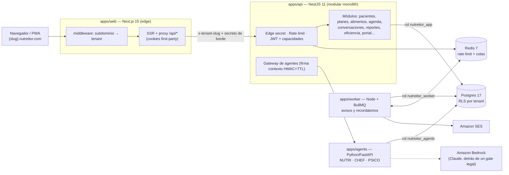
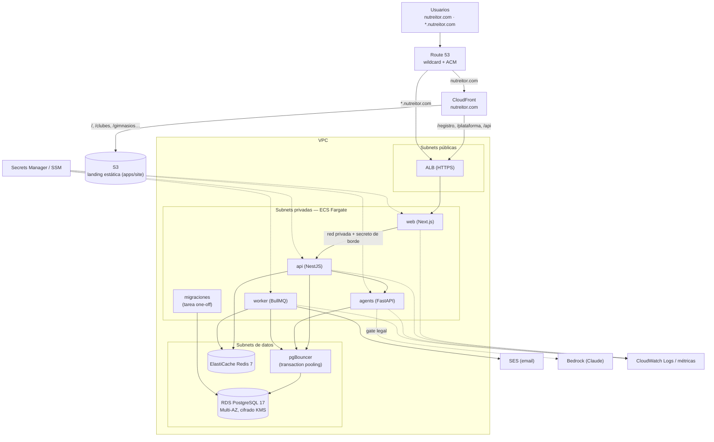

# Nutreitor

**Plataforma SaaS multi-tenant y white-label para la nutrición deportiva**:
nutricionistas deportivos, sus deportistas, **clubes** y **gimnasios**. Captación,
ficha clínica, planes alimentarios con cálculo nutricional (por día de entrenamiento
y de descanso), agenda, seguimiento (composición corporal, adherencia, chat, reportes)
y asistentes de IA, en un mismo producto que cada organización usa con su marca y su
subdominio.

Un mismo deploy sirve a muchas organizaciones (nutricionistas independientes,
consultorios, clubes, gimnasios) con **aislamiento de datos fuerte en la base de
datos** (Postgres RLS), porque lo que se guarda son **datos de salud**.

> **Estado (octubre 2026)**: Fases 1–2 cerradas, Fase 4 (eficiencia del profesional)
> construida en lo que no depende de terceros. Todo en `main`, con CI en verde.
> **Todavía no está desplegado**: la arquitectura AWS de abajo es el **objetivo** y
> hay una lista corta de deuda que resolver [antes de producción](#próximos-pasos).

**Índice** —
[Qué hace](#qué-hace-la-plataforma) ·
[Arquitectura](#arquitectura) ·
[AWS](#arquitectura-en-aws-objetivo) ·
[Decisiones](#decisiones-de-diseño-y-arquitectura) ·
[Datos de salud](#seguridad-y-privacidad-de-datos-de-salud) ·
[Repo](#estructura-del-repo) ·
[Levantarlo](#cómo-levantarlo) ·
[Tests y CI](#tests-y-ci) ·
[Cómo trabajamos](#cómo-trabajamos) ·
[Próximos pasos](#próximos-pasos) ·
[Documentación](#documentación)

---

## Qué hace la plataforma

Cada organización vive en su subdominio (`{slug}.nutreitor.com`) con su nombre,
color y logo. Hay tres roles dentro de una organización, más la cara pública.

### Público (sin login)

- **Landing de producto** en el dominio raíz (`apps/site`), dirigida a
  nutricionistas deportivos, clubes y gimnasios, con páginas propias para clubes y
  gimnasios.
- **Alta autoservicio** (`/registro`): un equipo o un profesional independiente se
  registra, confirma el email y entra a configurar. La organización queda **en
  revisión** hasta que la plataforma la aprueba (sin vidriera ni pacientes mientras
  tanto). La matrícula se declara y se revisa antes de publicar el perfil.
- **Vidriera del consultorio y de cada profesional** (SSR, indexable, sitemap y
  robots por tenant), con **visibilidad por campo** de lo que se publica.
- **Reserva de turno pública**: un lead elige un horario libre y queda como cita
  (con rate-limiting contra abuso).
- **Consulta desde la vidriera**: quien todavía no quiere reservar le escribe al
  profesional o al consultorio (con consentimiento). Le llega **sólo al destinatario**,
  que la acepta (se crea la ficha y se lo invita al portal) o la rechaza con un mail
  amable.

### Profesional (`/pro`)

| Área | Qué tiene |
|---|---|
| **Hoy** | turnos del día, pacientes a cargo y **sus métricas de eficiencia** |
| **Pacientes** | ficha clínica, notas append-only, asignaciones versionadas |
| **Plan alimentario** | editor día-tipo o semanal, versionado; cada item se vincula a la **base de alimentos** y los macros se calculan solos; total del día contra el objetivo; **intercambios** por equivalencia calculada; **plantillas** del consultorio; **lista de compras** semanal; **borrador con NUTRI** |
| **Requerimiento** | gasto en reposo con 4 fórmulas (Cunningham con la masa libre de grasa de la antropometría), sesiones por MET y **objetivos por tipo de día** (entrenamiento, partido, descanso) en g/kg; la semana tipo pasa al plan como objetivo de cada día |
| **Ingesta** | **recordatorio de 24 h** guiado por pasadas, con la base de alimentos; kcal, macros en g/kg y por comida, comparado contra el requerimiento del tipo de día y promedio de los días habituales; **frecuencia de consumo** por grupos contra las GAPA |
| **Recetas** | biblioteca global + recetas propias; nutrientes calculados desde los ingredientes |
| **Evolución** | mediciones con gráficos + **adherencia** del paciente (grilla de 2 semanas, %, sensaciones) |
| **Antropometría ISAK** | perfil restringido + bloque Kerr, 2 tomas con 3ª obligatoria; Σ6/Σ8, % graso (Durnin-Womersley, Yuhasz, Faulkner), somatotipo Heath-Carter y Kerr 5 componentes, con evolución. El deportista ve en su portal lo que el profesional marque visible |
| **Grupos** | planteles, divisiones o turnos; **medir a todo el plantel** en una planilla por pasadas (ISAK) y ver la última antropometría de cada uno |
| **Hidratación** | prueba de sudoración (individual o de todo el plantel en una planilla): L/h, % de pérdida con aviso sobre el 2 % y plan de líquidos antes, durante y después |
| **Reportes** | **reporte mensual** que se arma solo, se comenta y se publica al paciente |
| **Agenda** | disponibilidad semanal (huso IANA), turnos, sin solapamientos |
| **Mensajes** | conversaciones **privadas** con cada paciente y canal con la administración |
| **Asistentes** | NUTRI (complemento instalable), supervisión de las charlas de PSICO |

### Paciente (`/app`, PWA instalable)

- **Lo que le toca hoy**: las comidas del día con **un toque por comida** (cumplí /
  en parte / no) y "¿cómo te sentiste?" (hambre, energía, ánimo).
- **Su plan** imprimible, **lista de compras**, **turnos** (reserva y cancelación),
  **evolución** y auto-reporte de peso.
- **Mensajes** con su profesional, **reportes mensuales** publicados,
  **recordatorio diario** opcional por email.
- **CHEF** (recetas de su plan, respetando alergias) y **PSICO** (acompañamiento,
  supervisado y con guardrail de crisis), si el consultorio instaló el complemento.

### Admin del consultorio (`/admin`)

- **Resumen** con pendientes y **eficiencia del equipo** por profesional.
- **Miembros** (invitaciones con vencimiento, roles, bajas), **pacientes** y
  asignaciones.
- **Página pública**, **branding**, **complementos** (instalar agentes de IA).
- **Mensajes** con cada profesional. La admin **no** ve las conversaciones con
  pacientes.
- **Audit log** append-only.
- **Primeros pasos**: checklist derivada de los datos (perfil, matrícula, marca,
  horarios, equipo) y aviso de "en revisión" hasta que aprueben el alta.

### Profesional independiente

- Es una organización de una persona: la admin **atiende**. Entra directo a "Hoy",
  tiene el menú del profesional más Página pública y Configuración, sus pacientes
  quedan asignados a ella y chatea con ellos. Si suma colegas, pasa la cuenta a
  **equipo** desde Configuración, sin migrar nada.

### Operación de la plataforma (`nutreitor.com/plataforma`)

- **Consola** con sesión propia (no es un rol de ninguna organización): aprobar,
  rechazar, suspender o reactivar organizaciones y revisar matrículas. Nunca muestra
  datos de pacientes.

### En segundo plano

- **Worker de notificaciones**: recordatorio de turno (~24 h antes), aviso de
  mensaje sin leer (sin el contenido), recordatorio diario de registro, aviso de
  reporte publicado y de consulta nueva desde la vidriera. Email por Amazon SES.

---

## Arquitectura



- **Monorepo TypeScript** (pnpm + Turborepo, ESM): `apps/web`, `apps/api` y
  `apps/worker`, más `packages/shared` (DTOs y lógica pura compartida: cálculo
  nutricional, lista de compras, intercambios) y `packages/db` (schema Drizzle +
  migraciones SQL). El servicio de agentes es **Python** porque ahí vive el
  ecosistema de IA.
- **Modular monolith a propósito** (ADR 0012): la API es stateless y escala
  horizontal. Se extrae un servicio cuando hay un disparador real, como pasó con los
  agentes (Python, ciclo propio) y el worker (proceso en segundo plano).
- **Cuatro roles de Postgres**, cada uno con lo justo. Ninguno de runtime
  bypassa RLS:

| Rol | Lo usa | Bypassa RLS | Para qué |
|---|---|---|---|
| `nutreitor_owner` | migraciones y seed | sí | DDL, GRANTs, datos de referencia |
| `nutreitor_app` | la API | **no** | todo el producto |
| `nutreitor_agents` | servicio de agentes | **no** | contexto clínico **minimizado** por agente |
| `nutreitor_worker` | worker | **no** | recorre consultorios uno por uno; sólo escribe su registro de avisos |

Más detalle: [`docs/architecture/overview.md`](docs/architecture/overview.md) y
[`docs/architecture/multi-tenancy.md`](docs/architecture/multi-tenancy.md).

---

## Arquitectura en AWS (objetivo)

> No hay infraestructura como código todavía: esto es la **topología objetivo** que
> guió las decisiones (stateless, transaction pooling, secretos fuera del repo,
> todo dentro del perímetro AWS para el BAA). Ver [ADR 0012](docs/decisions/0012-modular-monolith-evolucion-a-servicios.md).



| Pieza | Servicio AWS | Por qué |
|---|---|---|
| Web, API, agentes, worker | **ECS Fargate**, una tarea por servicio, subnets privadas | contenedores stateless que ya existen (Dockerfiles multi-stage); escalan por separado |
| Entrada | **ALB** + **Route 53** con certificado wildcard (ACM) | un subdominio por consultorio; la API **no** queda expuesta: sólo la alcanza la web |
| Landing | **S3 + CloudFront** en `nutreitor.com` | sitio estático (Astro); CloudFront manda `/registro`, `/plataforma` y `/api` al ALB y el resto a S3 ([ADR 0028](docs/decisions/0028-landing-separada-astro-s3-cloudfront.md)) |
| Base de datos | **RDS PostgreSQL 17** (Multi-AZ, KMS) + **pgBouncer** | RLS con `SET LOCAL` por transacción → compatible con transaction pooling ([ADR 0002](docs/decisions/0002-als-vs-request-scoped-di.md)). RDS Proxy queda a validar (fija la conexión ante algunos `SET`) |
| Rate limit y colas | **ElastiCache Redis 7** | contadores por ventana ([ADR 0017](docs/decisions/0017-rate-limiting-redis.md)) y cola BullMQ del worker ([ADR 0023](docs/decisions/0023-worker-de-notificaciones.md)) |
| Email | **SES** | misma cuenta e IAM; avisos sin datos clínicos |
| IA | **Bedrock** (Converse API, prompt caching) | el dato de salud no sale del perímetro AWS; cubierto por el BAA de AWS ([ADR 0014](docs/decisions/0014-inferencia-bedrock-y-controles-de-costo.md)) |
| Secretos | **Secrets Manager / SSM** inyectados al task definition | nada de `.env` fuera de dev; rotación dual del secreto de agentes ya soportada |
| Migraciones | **tarea ECS one-off** con el rol owner | en dev la API migra al arrancar; en prod no |
| Residencia | columna `region` en toda tabla de negocio | un tenant se puede promover a una base propia (SILO) o a otra región sin cambiar el modelo ([ADR 0004](docs/decisions/0004-region-enum-denormalizado.md)) |

---

## Decisiones de diseño y arquitectura

Cada decisión con trade-offs tiene su ADR en [`docs/decisions/`](docs/decisions/).
Las que más ordenan todo:

**1. El aislamiento entre consultorios lo garantiza la base, no el código.**
Modelo POOL (una base, todas las orgs) con **Row Level Security** forzada
(`FORCE RLS`) y *fail-closed*: sin tenant fijado no se ve ninguna fila. El
`tenant_id` **nunca** viene del request; sale del JWT + subdominio y se inyecta
con `SET LOCAL` por transacción. Un test recorre el catálogo de Postgres y falla
si aparece una tabla sin RLS que no esté declarada como global
([0001](docs/decisions/0001-pool-rls-multi-tenancy.md), [0002](docs/decisions/0002-als-vs-request-scoped-di.md), [0006](docs/decisions/0006-borde-edge-api-defensa-en-profundidad.md)).

**2. Identidad global, pertenencia por organización, autorización por capacidades.**
Un usuario = una credencial y N organizaciones (`memberships` bajo RLS). El código y
la UI preguntan por **capacidades** (`plan:write`, `message:send`…), no por rol
crudo. El profesional sólo ve a sus pacientes **asignados** (404, no 403, para no
revelar que existen) ([0003](docs/decisions/0003-auth-self-hosted-identidad-global.md), [0005](docs/decisions/0005-care-assignments-versionadas.md), [0007](docs/decisions/0007-autorizacion-por-capacidades.md)).

**3. La historia clínica no se reescribe.**
Notas y mensajes son **append-only por GRANT** (el rol de la app no tiene `UPDATE` ni
`DELETE`). Los planes se versionan. El audit log es inmutable. Los reportes
publicados son una **foto fija**.

**4. El paciente ve lo que el profesional decide.**
Visibilidad **por campo** de la ficha (default: nada). El paciente nunca ve el desvío
contra el objetivo ni las notas internas ([0008](docs/decisions/0008-visibilidad-campo-ficha-clinica.md)).

**5. Conversaciones privadas por par.**
Paciente ↔ profesional (una por par; ni la admin ni otros profesionales la ven) y
profesional ↔ administración. Polling cada 10 s en vez de websockets: un chat de
consultorio es asincrónico ([0022](docs/decisions/0022-chat-profesional-paciente-polling.md), [0024](docs/decisions/0024-conversaciones-privadas.md)).

**6. Los números nutricionales salen de una base de alimentos, no del modelo.**
Catálogo global (USDA FoodData Central + curado argentino: 103 alimentos con medidas
caseras) + alimentos propios. Cada item del plan guarda una **copia** de los
nutrientes, así corregir el catálogo no cambia planes ya entregados. Las recetas
calculan sus nutrientes desde los ingredientes ([0018](docs/decisions/0018-base-de-alimentos.md), [0019](docs/decisions/0019-recetas.md)).

**7. La IA propone, el profesional decide.**
Los agentes son un **complemento instalable** por organización. Cada agente recibe
sólo los campos que necesita (allow-list). Todo lo de NUTRI es un **borrador**: para
armar un plan, el modelo elige alimentos y gramos y la API calcula los macros desde
el catálogo. PSICO es supervisado y tiene guardrail de crisis. El provider real
(Bedrock) está construido pero **apagado** hasta cerrar lo legal
([0013](docs/decisions/0013-agentes-servicio-ia.md)–[0016](docs/decisions/0016-modulos-instalables-por-organizacion.md), [0020](docs/decisions/0020-borrador-de-plan-nutri.md)).

**8. Procesos en segundo plano sin romper el aislamiento.**
El worker recorre los consultorios **uno por uno bajo RLS** con su propio rol; lo
único cross-tenant es una función que devuelve ids. Cada aviso se manda **una vez**
(UNIQUE en la base) y el registro y el encolado van en la misma transacción
([0023](docs/decisions/0023-worker-de-notificaciones.md)).

**9. Construir lo propio cuando es el núcleo.**
Agenda propia en vez de Cal.com: DST por país, no-overlap con `EXCLUDE gist` y
datos bajo RLS ([0011](docs/decisions/0011-agendamiento-motor-propio.md)). Auth propia
(con datos de salud, la credencial vive en nuestra base y es reemplazable por OIDC).

<details>
<summary><b>Los 24 ADRs</b></summary>

| # | Decisión |
|---|---|
| [0001](docs/decisions/0001-pool-rls-multi-tenancy.md) | Multi-tenancy POOL + RLS, listo para promover a SILO |
| [0002](docs/decisions/0002-als-vs-request-scoped-di.md) | Contexto de tenant con AsyncLocalStorage (no DI por request) |
| [0003](docs/decisions/0003-auth-self-hosted-identidad-global.md) | Auth self-hosted, identidad global + memberships |
| [0004](docs/decisions/0004-region-enum-denormalizado.md) | `region` como enum denormalizado (residencia de datos) |
| [0005](docs/decisions/0005-care-assignments-versionadas.md) | Asignaciones de cuidado versionadas |
| [0006](docs/decisions/0006-borde-edge-api-defensa-en-profundidad.md) | Borde edge ↔ API en capas |
| [0007](docs/decisions/0007-autorizacion-por-capacidades.md) | Autorización por capacidades |
| [0008](docs/decisions/0008-visibilidad-campo-ficha-clinica.md) | Visibilidad por campo de la ficha clínica |
| [0009](docs/decisions/0009-estructura-plan-multiestilo.md) | Plan multi-estilo (día-tipo / semanal) |
| [0010](docs/decisions/0010-posicionamiento-landing-producto.md) | Posicionamiento de la landing |
| [0011](docs/decisions/0011-agendamiento-motor-propio.md) | Motor de agenda propio |
| [0012](docs/decisions/0012-modular-monolith-evolucion-a-servicios.md) | Modular monolith con evolución a servicios |
| [0013](docs/decisions/0013-agentes-servicio-ia.md) | Agentes como servicio Python aparte |
| [0014](docs/decisions/0014-inferencia-bedrock-y-controles-de-costo.md) | Bedrock + tope de costo por tenant |
| [0015](docs/decisions/0015-agentes-del-paciente-psico-supervisado.md) | Agentes del paciente; PSICO supervisado |
| [0016](docs/decisions/0016-modulos-instalables-por-organizacion.md) | Módulos instalables por organización |
| [0017](docs/decisions/0017-rate-limiting-redis.md) | Rate limiting con Redis (fail-open) |
| [0018](docs/decisions/0018-base-de-alimentos.md) | Base de alimentos (USDA + curado AR) |
| [0019](docs/decisions/0019-recetas.md) | Recetas calculadas desde ingredientes |
| [0020](docs/decisions/0020-borrador-de-plan-nutri.md) | Borrador de plan: NUTRI propone, la API resuelve |
| [0021](docs/decisions/0021-pwa-white-label-sin-cache.md) | PWA white-label sin caché de datos |
| [0022](docs/decisions/0022-chat-profesional-paciente-polling.md) | Chat append-only con polling |
| [0023](docs/decisions/0023-worker-de-notificaciones.md) | Worker de notificaciones (BullMQ, rol sin BYPASSRLS, SES) |
| [0024](docs/decisions/0024-conversaciones-privadas.md) | Conversaciones privadas por par |
| [0025](docs/decisions/0025-alta-de-organizaciones-y-consola-de-plataforma.md) | Alta autoservicio con aprobación y consola de plataforma |
| [0026](docs/decisions/0026-profesional-independiente-org-de-una-persona.md) | Profesional independiente: org de una persona |
| [0027](docs/decisions/0027-solicitud-de-contacto-desde-la-vidriera.md) | Solicitud de contacto desde la vidriera |
| [0028](docs/decisions/0028-landing-separada-astro-s3-cloudfront.md) | Landing separada: Astro en S3 + CloudFront |
| [0029](docs/decisions/0029-recuperar-la-contrasena.md) | Recuperar la contraseña |
| [0030](docs/decisions/0030-antropometria-isak.md) | Antropometría deportiva ISAK |
| [0031](docs/decisions/0031-grupos-y-carga-por-plantel.md) | Grupos de deportistas y carga por plantel |
| [0032](docs/decisions/0032-requerimiento-energetico-periodizado.md) | Requerimiento energético con periodización deportiva |
| [0033](docs/decisions/0033-recordatorio-de-24-horas.md) | Recordatorio de 24 horas |
| [0034](docs/decisions/0034-frecuencia-de-consumo.md) | Frecuencia de consumo por grupos (vs. GAPA) |
| [0036](docs/decisions/0036-hidratacion-y-prueba-de-sudoracion.md) | Hidratación: prueba de sudoración y plan de líquidos |

</details>

---

## Seguridad y privacidad de datos de salud

Lo que ya está resuelto en el código:

- **Aislamiento por base** (RLS forzada, fail-closed) + test que lo verifica sobre el
  catálogo de Postgres + test de aislamiento con dos tenants reales en CI.
- **Mínimo privilegio por proceso**: cuatro roles de Postgres; ninguno de runtime
  bypassa RLS. Los GRANTs hacen append-only lo que tiene que serlo.
- **Borde**: la API rechaza requests sin el secreto del edge; en prod además queda en
  red privada. Rate limiting en login y rutas públicas.
- **Minimización hacia afuera**: los emails no llevan contenido clínico (el aviso de
  mensaje no incluye el mensaje). La PWA **no cachea datos** en el dispositivo
  ([0021](docs/decisions/0021-pwa-white-label-sin-cache.md)). Cada agente recibe
  sólo los campos de su allow-list.
- **IA con gates**: complemento apagado por default, consentimiento del paciente para
  sus asistentes, tope de costo por tenant, provider real detrás de un flag.

Lo que falta está en [Próximos pasos](#próximos-pasos) (Fase 3: registro de
**lecturas** de datos de salud, export y retención, dossier de compliance).

---

## Estructura del repo

```
apps/
  api/       NestJS — core (tenant ALS, auth, capacidades, RLS, rate limit, audit)
             y módulos: organizations, members, invitations, patients (ficha, planes,
             métricas, adherencia, conversaciones, reportes, eficiencia, plantillas),
             foods (catálogo, propios, recetas, intercambios), scheduling, portal,
             public, agents (gateway)
  site/      Astro 5 estático — landing de producto (/, /clubes, /gimnasios, /ingresar),
             publicada en S3 + CloudFront
  web/       Next.js 15 App Router + Tailwind — alta (/registro), consola (/plataforma),
             vidrieras, /admin, /pro, /app (PWA), proxy /api/*, manifest e íconos por tenant
  worker/    Node + BullMQ — escaneo por consultorio y entrega de avisos (SES)
  agents/    Python/FastAPI — NUTRI, CHEF, PSICO (stub | Bedrock)
packages/
  db/        schema Drizzle, migraciones SQL numeradas (0001–0042), runner, seed,
             catálogo de alimentos y recetario (curación + generadores)
  shared/    DTOs y schemas Zod, capacidades, lógica pura (macros, lista de compras,
             intercambios, adherencia, borrador de plan)
  config/    tsconfig / eslint compartidos
docs/
  architecture/  overview, multi-tenancy, data-model (erDiagram + notas de RLS)
  decisions/     ADRs 0001–0036
  flows/         un .md por flujo de negocio (auth, pacientes, agenda, alimentos…)
tools/
  screenshots/   capturas por rol con Playwright (revisión de UX)
```

---

## Cómo levantarlo

Requisito: Docker con Compose v2. No hace falta Node ni Python en el host.

```bash
# macOS sin Docker Desktop:
brew install colima docker docker-compose
colima start --cpu 4 --memory 8

docker compose up --build
```

El primer arranque instala dependencias, compila, migra y siembra la base.

| Servicio | URL / puerto | Notas |
|---|---|---|
| site | http://localhost:4321 | landing de producto (Astro) |
| web | http://localhost:3000 | la raíz redirige a la landing; el tenant demo en **http://demo.localhost:3000** |
| api | http://localhost:3001 | `GET /health` |
| db | localhost:5432 | Postgres 17 |
| redis | localhost:6379 | rate limit + colas |
| worker | — | en dev escanea cada minuto y "manda" los emails a `docker compose logs -f worker` |
| agents | interno | provider `stub` (sin IA real) |

**Usuarios demo** (org `demo`, password `demo1234`):

| Email | Rol | Entra a |
|---|---|---|
| `admin@demo.test` | admin | `/admin` |
| `pro@demo.test` | profesional | `/pro` |
| `patient@demo.test` | paciente | `/app` |
| `plataforma@nutreitor.test` | operador de plataforma | `localhost:3000/plataforma` |

Para probar el alta: `localhost:3000/registro`. El link de confirmación sale en
`docker compose logs api` (el mail de dev va a la consola). Lo mismo para
"¿Olvidaste tu contraseña?" (`/olvide`): el link de recuperación aparece en esos logs.

`*.localhost` resuelve solo en Chrome y Firefox (en Safari puede requerir
`/etc/hosts`). Los asistentes de IA son un complemento: se instalan como admin en
*Configuración → Complementos*.

**Útil en el día a día**

```bash
docker compose exec api pnpm --filter @nutreitor/db db:reset-dev   # base de dev a estado demo
docker compose --profile tools run --rm screenshots                # capturas por rol (tools/screenshots/out)
docker compose restart api                                         # tras cambios en packages/shared
```

- Tras cambiar `packages/shared`, reiniciá la API: Zod descarta los campos que la
  versión vieja no conoce.
- En colima los watchers usan **polling** (web, API y worker ya vienen configurados):
  el bind-mount no propaga eventos de archivos desde el Mac.
- El login tiene rate limit (10 intentos cada 15 min por email): probando mucho se
  agota rápido.
- El build de web hay que correrlo con `NODE_ENV=production` (el contenedor de la
  API tiene `development`).

---

## Tests y CI

```bash
docker compose exec api pnpm --filter @nutreitor/api test      # API (410 tests)
docker compose exec api pnpm --filter @nutreitor/worker test   # worker (11 tests)
```

- Los tests corren contra **Postgres real** en una base aparte (`nutreitor_test`, se
  crea sola): nada de mocks de la base, porque lo que se prueba es justamente RLS,
  GRANTs y constraints.
- Cubren:
  - Aislamiento entre tenants y el test de RLS por catálogo.
  - Autorización por rol y alcance (asignados, admin, paciente).
  - Append-only por GRANT y privacidad de conversaciones.
  - Cálculo nutricional, intercambios, adherencia, métricas con datos conocidos y
    reportes con foto fija.
  - Worker: idempotencia, rollback y reintentos.
- **CI** (GitHub Actions, en cada push y PR):
  1. lint + typecheck + build de todo el monorepo;
  2. tests de API y worker contra un Postgres de servicio;
  3. build de las imágenes de producción (api, web, worker).

---

## Cómo trabajamos

- **Un PR por porción de funcionalidad**: rama → PR → CI verde → merge a `main`.
  Commits en español con el porqué.
- **Documentación viva**: el cambio y su doc van en el mismo PR.
  - Tabla nueva → `docs/architecture/data-model.md`.
  - Flujo nuevo → `docs/flows/`.
  - Decisión con trade-offs → ADR en `docs/decisions/`.
  - Prosa en español de Argentina, identificadores en inglés.
- **Migraciones**: SQL numerado en `packages/db/migrations`. Una migración aplicada
  **no se edita**: el runner verifica el checksum. Toda tabla de negocio lleva
  `tenant_id` + `region`, RLS forzada y sus GRANTs en la misma migración.
- **Verificación visual**: los cambios de UI se prueban con Playwright (capturas en
  escritorio y en celular a 360 px, sin scroll horizontal).

---

## Próximos pasos

### 1. Antes de producción (bloquea el despliegue)

- [x] ~~Control de acceso al panel de plataforma~~: resuelto con la sesión de
  plataforma ([ADR 0025](docs/decisions/0025-alta-de-organizaciones-y-consola-de-plataforma.md)).
- [x] ~~Recuperar la contraseña~~: link por mail de un solo uso, vence en 60 min y
  cierra todas las sesiones ([ADR 0029](docs/decisions/0029-recuperar-la-contrasena.md)).
- [ ] **MFA (TOTP) obligatorio para operadores de plataforma**: la consola decide qué
  organizaciones reciben datos de salud. Después, opcional para admins de org.
- [ ] **Alta del operador inicial por CLI** (sin endpoint web) y **sin el usuario
  seed** `plataforma@nutreitor.test` en prod.
- [ ] **Extraer el control-plane** (alta, consola, resolución de login) a un
  servicio propio: la API clínica queda sólo con el rol `app`, sin credenciales
  `owner` en el plano de datos ([ADR 0012](docs/decisions/0012-modular-monolith-evolucion-a-servicios.md)).
- [ ] **Textos legales** (términos y privacidad) que acepta el formulario de alta.
- [ ] Adapter de **SES en la API** para los mails transaccionales (invitaciones, alta,
  decisiones de la plataforma); hoy salen por consola.
- [ ] Contraseñas **bcryptjs → argon2id**, con migración transparente al próximo login.
- [ ] Cookies `Secure`, dominio raíz + DNS/certificado wildcard,
  `TRUSTED_PROXY_HOPS` según lo que haya delante de la web.
- [ ] **Infraestructura como código** de la topología AWS de arriba.
- [ ] SES: verificar el dominio y salir del sandbox. Pasar el email de confirmación
  de turno (hoy por consola) al mismo canal.
- [ ] Imágenes de runtime más livianas (`pnpm deploy`).

### 2. Fase 3 — Defendible (datos de salud)

- [ ] **Registro de lecturas** de datos de salud: quién vio qué ficha, conversación o
  reporte (hoy se auditan los cambios, no las lecturas).
- [ ] **Export de datos del paciente** (portabilidad) y **política de retención y
  borrado**.
- [ ] Documento del flujo de datos de salud: dónde viven, quién accede y qué sale de
  la plataforma (SES, Bedrock).
- [ ] Revisar consentimientos, incluido el uso de NUTRI del lado profesional.
- [ ] Dossier de compliance sobre los ADRs (Ley 25.326, residencia, transferencia
  internacional).

### 3. Producto (Fase 4, lo que queda)

- [ ] NUTRI, segunda iteración: alimentos propios y recetas del consultorio en el
  borrador; plan semanal.
- [ ] Con Bedrock activo:
  - foto de carta, heladera o plato → sugerencias de CHEF según el plan;
  - NUTRI redacta el comentario del reporte mensual.
- [ ] Wearables (Apple Health, Health Connect) si aparecen clientes deportivos.
- [ ] Canal de WhatsApp para los avisos.

### Dependen de afuera

| Qué | De quién |
|---|---|
| Activar Bedrock (BAA de AWS + consentimiento, Ley 25.326) | legal |
| Validar medidas caseras y el recetario borrador | criterio profesional |
| Permiso de ARGENFOODS (Univ. de Luján) para uso comercial | trámite |
| Validación con uso real | Matías |
| Cuenta de negocio verificada en Meta (WhatsApp) | trámite |

### Más adelante (backlog)

Monetización sobre los complementos (planes, add-ons), onboarding self-serve, MFA
antes de abrir el registro masivo, canal enterprise (sedes, clínicas), sync con
Google/Outlook Calendar.

---

## Documentación

| Dónde | Qué hay |
|---|---|
| [`docs/architecture/overview.md`](docs/architecture/overview.md) | componentes, bordes de red y de tenant, despliegue |
| [`docs/architecture/multi-tenancy.md`](docs/architecture/multi-tenancy.md) | cómo viaja el tenant del subdominio a la policy RLS |
| [`docs/architecture/data-model.md`](docs/architecture/data-model.md) | modelo de datos (erDiagram), RLS y GRANTs por tabla |
| [`docs/decisions/`](docs/decisions/) | los 24 ADRs |
| [`docs/flows/auth.md`](docs/flows/auth.md) · [`invitations.md`](docs/flows/invitations.md) | login, sesión, invitaciones |
| [`docs/flows/onboarding.md`](docs/flows/onboarding.md) | alta de organizaciones, matrícula, consola de plataforma |
| [`docs/flows/patients.md`](docs/flows/patients.md) | ficha, planes, adherencia, mensajes, portal |
| [`docs/flows/foods.md`](docs/flows/foods.md) | base de alimentos, recetas, intercambios |
| [`docs/flows/scheduling.md`](docs/flows/scheduling.md) | agenda y reserva pública |
| [`docs/flows/agents.md`](docs/flows/agents.md) | NUTRI, CHEF, PSICO, borrador de plan |
| [`docs/flows/notifications.md`](docs/flows/notifications.md) | worker y avisos |
| [`docs/flows/reports.md`](docs/flows/reports.md) · [`efficiency.md`](docs/flows/efficiency.md) | reporte mensual, métricas de eficiencia |
| [`docs/flows/public-profiles.md`](docs/flows/public-profiles.md) · [`contact.md`](docs/flows/contact.md) | vidrieras públicas, consultas desde la vidriera |
