# Modelo de datos

Este documento describe el modelo de datos de Nutreitor tal como existe hoy en las
migraciones de `packages/db/migrations` (hasta `0019`). Es la fuente de verdad del
esquema relacional y, sobre todo, de qué tablas viven **bajo Row Level Security
(tenant-scoped)** y cuáles son **globales (control plane)** — la distinción central
del aislamiento multi-tenant del producto.

## Tenant-scoped (RLS) vs control plane (global)

Nutreitor corre en modelo **pool**: un solo Postgres con todas las organizaciones,
aislado por RLS. El runtime usa el rol `nutreitor_app` (sin `BYPASSRLS`, sin
superuser, no es owner de las tablas) y resuelve el tenant del request en el GUC
`app.current_tenant_id` vía `SET LOCAL`. Cada tabla tenant-scoped tiene una policy
`tenant_isolation` con `USING` + `WITH CHECK` contra ese GUC, en modo **fail-closed**
(sin contexto de tenant → no se ve ni se escribe nada). Todas usan
`ENABLE` + `FORCE ROW LEVEL SECURITY`, de modo que la regla aplica incluso al owner.

| Tabla | Clase | Discriminador de tenant | Notas |
|---|---|---|---|
| `users` | **Global (control plane)** | — (sin `tenant_id`, sin RLS) | Identidad de plataforma. Email único global, sin PHI. El acceso se gatea por `memberships`. |
| `organizations` | Tenant-scoped (RLS) | `id` (es la raíz del tenant) | En runtime una org sólo se ve a sí misma. El alta corre con owner (bypassa RLS). |
| `memberships` | Tenant-scoped (RLS) | `organization_id` | Vínculo user↔org con rol. |
| `refresh_tokens` | Tenant-scoped (RLS) | `organization_id` | Sesiones persistidas, con cadena de rotación. |
| `invitations` | Tenant-scoped (RLS) | `organization_id` | |
| `patients` | Tenant-scoped (RLS) | `tenant_id` | Entidad clínica; cuenta de portal opcional vía `user_id`. |
| `locations` | Tenant-scoped (RLS) | `tenant_id` | Sede esquelética (referencia). |
| `care_assignments` | Tenant-scoped (RLS) | `tenant_id` | Paciente↔profesional M:N versionado. |
| `patient_notes` | Tenant-scoped (RLS) | `tenant_id` | Append-only (sólo `SELECT`+`INSERT`). |
| `patient_metrics` | Tenant-scoped (RLS) | `tenant_id` | Serie temporal editable. |
| `meal_plans` | Tenant-scoped (RLS) | `tenant_id` | Plan versionado (JSONB). |
| `professional_profiles` | Tenant-scoped (RLS) | `organization_id` | Vidriera pública por membership. |
| `audit_log` | Tenant-scoped (RLS) | `organization_id` | Append-only; `organization_id` con `ON DELETE RESTRICT`. |

> `users` es la **única** tabla global. Todo lo demás está aislado por tenant.
> Aunque `organizations` lleva RLS, conceptualmente es la **raíz** del tenant: las
> demás tablas referencian su `id` como `tenant_id` / `organization_id`.

### Inmutabilidad forzada por GRANT

Algunas tablas restringen el DML a nivel de rol (no sólo por código). El rol
`nutreitor_app` recibe:

- `audit_log`, `patient_notes`: **sólo `SELECT` + `INSERT`** → append-only, el
  runtime no puede actualizar ni borrar (corregir = nueva entrada).
- `care_assignments`, `meal_plans`: `SELECT` + `INSERT` + `UPDATE`, **sin `DELETE`**
  → la historia versionada no se borra (una asignación se *cierra*, un plan se
  *supersede*).
- `patient_metrics`, `patients`, `memberships`, etc.: DML completo (data entry).

### `region` denormalizado

El enum `region` (`us-east-1`, `eu-central-1`, `sa-east-1`) viaja denormalizado en
cada tabla tenant-scoped. Gobierna la residencia de datos y permite routing/SILO
sin join contra `organizations`.

## Diagrama entidad-relación

Mermaid no permite agrupar visualmente por aislamiento; la clasificación RLS vs
global está en la tabla de arriba. En el diagrama, `users` es la única entidad de
control plane — todas las demás son tenant-scoped.

```mermaid
erDiagram
  organizations ||--o{ memberships            : "has"
  organizations ||--o{ refresh_tokens         : "scopes"
  organizations ||--o{ invitations            : "issues"
  organizations ||--o{ patients               : "owns"
  organizations ||--o{ locations              : "has"
  organizations ||--o{ care_assignments       : "scopes"
  organizations ||--o{ patient_notes          : "scopes"
  organizations ||--o{ patient_metrics        : "scopes"
  organizations ||--o{ meal_plans             : "scopes"
  organizations ||--o{ professional_profiles  : "scopes"
  organizations ||--o{ audit_log              : "scopes (RESTRICT)"

  users ||--o{ memberships     : "is member via"
  users ||--o{ refresh_tokens  : "owns session"
  users |o--o{ patients        : "portal account (SET NULL)"
  users |o--o{ invitations     : "invited_by (SET NULL)"
  users |o--o{ audit_log       : "actor (SET NULL)"

  memberships ||--|| professional_profiles : "public profile (1:1)"
  memberships ||--o{ care_assignments       : "assigned as"
  memberships ||--o{ patient_notes          : "authors"
  memberships ||--o{ patient_metrics        : "records"
  memberships ||--o{ meal_plans             : "authors"

  patients ||--o{ care_assignments : "cared by"
  patients ||--o{ patient_notes    : "has"
  patients ||--o{ patient_metrics  : "has"
  patients ||--o{ meal_plans       : "has"
  patients |o--o{ invitations      : "links (SET NULL)"

  locations |o--o{ patients         : "based at (SET NULL)"
  locations |o--o{ care_assignments : "at (SET NULL)"

  refresh_tokens |o--o| refresh_tokens : "replaced_by (rotation)"

  organizations {
    uuid id PK
    text name
    text slug UK
    region region
    text display_name "branding"
    text brand_logo_url
    text public_headline
    timestamptz created_at
  }

  users {
    uuid id PK
    text email UK "lowercase CHECK; GLOBAL"
    text hashed_password
    text full_name
    timestamptz created_at
  }

  memberships {
    uuid id PK
    uuid user_id FK
    uuid organization_id FK
    membership_role role "admin|professional|patient"
    region region
    timestamptz revoked_at "soft delete"
    timestamptz created_at
  }

  refresh_tokens {
    uuid id PK
    uuid user_id FK
    uuid organization_id FK
    text token_hash UK
    timestamptz expires_at
    timestamptz revoked_at
    uuid replaced_by FK "self, SET NULL"
    timestamptz created_at
  }

  invitations {
    uuid id PK
    uuid organization_id FK
    text email
    membership_role role
    text token_hash UK
    invitation_status status "pending|accepted|revoked|expired"
    timestamptz expires_at
    uuid invited_by_user_id FK
    uuid patient_id FK
    timestamptz created_at
  }

  patients {
    uuid id PK
    uuid tenant_id FK
    region region
    text full_name
    text email
    uuid user_id FK "portal account, unique per tenant"
    text document_id
    date birth_date
    integer height_cm
    numeric initial_weight_kg
    uuid location_id FK
    timestamptz archived_at "soft delete"
    timestamptz updated_at
    timestamptz created_at
  }

  locations {
    uuid id PK
    uuid tenant_id FK
    region region
    text name
    timestamptz created_at
  }

  care_assignments {
    uuid id PK
    uuid tenant_id FK
    region region
    uuid patient_id FK
    uuid membership_id FK
    uuid location_id FK
    care_assignment_status status "active|ended"
    timestamptz assigned_at
    timestamptz ended_at
    uuid assigned_by_membership_id
    timestamptz created_at
  }

  patient_notes {
    uuid id PK
    uuid tenant_id FK
    region region
    uuid patient_id FK
    uuid author_membership_id FK "RESTRICT"
    text content
    timestamptz created_at "append-only"
  }

  patient_metrics {
    uuid id PK
    uuid tenant_id FK
    region region
    uuid patient_id FK
    uuid recorded_by_membership_id FK "RESTRICT"
    date measured_at
    numeric weight_kg
    numeric body_fat_pct
    jsonb extra
    timestamptz updated_at
    timestamptz created_at
  }

  meal_plans {
    uuid id PK
    uuid tenant_id FK
    region region
    uuid patient_id FK
    uuid author_membership_id FK "RESTRICT"
    integer version
    meal_plan_status status "active|superseded|archived"
    text title
    date start_date
    jsonb body "meals -> items"
    timestamptz created_at
  }

  professional_profiles {
    uuid id PK
    uuid organization_id FK
    region region
    uuid membership_id FK "unique 1:1"
    text profile_slug "unique per org"
    boolean is_publicly_listed
    integer display_order
    jsonb specialties
    jsonb services
    jsonb visibility "qué campos son públicos"
    timestamptz created_at
  }

  audit_log {
    uuid id PK
    uuid organization_id FK "RESTRICT"
    region region
    uuid actor_user_id FK "SET NULL"
    membership_role actor_role
    text action
    text target_type
    uuid target_id
    jsonb metadata
    timestamptz created_at "append-only"
  }
```

## Invariantes y restricciones destacadas

- **Email case-insensitive** (`users`): `CHECK (email = lower(email))` + `UNIQUE(email)`
  garantizan unicidad case-insensitive y que el login siempre matchee.
- **Una invitación pendiente por (org, email)**: índice único parcial sobre
  `invitations (organization_id, email) WHERE status = 'pending'`.
- **Una cuenta ↔ un paciente por tenant**: índice único parcial
  `patients (tenant_id, user_id) WHERE user_id IS NOT NULL` — el portal resuelve
  "mi paciente" por `user_id` sin ambigüedad.
- **Una asignación activa por (paciente, profesional)**: único parcial sobre
  `care_assignments (patient_id, membership_id) WHERE status = 'active'`.
- **Un plan activo por paciente**: único parcial
  `meal_plans (patient_id) WHERE status = 'active'`.
- **Un perfil público por membership**: único sobre `professional_profiles
  (membership_id)`, y slug único por org `(organization_id, profile_slug)`.
- **Preservación de autoría**: `patient_notes`, `patient_metrics` y `meal_plans`
  referencian al `membership` autor con `ON DELETE RESTRICT` (no se puede borrar un
  membership que dejó historia clínica).

## Historia

- `patient_assignments` (intro en `0006`) fue **eliminada** en `0015` y reemplazada
  por `care_assignments`: la anterior era por user global y sin versión; la nueva
  referencia el `membership` y versiona la vigencia (`active`/`ended`) para conservar
  la historia de quién atendió y cuándo.
