# Modelo de datos

Este documento describe el modelo de datos de Nutreitor tal como existe hoy en las
migraciones de `packages/db/migrations` (hasta `0019`). Es la fuente de verdad del
esquema relacional y, sobre todo, de qué tablas viven **bajo Row Level Security
(tenant-scoped)** y cuáles son **globales (control plane)** — la distinción central
del aislamiento multi-tenant del producto.

## Tenant-scoped (RLS) vs control plane (global)

Nutreitor corre en modelo **pool**: un solo Postgres con todas las organizaciones,
aislado por RLS. El runtime usa el rol `nutreitor_app` (sin `BYPASSRLS`, sin
superuser, no es owner de las tablas) y resuelve el tenant del request en el GUC
`app.current_tenant_id` vía `SET LOCAL`. Cada tabla tenant-scoped tiene una policy
`tenant_isolation` con `USING` + `WITH CHECK` contra ese GUC, en modo **fail-closed**
(sin contexto de tenant → no se ve ni se escribe nada). Todas usan
`ENABLE` + `FORCE ROW LEVEL SECURITY`, de modo que la regla aplica incluso al owner.

| Tabla | Clase | Discriminador de tenant | Notas |
|---|---|---|---|
| `users` | **Global (control plane)** | — (sin `tenant_id`, sin RLS) | Identidad de plataforma. Email único global, sin PHI. El acceso se gatea por `memberships`. `is_platform_admin` marca a los operadores de la consola (ADR 0025; se otorga a mano). |
| `password_resets` | **Global (control plane)** | — (sin `tenant_id`, sin RLS) | Pedidos de recuperación de contraseña (ADR 0029): sha256 del token, vence en 60 min, un solo uso. **Sin grants al rol app**. `users.password_changed_at` invalida la sesión de consola emitida antes del cambio. |
| `org_signups` | **Global (control plane)** | — (sin `tenant_id`, sin RLS) | Solicitudes de alta pendientes de verificar el email (token hasheado, vencen en 48 h, un solo uso). **Sin grants al rol app**: la opera sólo la conexión owner. |
| `organizations` | Tenant-scoped (RLS) | `id` (es la raíz del tenant) | En runtime una org sólo se ve a sí misma. El alta corre con owner (bypassa RLS). `status` (`pending_review`/`active`/`rejected`/`suspended`) y `kind` (`team`/`individual`), ADR 0025. **El rol app sólo puede actualizar branding, textos públicos y `kind`** (GRANT por columna; `kind` lo cambia la admin, ADR 0026): el estado lo decide la plataforma. |
| `memberships` | Tenant-scoped (RLS) | `organization_id` | Vínculo user↔org con rol. |
| `refresh_tokens` | Tenant-scoped (RLS) | `organization_id` | Sesiones persistidas, con cadena de rotación. |
| `invitations` | Tenant-scoped (RLS) | `organization_id` | |
| `patients` | Tenant-scoped (RLS) | `tenant_id` | Entidad clínica; cuenta de portal opcional vía `user_id`. `clinical_visibility` (jsonb) define qué campos clínicos ve el paciente en el portal (default `{}` = ninguno). |
| `locations` | Tenant-scoped (RLS) | `tenant_id` | Sede esquelética (referencia). |
| `care_assignments` | Tenant-scoped (RLS) | `tenant_id` | Paciente↔profesional M:N versionado. |
| `patient_notes` | Tenant-scoped (RLS) | `tenant_id` | Append-only (sólo `SELECT`+`INSERT`). |
| `patient_metrics` | Tenant-scoped (RLS) | `tenant_id` | Serie temporal editable. |
| `meal_plans` | Tenant-scoped (RLS) | `tenant_id` | Plan versionado; `body` JSONB flexible por estilo (layout `day`/`week` + detalle opcional). |
| `anthropometry_sessions` | Tenant-scoped (RLS) | `tenant_id` | Antropometría ISAK (ADR 0030): **tomas crudas** por sitio (`takes` jsonb, 1 a 3 valores); los resultados se calculan al leer. Editable y borrable, auditada. |
| `sweat_tests` | Tenant-scoped (RLS) | `tenant_id` | Prueba de sudoración (ADR 0036): pesos antes/después, lo tomado y la orina, duración y condiciones (columnas tipadas con `CHECK`). Tasa, % de pérdida y plan de líquidos al leer. `group_id` (`ON DELETE SET NULL`) marca las cargadas por plantel. Editable y borrable, auditado. |
| `food_frequency_surveys` | Tenant-scoped (RLS) | `tenant_id` | Frecuencia de consumo (ADR 0034): `answers` jsonb (item → frecuencia + porciones); porciones por día y comparación con las GAPA al leer. Editable y borrable, auditado. |
| `dietary_recalls` | Tenant-scoped (RLS) | `tenant_id` | Recordatorio de 24 h (ADR 0033): `meals` jsonb con la forma de las comidas del plan (items vinculados a la base); `typical` y `day_label` para promediar y comparar contra el requerimiento. Totales derivados al leer. Editable y borrable, auditado. |
| `energy_requirements` | Tenant-scoped (RLS) | `tenant_id` | Requerimiento energético (ADR 0032): **entradas** (`inputs` jsonb: fórmula, factor, ajuste, peso/talla/MLG usados, tipos de día con sesiones y g/kg, semana tipo); los resultados se calculan al leer. Append-only (sólo `SELECT`+`INSERT`). |
| `patient_groups` | Tenant-scoped (RLS) | `tenant_id` | Grupo de deportistas: plantel, división o turno (ADR 0031). Nombre único por tenant (`lower(btrim(name))`). Lo arma el admin (`group:manage`). |
| `patient_group_members` | Tenant-scoped (RLS) | `tenant_id` | Pertenencia paciente↔grupo (M:N, PK `group_id, patient_id`). Sin UPDATE (GRANT). Borrar el grupo o el paciente la borra; un grupo **no** abre acceso a sus miembros. |
| `contact_requests` | Tenant-scoped (RLS) | `tenant_id` | Consultas desde la vidriera (ADR 0027). La ve sólo el destinatario (`membership_id`, o las admins si es NULL); estado `new`/`accepted`/`declined`, `patient_id` al aceptar. Sin DELETE (GRANT). |
| `professional_profiles` | Tenant-scoped (RLS) | `organization_id` | Vidriera pública por membership. Matrícula (`license_number`, `license_jurisdiction`, `license_status`, `license_note`): sólo `reviewed` es pública. El rol app no puede escribir `license_status`/`license_note` (GRANT por columna); el trigger `professional_profiles_license_reset` la devuelve a `declared` si cambia la matrícula. |
| `audit_log` | Tenant-scoped (RLS) | `organization_id` | Append-only; `organization_id` con `ON DELETE RESTRICT`. |
| `availability_rules` | Tenant-scoped (RLS) | `tenant_id` | Disponibilidad semanal por `membership`, con huso IANA. |
| `appointments` | Tenant-scoped (RLS) | `tenant_id` | Citas; `starts_at`/`ends_at` UTC. No-overlap por profesional vía `EXCLUDE gist`. Sin DELETE (se cancela). |
| `agent_conversations` | Tenant-scoped (RLS) | `tenant_id` | Hilo de un agente (NUTRI/CHEF/PSICO), opcionalmente sobre un paciente. |
| `agent_messages` | Tenant-scoped (RLS) | `tenant_id` | Append-only. Mensajes user/assistant de un hilo. |
| `agent_runs` | Tenant-scoped (RLS) | `tenant_id` | Append-only. Audit por llamada (modelo, tokens, latencia, `status`: ok/crisis/error). Base del tope de costo y del flag de crisis. |
| `agent_consents` | Tenant-scoped (RLS) | `tenant_id` | Consentimiento del paciente para asistentes del portal (versión + fecha). |
| `org_modules` | Tenant-scoped (RLS) | `tenant_id` | Complementos instalables por org (entitlements). Una fila por `(tenant, module)`; `status` active/inactive, `plan`, `terms_version`. Gatea features vía `ModuleGuard`. |
| `food_catalog` | **Global (sin RLS), sólo lectura** | — | Catálogo de referencia nutricional: valores por 100 g de USDA FoodData Central (CC0) + curado AR (nombre local, grupo, medidas caseras). Sin tenant ni PHI. El rol app sólo tiene `SELECT`; se carga por seed. Ver ADR 0018. |
| `recipe_library` | **Global (sin RLS), sólo lectura** | — | Recetario de referencia (ADR 0019): ingredientes del catálogo **por `slug`** (los ids del catálogo cambian entre bases), porciones que rinde y pasos. Sin nutrientes guardados: se calculan al servir. Se carga por migración generada. |
| `tenant_recipes` | Tenant-scoped (RLS) | `tenant_id` | Recetas propias del consultorio: ingredientes del catálogo (por `slug`) o propios (por `id`). Sin `DELETE`: se archivan. |
| `plan_templates` | Tenant-scoped (RLS) | `tenant_id` | Plantillas de planes del consultorio: `body` con la misma forma que `meal_plans.body`, sin datos del paciente. Se usan como punto de partida al crear o revisar un plan. Sin `DELETE`: se archivan. |
| `adherence_meal_logs` | Tenant-scoped (RLS) | `tenant_id` | Adherencia por comida que registra el paciente: (paciente, fecha, comida) único, `status` done/partial/skipped, nota, `plan_id` de la versión vigente (SET NULL). Se corrige con upsert; sin `DELETE`. |
| `adherence_checkins` | Tenant-scoped (RLS) | `tenant_id` | Cómo se sintió el paciente en el día: hambre/energía/ánimo 1–5 (CHECK) + nota; (paciente, fecha) único, upsert, sin `DELETE`. |
| `conversations` | Tenant-scoped (RLS) | `tenant_id` | Conversaciones privadas por par (ADR 0024): `patient_professional` (paciente + profesional) o `professional_admin` (profesional + administración). Únicas por índices parciales. |
| `messages` | Tenant-scoped (RLS) | `tenant_id` | Mensajes de una conversación: autor = membership, cuerpo ≤ 2000. **Append-only** por GRANT. |
| `conversation_reads` | Tenant-scoped (RLS) | `tenant_id` | Hasta dónde leyó cada participante (PK conversación + membership). |
| `notifications` | Tenant-scoped (RLS) | `tenant_id` | Registro de avisos del worker (ADR 0023), **sin contenido**: tipo, `ref_key`, destinatario, canal, estado e intentos. `UNIQUE (tenant, kind, ref_key, destinatario, canal)` = idempotencia. Escribe sólo `nutreitor_worker`; la app sólo lee. |
| `notification_preferences` | Tenant-scoped (RLS) | `tenant_id` | Opt-in del recordatorio diario de registro por usuario (hora 0–23 + zona horaria). PK (tenant, user). |
| `patient_reports` | Tenant-scoped (RLS) | `tenant_id` | Reporte mensual del paciente: `period` (1.º del mes, único por paciente), `status` draft/published, `data` (foto de los números del mes), comentario del profesional. Publicado = fijo. Ver `flows/reports.md`. |
| `tenant_foods` | Tenant-scoped (RLS) | `tenant_id` | Alimentos propios del consultorio (preparaciones, marcas locales). Mismas columnas nutricionales que el catálogo. Sin `DELETE`: se archiva (`archived_at`). |

> Las tablas globales son **tres**: `users` (identidad, ADR 0003), `food_catalog`
> (referencia nutricional, ADR 0018) y `recipe_library` (recetario de referencia,
> ADR 0019); las dos últimas de sólo lectura para el rol app. Todo lo demás está aislado por
> tenant. El test `rls-catalog.e2e.spec.ts` lo verifica recorriendo el catálogo de
> Postgres: una tabla global nueva tiene que declararse ahí con su justificación.
>
> Las tablas `agent_*` las escribe el **servicio Python** con un rol propio
> `nutreitor_agents` (sin `BYPASSRLS`, igual que `nutreitor_app`), bajo las mismas
> policies de RLS. Ver flujo [`../flows/agents.md`](../flows/agents.md) y ADRs 0013–0015.
> Además lee `food_catalog` (sólo `SELECT`, dato de referencia) para el borrador de
> plan de NUTRI (ADR 0020).
>
> El **worker de notificaciones** usa el rol `nutreitor_worker` (sin `BYPASSRLS`):
> `SELECT` acotado a lo que necesita para decidir y redactar, `SELECT/INSERT/UPDATE`
> sólo en `notifications`. Recorre los consultorios fijando el tenant; la lista de
> ids sale de `worker_tenant_ids()` (SECURITY DEFINER, sólo ids). ADR 0023.
> Aunque `organizations` lleva RLS, conceptualmente es la **raíz** del tenant: las
> demás tablas referencian su `id` como `tenant_id` / `organization_id`.

### Inmutabilidad forzada por GRANT

Algunas tablas restringen el DML a nivel de rol (no sólo por código). El rol
`nutreitor_app` recibe:

- `audit_log`, `patient_notes`, `messages`: **sólo `SELECT` + `INSERT`** → append-only, el
  runtime no puede actualizar ni borrar (corregir = nueva entrada).
- `food_catalog`, `recipe_library`: **sólo `SELECT`** → referencias globales; se
  cargan por migración con el owner, el runtime no las puede modificar.
- `care_assignments`, `meal_plans`, `appointments`, `tenant_foods`, `tenant_recipes`, `plan_templates`, `adherence_meal_logs`, `adherence_checkins`, `conversation_reads`, `patient_reports`: `SELECT` + `INSERT` + `UPDATE`, `conversations`: `SELECT` + `INSERT`,
  **sin `DELETE`** → la historia no se borra (una asignación se *cierra*, un plan se
  *supersede*, una cita se *cancela*).
- `patient_metrics`, `patients`, `memberships`, `availability_rules`, etc.: DML
  completo (data entry; la disponibilidad se reescribe por completo al editarla).

> **`appointments` y el no-overlap**: `starts_at`/`ends_at` van en **UTC**
> (conversión en presentación). Dos citas *reservadas* del mismo profesional no
> pueden solaparse: lo fuerza la DB con `EXCLUDE USING gist (membership_id WITH =,
> tstzrange(starts_at, ends_at) WITH &&) WHERE status='booked'` (requiere
> `btree_gist`). Se guarda `ends_at` explícito porque `timestamptz + interval` no es
> `IMMUTABLE` y no puede ir en el índice. Ver el ADR
> [`../decisions/0011-agendamiento-motor-propio.md`](../decisions/0011-agendamiento-motor-propio.md).

### `region` denormalizado

El enum `region` (`us-east-1`, `eu-central-1`, `sa-east-1`) viaja denormalizado en
cada tabla tenant-scoped. Gobierna la residencia de datos y permite routing/SILO
sin join contra `organizations`.

## Diagrama entidad-relación

Mermaid no permite agrupar visualmente por aislamiento; la clasificación RLS vs
global está en la tabla de arriba. En el diagrama, `users`, `org_signups` y
`password_resets` son las entidades de control plane — todas las demás son tenant-scoped.

```mermaid
erDiagram
  organizations ||--o{ memberships            : "has"
  users         ||--o{ password_resets        : "requests"
  organizations |o--o| org_signups            : "created from"
  organizations ||--o{ contact_requests       : "scopes"
  patients      ||--o{ anthropometry_sessions : "measured in"
  organizations ||--o{ patient_groups         : "has"
  patients      ||--o{ energy_requirements    : "prescribed"
  patients      ||--o{ dietary_recalls        : "recalled"
  patients      ||--o{ food_frequency_surveys : "answers"
  patients      ||--o{ sweat_tests            : "tested"
  patient_groups |o--o{ sweat_tests           : "batch"
  patient_groups ||--o{ patient_group_members : "contains"
  patients      ||--o{ patient_group_members  : "belongs to"
  memberships   |o--o{ contact_requests       : "addressed to"
  patients      |o--o| contact_requests       : "created from"
  organizations ||--o{ refresh_tokens         : "scopes"
  organizations ||--o{ invitations            : "issues"
  organizations ||--o{ patients               : "owns"
  organizations ||--o{ locations              : "has"
  organizations ||--o{ care_assignments       : "scopes"
  organizations ||--o{ patient_notes          : "scopes"
  organizations ||--o{ patient_metrics        : "scopes"
  organizations ||--o{ meal_plans             : "scopes"
  organizations ||--o{ professional_profiles  : "scopes"
  organizations ||--o{ availability_rules      : "scopes"
  organizations ||--o{ appointments            : "scopes"
  organizations ||--o{ audit_log              : "scopes (RESTRICT)"
  organizations ||--o{ agent_conversations    : "scopes"
  organizations ||--o{ agent_messages         : "scopes"
  organizations ||--o{ agent_runs             : "scopes"
  organizations ||--o{ agent_consents         : "scopes"
  organizations ||--o{ org_modules            : "installs"
  organizations ||--o{ tenant_foods           : "owns"
  organizations ||--o{ tenant_recipes         : "owns"
  organizations ||--o{ plan_templates         : "owns"
  organizations ||--o{ adherence_meal_logs    : "scopes"
  organizations ||--o{ adherence_checkins     : "scopes"
  organizations ||--o{ conversations          : "scopes"
  organizations ||--o{ notifications          : "scopes"
  organizations ||--o{ notification_preferences : "scopes"

  users ||--o{ memberships     : "is member via"
  users ||--o{ refresh_tokens  : "owns session"
  users |o--o{ patients        : "portal account (SET NULL)"
  users |o--o{ invitations     : "invited_by (SET NULL)"
  users |o--o{ audit_log       : "actor (SET NULL)"

  memberships ||--|| professional_profiles : "public profile (1:1)"
  memberships ||--o{ care_assignments       : "assigned as"
  memberships ||--o{ patient_notes          : "authors"
  memberships ||--o{ patient_metrics        : "records"
  memberships ||--o{ meal_plans             : "authors"
  memberships ||--o{ availability_rules      : "defines"
  memberships ||--o{ appointments            : "attends"
  memberships ||--o{ tenant_foods            : "creates"
  memberships ||--o{ tenant_recipes          : "creates"
  memberships ||--o{ plan_templates          : "creates"

  patients ||--o{ care_assignments : "cared by"
  patients ||--o{ patient_notes    : "has"
  patients ||--o{ patient_metrics  : "has"
  patients ||--o{ meal_plans       : "has"
  patients ||--o{ adherence_meal_logs : "logs"
  patients ||--o{ adherence_checkins  : "checks in"
  patients |o--o{ conversations       : "talks (patient_professional)"
  patients ||--o{ patient_reports     : "monthly report"
  memberships ||--o{ conversations    : "professional"
  conversations ||--o{ messages       : "contains"
  conversations ||--o{ conversation_reads : "read by"
  memberships ||--o{ messages         : "writes"
  users |o--o{ notifications            : "recipient (SET NULL)"
  users ||--o{ notification_preferences : "prefers"
  meal_plans |o--o{ adherence_meal_logs : "version (SET NULL)"
  patients ||--o{ appointments     : "books"
  patients ||--o{ agent_conversations : "subject of"
  patients ||--o{ agent_consents      : "consents"

  agent_conversations ||--o{ agent_messages : "contains"
  patients |o--o{ invitations      : "links (SET NULL)"

  locations |o--o{ patients         : "based at (SET NULL)"
  locations |o--o{ care_assignments : "at (SET NULL)"

  refresh_tokens |o--o| refresh_tokens : "replaced_by (rotation)"

  organizations {
    uuid id PK
    text name
    text slug UK
    region region
    text display_name "branding"
    text brand_logo_url
    text public_headline
    org_status status "pending_review|active|rejected|suspended"
    org_kind kind "team|individual"
    text review_note
    timestamptz reviewed_at
    timestamptz created_at
  }

  users {
    uuid id PK
    text email UK "lowercase CHECK; GLOBAL"
    text hashed_password
    text full_name
    boolean is_platform_admin
    timestamptz password_changed_at
    timestamptz created_at
  }

  password_resets {
    uuid id PK
    uuid user_id FK
    text token_hash UK
    timestamptz expires_at
    timestamptz used_at "un solo uso"
  }

  sweat_tests {
    uuid id PK
    uuid tenant_id FK
    uuid patient_id FK
    uuid group_id FK "null = individual"
    date measured_on
    integer duration_min
    numeric pre_weight_kg
    numeric post_weight_kg
    integer fluid_intake_ml
    integer urine_ml
  }

  food_frequency_surveys {
    uuid id PK
    uuid tenant_id FK
    uuid patient_id FK
    uuid recorded_by_membership_id FK
    date answered_on
    jsonb answers "item → frecuencia + porciones"
  }

  dietary_recalls {
    uuid id PK
    uuid tenant_id FK
    uuid patient_id FK
    uuid recorded_by_membership_id FK
    date recalled_date
    boolean typical
    text day_label
    jsonb meals "forma del plan"
  }

  energy_requirements {
    uuid id PK
    uuid tenant_id FK
    uuid patient_id FK
    uuid created_by_membership_id FK
    jsonb inputs "fórmula, tipos de día, semana"
    text note
    timestamptz created_at
  }

  patient_groups {
    uuid id PK
    uuid tenant_id FK
    text name "único por tenant"
    text description
  }

  patient_group_members {
    uuid group_id PK
    uuid patient_id PK
    uuid tenant_id FK
  }

  anthropometry_sessions {
    uuid id PK
    uuid tenant_id FK
    uuid patient_id FK
    uuid measured_by_membership_id FK
    date measured_at
    text profile "isak_restricted"
    jsonb takes "sitio → 1 a 3 tomas"
    text note
  }

  contact_requests {
    uuid id PK
    uuid tenant_id FK
    uuid membership_id FK "null = consultorio"
    text full_name
    text email
    text phone
    text message
    timestamptz consent_at
    contact_request_status status "new|accepted|declined"
    uuid patient_id FK "al aceptar"
    uuid decided_by_membership_id FK
    text decision_note "interna"
    timestamptz created_at
  }

  org_signups {
    uuid id PK
    text email
    text org_name
    text slug
    org_kind kind
    text license_number
    text token_hash UK
    timestamptz expires_at
    timestamptz completed_at "un solo uso"
    uuid organization_id FK "al confirmar"
  }

  memberships {
    uuid id PK
    uuid user_id FK
    uuid organization_id FK
    membership_role role "admin|professional|patient"
    region region
    timestamptz revoked_at "soft delete"
    timestamptz created_at
  }

  refresh_tokens {
    uuid id PK
    uuid user_id FK
    uuid organization_id FK
    text token_hash UK
    timestamptz expires_at
    timestamptz revoked_at
    uuid replaced_by FK "self, SET NULL"
    timestamptz created_at
  }

  invitations {
    uuid id PK
    uuid organization_id FK
    text email
    membership_role role
    text token_hash UK
    invitation_status status "pending|accepted|revoked|expired"
    timestamptz expires_at
    uuid invited_by_user_id FK
    uuid patient_id FK
    timestamptz created_at
  }

  patients {
    uuid id PK
    uuid tenant_id FK
    region region
    text full_name
    text email
    uuid user_id FK "portal account, unique per tenant"
    text document_id
    date birth_date
    integer height_cm
    numeric initial_weight_kg
    uuid location_id FK
    jsonb clinical_visibility "campos clínicos visibles al paciente; {} = ninguno"
    timestamptz archived_at "soft delete"
    timestamptz updated_at
    timestamptz created_at
  }

  locations {
    uuid id PK
    uuid tenant_id FK
    region region
    text name
    timestamptz created_at
  }

  care_assignments {
    uuid id PK
    uuid tenant_id FK
    region region
    uuid patient_id FK
    uuid membership_id FK
    uuid location_id FK
    care_assignment_status status "active|ended"
    timestamptz assigned_at
    timestamptz ended_at
    uuid assigned_by_membership_id
    timestamptz created_at
  }

  patient_notes {
    uuid id PK
    uuid tenant_id FK
    region region
    uuid patient_id FK
    uuid author_membership_id FK "RESTRICT"
    text content
    timestamptz created_at "append-only"
  }

  patient_metrics {
    uuid id PK
    uuid tenant_id FK
    region region
    uuid patient_id FK
    uuid recorded_by_membership_id FK "RESTRICT"
    date measured_at
    numeric weight_kg
    numeric body_fat_pct
    jsonb extra
    timestamptz updated_at
    timestamptz created_at
  }

  meal_plans {
    uuid id PK
    uuid tenant_id FK
    region region
    uuid patient_id FK
    uuid author_membership_id FK "RESTRICT"
    integer version
    meal_plan_status status "active|superseded|archived"
    text title
    date start_date
    jsonb body "documento por layout: day|week (ver nota)"
    timestamptz created_at
    int edit_seconds "armado (s), tope 2 h; métricas"
    text drafted_from "scratch | previous | template | nutri"
  }

  availability_rules {
    uuid id PK
    uuid tenant_id FK
    region region
    uuid membership_id FK
    text timezone "IANA"
    smallint weekday "ISO 1=lun..7=dom"
    smallint start_minute
    smallint end_minute
    smallint slot_minutes
    timestamptz created_at
  }

  appointments {
    uuid id PK
    uuid tenant_id FK
    region region
    uuid patient_id FK
    uuid membership_id FK "RESTRICT"
    timestamptz starts_at "UTC"
    timestamptz ends_at "UTC; EXCLUDE no-overlap"
    appointment_status status "booked|cancelled|completed|no_show"
    appointment_booked_via booked_via "professional|patient|public"
    uuid created_by_membership_id
    text notes
    timestamptz created_at
  }

  professional_profiles {
    uuid id PK
    uuid organization_id FK
    region region
    uuid membership_id FK "unique 1:1"
    text profile_slug "unique per org"
    boolean is_publicly_listed
    integer display_order
    jsonb specialties
    jsonb services
    jsonb visibility "qué campos son públicos"
    text license_number
    text license_jurisdiction
    license_status license_status "missing|declared|reviewed|rejected"
    text license_note
    timestamptz created_at
  }

  audit_log {
    uuid id PK
    uuid organization_id FK "RESTRICT"
    region region
    uuid actor_user_id FK "SET NULL"
    membership_role actor_role
    text action
    text target_type
    uuid target_id
    jsonb metadata
    timestamptz created_at "append-only"
  }

  agent_conversations {
    uuid id PK
    uuid tenant_id FK
    region region
    agent_kind agent "nutri|chef|psico"
    uuid patient_id FK "nullable; SET NULL"
    uuid created_by_membership_id
    timestamptz created_at
  }

  agent_messages {
    uuid id PK
    uuid tenant_id FK
    region region
    uuid conversation_id FK
    agent_message_role role "user|assistant"
    text content
    timestamptz created_at "append-only"
  }

  agent_runs {
    uuid id PK
    uuid tenant_id FK
    region region
    uuid conversation_id
    agent_kind agent
    text model
    integer input_tokens
    integer output_tokens
    integer latency_ms
    text status "ok|crisis|error; append-only"
    timestamptz created_at
  }

  agent_consents {
    uuid id PK
    uuid tenant_id FK
    region region
    uuid patient_id FK
    text version
    timestamptz accepted_at
  }

  org_modules {
    uuid id PK
    uuid tenant_id FK
    region region
    text module "ej. 'agents'"
    text status "active|inactive"
    text plan
    text terms_version
    uuid installed_by_membership_id
    timestamptz installed_at
    timestamptz uninstalled_at
  }

  food_catalog {
    uuid id PK
    text slug UK "clave estable del curado"
    text name "nombre AR"
    text food_group
    text source "usda"
    text source_ref "fdc_id"
    numeric energy_kcal "por 100 g"
    numeric protein_g
    numeric carbs_g
    numeric fat_g
    numeric fiber_g
    numeric sugars_g
    numeric sat_fat_g
    numeric sodium_mg
    jsonb portions "medidas caseras"
    jsonb extra "micronutrientes"
  }

  tenant_foods {
    uuid id PK
    uuid tenant_id FK
    region region
    text name
    text food_group
    numeric energy_kcal "por 100 g"
    numeric protein_g
    numeric carbs_g
    numeric fat_g
    jsonb portions
    uuid created_by_membership_id FK
    timestamptz archived_at "baja lógica"
  }

  recipe_library {
    uuid id PK
    text slug UK
    text name
    text category
    int servings
    jsonb ingredients "[{kind:catalog, slug, grams}]"
    text steps
  }

  notifications {
    uuid id PK
    uuid tenant_id FK
    region region
    notification_kind kind "appointment_reminder | unread_message | adherence_reminder | report_published"
    text ref_key "UQ con tenant + kind + email + canal"
    uuid recipient_user_id FK
    text recipient_email
    text channel "email"
    notification_status status "pending | sent | failed"
    int attempts
  }

  notification_preferences {
    uuid tenant_id PK
    uuid user_id PK
    region region
    boolean adherence_reminder
    smallint adherence_reminder_hour "0-23"
    text timezone
  }

  patient_reports {
    uuid id PK
    uuid tenant_id FK
    uuid patient_id FK "UQ con period"
    date period "1.º del mes"
    patient_report_status status "draft | published"
    jsonb data "foto de los números del mes"
    text comment
    uuid author_membership_id FK
    timestamptz published_at
  }

  conversations {
    uuid id PK
    uuid tenant_id FK
    region region
    conversation_kind kind "patient_professional | professional_admin"
    uuid patient_id FK "sólo patient_professional"
    uuid professional_membership_id FK
  }

  messages {
    uuid id PK
    uuid tenant_id FK
    uuid conversation_id FK
    uuid author_membership_id FK "RESTRICT"
    text body "1-2000"
    timestamptz created_at
  }

  conversation_reads {
    uuid conversation_id PK
    uuid membership_id PK
    uuid tenant_id FK
    timestamptz last_read_at
  }

  adherence_meal_logs {
    uuid id PK
    uuid tenant_id FK
    region region
    uuid patient_id FK
    date date "local del paciente"
    text meal_name "UQ con patient_id + date"
    adherence_status status "done | partial | skipped"
    text note
    uuid plan_id FK "versión vigente (SET NULL)"
  }

  adherence_checkins {
    uuid id PK
    uuid tenant_id FK
    region region
    uuid patient_id FK
    date date "UQ con patient_id"
    smallint hunger "1-5"
    smallint energy "1-5"
    smallint mood "1-5"
    text note
  }

  plan_templates {
    uuid id PK
    uuid tenant_id FK
    region region
    text name
    text description
    jsonb body "forma de meal_plans.body"
    uuid created_by_membership_id FK
    timestamptz archived_at "baja lógica"
  }

  tenant_recipes {
    uuid id PK
    uuid tenant_id FK
    region region
    text name
    text category
    int servings
    jsonb ingredients "catalog por slug | tenant por id"
    text steps
    uuid created_by_membership_id FK
    timestamptz archived_at "baja lógica"
  }
```

## Invariantes y restricciones destacadas

- **Email case-insensitive** (`users`): `CHECK (email = lower(email))` + `UNIQUE(email)`
  garantizan unicidad case-insensitive y que el login siempre matchee.
- **Una invitación pendiente por (org, email)**: índice único parcial sobre
  `invitations (organization_id, email) WHERE status = 'pending'`.
- **Una cuenta ↔ un paciente por tenant**: índice único parcial
  `patients (tenant_id, user_id) WHERE user_id IS NOT NULL` — el portal resuelve
  "mi paciente" por `user_id` sin ambigüedad.
- **Una asignación activa por (paciente, profesional)**: único parcial sobre
  `care_assignments (patient_id, membership_id) WHERE status = 'active'`.
- **Un plan activo por paciente**: único parcial
  `meal_plans (patient_id) WHERE status = 'active'`.
- **Un perfil público por membership**: único sobre `professional_profiles
  (membership_id)`, y slug único por org `(organization_id, profile_slug)`.
- **Preservación de autoría**: `patient_notes`, `patient_metrics` y `meal_plans`
  referencian al `membership` autor con `ON DELETE RESTRICT` (no se puede borrar un
  membership que dejó historia clínica).

## Documentos JSONB

- **`meal_plans.body`** — documento del plan, flexible por estilo de trabajo del
  profesional. Discriminado por `layout`:
  - `{ layout: "day", day: { meals }, targets?, generalNotes? }` — día-tipo repetible.
  - `{ layout: "week", days: { mon: {meals}, … }, targets?, generalNotes? }` — semanal.

  Cada comida tiene `name`, `time?` e `items`; cada item, `text` (siempre) +
  `qty?`/`unit?`, `alternatives?` (intercambios), `macros?` (P/C/G/kcal), `note?` y
  `food?` — todo opcional. `food` vincula el item con la base de alimentos (ADR 0018):
  `{ source, id, grams, portion?, count?, portions?, per100g, attribution? }`. Guarda
  una **copia** de los nutrientes por 100 g, y los `macros` del item son el cálculo
  sobre esa copia: corregir el catálogo no altera versiones ya guardadas. Guarda
  también el `group` del alimento y, si es una receta, el desglose `ingredients`
  (`{ name, group, gramsPer100g }`): la lista de compras agrupa por góndola y
  expande las recetas en sus ingredientes sin consultar la receta (el paciente no
  tiene permiso para leerlas). Las macros se cargan por item; los totales por comida/día se
  **derivan en la UI** (única fuente = items). `targets` (objetivo del plan) sí se
  guarda. El stripping/normalización de bodies legacy (anteriores al `layout`) lo
  hace `normalizeMealPlanBody` (shared); la migración `0021` envolvió las filas
  existentes a `layout: "day"`. Ver el ADR
  [`../decisions/0009-estructura-plan-multiestilo.md`](../decisions/0009-estructura-plan-multiestilo.md).

- **`food_catalog.portions` / `tenant_foods.portions`** — medidas caseras del
  alimento: `[{ label: "1 taza", grams: 160 }]`. El editor del plan las ofrece como
  alternativa a cargar gramos. `extra` guarda micronutrientes opcionales por 100 g.

- **`patients.clinical_visibility`** — `Record<campo_clínico, boolean>`, default `{}`
  (todo oculto). Sólo `getMe` del portal lo consume: un campo clínico se expone al
  paciente únicamente si `clinical_visibility[campo] === true`. El stripping es
  server-side (helper puro `applyClinicalVisibility`); el front nunca decide. Ver el
  ADR [`../decisions/0008-visibilidad-campo-ficha-clinica.md`](../decisions/0008-visibilidad-campo-ficha-clinica.md).

## Historia

- `patient_assignments` (intro en `0006`) fue **eliminada** en `0015` y reemplazada
  por `care_assignments`: la anterior era por user global y sin versión; la nueva
  referencia el `membership` y versiona la vigencia (`active`/`ended`) para conservar
  la historia de quién atendió y cuándo.
