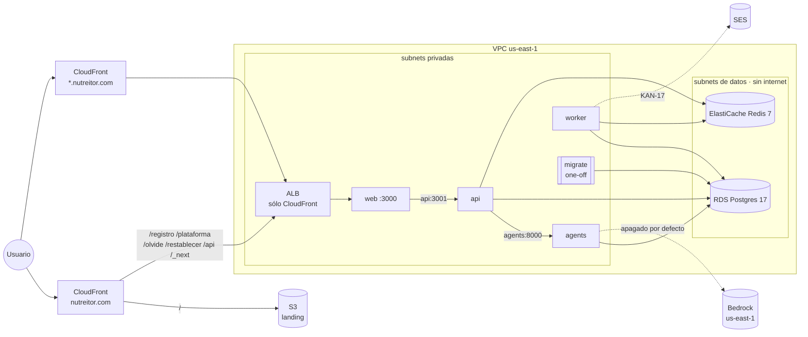
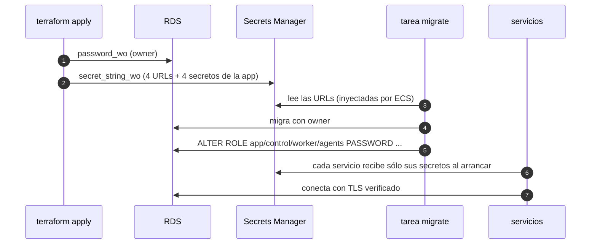

# Infraestructura en AWS (Terraform)

Este documento explica cómo está armada la infraestructura de Nutreitor en AWS. El
código está en [`infra/terraform/`](../../infra/terraform/) y su
[README](../../infra/terraform/README.md) tiene los comandos paso a paso. Las
decisiones están en el
[ADR 0048](../decisions/0048-region-us-east-1.md) (región) y el
[ADR 0047](../decisions/0047-infraestructura-como-codigo-terraform.md) (IaC).

**Estado (2026-11-06):** staging está desplegado en us-east-1, en la cuenta
`mascherano`. El primer `apply` real mostró tres problemas que se corrigieron en el
código (orden de Service Connect, roles vinculados a servicios y un diff permanente
en `rds.force_ssl`). Prod todavía no tiene cuenta. Lo pendiente está al final.

## Resumen en una pantalla

- **Dos entornos, staging y prod, cada uno en su propia cuenta de AWS.** Usan el mismo
  código y cambian sólo los tamaños.
- **Región:** todo corre en **us-east-1 (Virginia)**, incluido Bedrock (IA), que se
  llama sólo desde el servicio de agentes y está apagado por defecto.
- **Todo el tráfico entra por CloudFront.** Detrás hay un ALB que sólo acepta
  conexiones de CloudFront, y detrás del ALB, la web.
- **La app corre en ECS Fargate** como 4 servicios (web, api, agents, worker) más una
  tarea de migración que se corre a mano.
- **Datos:**
  - Postgres 17 en RDS;
  - Redis 7 en ElastiCache;
  - los dos en subnets sin salida a internet, cifrados con una llave KMS del entorno.
- **Secretos:** Terraform los genera y los escribe en Secrets Manager **sin guardarlos
  en el state**, y ECS los inyecta como variables de entorno.



## Cuántos contenedores corren

Hay **4 servicios permanentes** y **1 tarea de migración** que se corre en cada deploy
y termina.

| Servicio | Qué hace | Puerto | Staging (tareas) | Prod (mín → máx) | CPU / memoria en prod |
|---|---|---|---|---|---|
| **web** | Next.js: workspace, portal, alta y consola; proxy hacia la API | 3000, detrás del ALB | 1 | 2 → 6 | 0,5 vCPU / 1 GB |
| **api** | NestJS: toda la lógica y el acceso a datos | 3001, interno | 1 | 2 → 6 | 1 vCPU / 2 GB |
| **agents** | FastAPI (Python): asistentes NUTRI y CHEF | 8000, interno | 1 | 2 | 0,5 vCPU / 1 GB |
| **worker** | avisos por mail (BullMQ) | sin puertos | 1 | 1 | 0,25 vCPU / 0,5 GB |
| **migrate** | migra la base y fija las contraseñas de los roles | sin puertos | se corre y termina | se corre y termina | 0,5 vCPU / 1 GB |

- **Staging:** 4 tareas siempre prendidas, en Fargate Spot (más barato, AWS las puede
  reemplazar).
- **Prod:** 7 tareas como mínimo. web y api escalan solas hasta 6 cada una cuando la
  CPU pasa el 60 %, así que el máximo es 15.
- **Sidecar de Service Connect:** cada tarea lleva además un proxy (Envoy) que agrega
  ECS para que los servicios se encuentren por nombre (`api:3001`, `agents:8000`). No
  se configura ni se paga aparte del CPU que usa.
- **Desarrollo local:** son 7 contenedores con `docker compose` (db, redis, api, web,
  site, worker, agents). En AWS, `db` y `redis` pasan a ser servicios administrados
  (RDS y ElastiCache), y `site` pasa a ser archivos estáticos en S3.

## Cómo está organizado el código

```
infra/terraform/
  bootstrap/        una vez por cuenta: bucket del state y rol de deploy
  modules/
    stack/          un entorno completo; llama a los cuatro de abajo
    network/        VPC, subnets, NAT, endpoint de S3
    data/           RDS y ElastiCache
    edge/           certificados, ALB, CloudFront, landing en S3, DNS
    ecs/            cluster, imágenes, logs, IAM, tareas y servicios
  envs/
    staging/        llama a stack con tamaños chicos
    prod/           llama a stack con tamaños de producción
```

**Para cambiar un tamaño, se toca sólo `envs/<entorno>/main.tf`. Para cambiar cómo
funciona algo, se toca el módulo, y el cambio aplica a los dos entornos.**

### Cuentas, state y deploy (`bootstrap/`)

- **Una cuenta de AWS por entorno.** Un error en staging no puede tocar prod, y la
  facturación y los permisos quedan separados.
- **El bootstrap** se corre una vez por cuenta y crea dos cosas:
  - **el bucket del state** (`nutreitor-<env>-tfstate`): versionado, cifrado con KMS,
    sin acceso público, sólo por TLS, y con las versiones viejas borradas a los 90
    días. El lock usa el mecanismo nativo de S3 (`use_lockfile`), sin DynamoDB;
  - **el rol de deploy** (`nutreitor-<env>-deploy`): GitHub Actions lo asume por OIDC,
    sin llaves guardadas, y sólo desde el *environment* de GitHub con el mismo nombre
    (`staging` o `prod`), que puede exigir aprobación manual. Tiene permisos de
    administrador en su cuenta, porque Terraform crea VPC, IAM, KMS y RDS.
- **Los providers frenan si la cuenta no es la esperada** (`allowed_account_ids`): no
  se puede aplicar prod con credenciales de staging.

### Red (`modules/network`)

- **VPC en 2 zonas de disponibilidad**: `10.20.0.0/16` en staging y `10.30.0.0/16` en
  prod.
- **Tres capas de subnets por zona:**

  | Capa | Qué hay | Salida a internet |
  |---|---|---|
  | públicas | ALB y NAT gateways | directa (internet gateway) |
  | privadas | las tareas de ECS | por NAT |
  | datos | RDS y Redis | **ninguna** |

- **NAT:** uno solo en staging, para ahorrar, y uno por zona en prod, así una zona
  caída no deja sin salida a la otra.
- **Endpoint de S3:** las imágenes de ECR se bajan de S3 por este endpoint, sin pasar
  por el NAT (que cobra por GB).

### Datos (`modules/data`)

**RDS Postgres 17:**

| | Staging | Prod |
|---|---|---|
| Instancia | `db.t4g.micro` | `db.t4g.medium` |
| Multi-AZ | no | sí |
| Disco | 20 GB (crece hasta 50) | 50 GB (crece hasta 200) |
| Backups | 3 días | 14 días |
| Protección contra borrado | no | sí, y snapshot final |

- **En los dos entornos:**
  - cifrado con la KMS del entorno;
  - `rds.force_ssl=1`, así que sin TLS no se conecta nadie;
  - las consultas de más de 1 s van al log;
  - Performance Insights encendido.
- **Las apps verifican el certificado de RDS** (`sslmode=verify-full`) contra la CA
  de AWS, que viene adentro de las imágenes (`/etc/ssl/rds-global-bundle.pem`).
- **Los roles de la base son los mismos que en desarrollo**, que se arma igual que
  RDS (ADR [0049](../decisions/0049-plano-de-control-sin-superusuario.md)):
  - `nutreitor_owner` es el usuario maestro, no es superusuario y sólo corre las
    migraciones;
  - `nutreitor_control` es el plano de control de la API: ve entre tenants sólo las
    tablas de plataforma;
  - `nutreitor_app`, `nutreitor_worker` y `nutreitor_agents` son los de runtime,
    sujetos a RLS.

**ElastiCache Redis 7:**
- guarda los contadores del rate limiting y la cola del worker;
- staging tiene un nodo `cache.t4g.micro`; prod, `cache.t4g.small` con una réplica y
  failover automático;
- TLS en tránsito y cifrado en reposo;
- sin contraseña: lo cierra el security group;
- sin snapshots, porque guarda datos efímeros.

### Borde (`modules/edge`)

- **Dos distribuciones de CloudFront:**
  - **`nutreitor.com`:** sirve la landing desde S3, con una función que agrega
    `index.html` a las rutas de Astro. Las rutas de la app (`/registro`,
    `/plataforma`, `/olvide`, `/restablecer`, `/api/*`, `/_next/*`) van al ALB sin
    caché;
  - **`*.nutreitor.com`** (cada organización): todo va al ALB sin caché, salvo
    `/_next/static/*`, que se cachea en el borde.
- **Encabezados:** CloudFront reenvía el `Host` y las cookies, así la web sabe de qué
  organización es cada pedido.
- **El ALB sólo acepta tráfico de CloudFront**, por la lista de IPs que publica AWS.
  Con eso:
  - nadie puede saltearse CloudFront;
  - la IP real del cliente queda siempre en la misma posición de `X-Forwarded-For`
    (`TRUSTED_PROXY_HOPS=2`), y el rate limiting la usa;
  - si se suma un WAF, va en un solo lugar.
- **Certificados:** dos wildcards de ACM (`dominio` y `*.dominio`), los dos en
  us-east-1: uno para el ALB y otro para CloudFront, que sólo los toma de esa región. Se validan solos por DNS.
- **ALB:** TLS 1.2 o 1.3, descarta encabezados inválidos y revisa la salud de la web
  pidiendo `/robots.txt`.
- **Landing:** un bucket de S3 privado, que sólo lee CloudFront (OAC), con
  versionado.
- **DNS:** Route 53 apunta el dominio raíz y el wildcard a CloudFront. La zona tiene
  que existir de antemano. La de staging (`staging.nutreitor.com`) se delega desde la
  de prod.

### Servicios (`modules/ecs`)

- **Cluster:** Fargate, con un namespace de Service Connect (`<entorno>.internal`).
  api y agents publican su nombre; web y worker sólo lo usan.
- **Orden de creación:** el proxy de Service Connect de cada tarea conoce sólo los
  nombres que ya existían en el namespace cuando arrancó. Si web arranca antes de que
  api publique el suyo, falla con `getaddrinfo ENOTFOUND api` hasta que se la
  redeploya (pasó en el primer apply de staging). Por eso los servicios se crean en
  escalones (submódulo `modules/ecs/service`): primero agents, después api y al final
  web y worker.
- **Imágenes (ECR):** un repositorio por imagen (api, web, worker, agents), con tags
  inmutables (el SHA del commit), escaneo al subir, cifrado KMS y las últimas 30
  imágenes.
- **Deploys:** si una versión nueva no queda sana, ECS vuelve sola a la anterior
  (*circuit breaker*). Terraform no pisa la cantidad de tareas que decidió el
  autoscaling.
- **Logs:** CloudWatch, un grupo por servicio, cifrado con KMS. Se guardan 14 días en
  staging y 90 en prod.
- **Health checks:** api y agents se chequean por `/health` dentro del contenedor; la
  web, por el ALB.
- **La migración** usa la imagen de la API con otro comando: primero
  `migrate.js` y después `set-role-passwords.js`.

### Seguridad

**Quién puede hablar con quién** (todo lo demás está cerrado):

| Destino | Desde | Puerto |
|---|---|---|
| ALB | CloudFront | 443 |
| web | ALB | 3000 |
| api | web | 3001 |
| agents | api | 8000 |
| RDS | api, worker, agents, migrate | 5432 |
| Redis | api, worker | 6379 |

**Permisos de IAM**, con dos roles por servicio:
- **Rol de ejecución** (lo usa ECS para arrancar la tarea): bajar la imagen, escribir
  logs y leer **sólo los secretos de esa tarea**. Por ejemplo, la web no puede leer
  la contraseña de la base.
- **Rol de la tarea** (lo usa el código): **no tiene permisos**, salvo dos
  excepciones que se activan por variable:
  - **agents → Bedrock** (`bedrock_enabled`): sólo `InvokeModel` sobre los modelos
    listados, en us-east-1. Con un perfil de inferencia `us.`, cubre las regiones de
    EE.UU.;
  - **worker → SES** (`ses_identity_arns`): sólo enviar desde las identidades
    listadas.

### Secretos

| Secreto | Lo usan |
|---|---|
| `db/owner-url` | sólo migrate (la API no lo tiene, ADR 0049) |
| `db/control-url` | api (plano de control), migrate |
| `db/app-url` | api, migrate |
| `db/worker-url` | worker, migrate |
| `db/agents-url` | agents, migrate |
| `app/jwt_access`, `app/jwt_refresh` | api |
| `app/edge` (secreto web ↔ api) | web, api |
| `app/agents` (firma api ↔ agents) | api, agents |

**Cómo se crean sin que queden en ningún lado:**

1. Terraform genera las contraseñas como valores *ephemeral*: existen sólo durante el
   `plan` o el `apply`.
2. Las escribe con argumentos *write-only*: `password_wo` en RDS y `secret_string_wo`
   en Secrets Manager. **No quedan ni en el state ni en el repo.**
3. Sólo las reescribe cuando sube `credentials_version` (las de la base) o
   `app_secrets_version` (las de la app).
4. Las migraciones crean los roles de la base con la contraseña de desarrollo. Por
   eso la tarea `migrate`, después de migrar, les fija la contraseña real (app,
   control, worker y agents) leyéndola de su secreto.



## Staging y prod, lado a lado

| | Staging | Prod |
|---|---|---|
| Dominio | `staging.nutreitor.com` | `nutreitor.com` |
| NAT | 1 | 1 por zona (2) |
| RDS | t4g.micro, una zona, 3 días de backup | t4g.medium, Multi-AZ, 14 días |
| Redis | 1 nodo micro | small + réplica |
| Tareas | 4, en Spot | 7 a 15, Fargate normal, autoscaling |
| Container Insights | no | sí |
| Logs | 14 días | 90 días |
| Protección contra borrado | no | RDS, ALB y secretos (30 días de recuperación) |

## Operación

Los comandos completos están en el [README de infra](../../infra/terraform/README.md).

- **Primer despliegue:**
  1. bootstrap de la cuenta (en una cuenta nueva, con los roles vinculados de ECS y
     ElastiCache: `create_service_linked_roles = true`);
  2. zona DNS;
  3. crear los repos de ECR y subir las imágenes;
  4. `apply` (si algún cliente igual arrancara sin resolver `api` o `agents`,
     redeployarlo con `--force-new-deployment`);
  5. correr `migrate`;
  6. crear el primer operador de plataforma;
  7. subir la landing.
- **Deploy de una versión:** cambiar `image_tag` y hacer `apply`. Si hay migraciones,
  correr `migrate` antes.
- **Rotar las contraseñas de la base:** subir `credentials_version`, hacer `apply`,
  correr `migrate` y redeployar.
- **Rotar los secretos de la app:** subir `app_secrets_version`, hacer `apply` y
  redeployar. Rotar el JWT cierra todas las sesiones.
- **Activar Bedrock** (con el BAA y el consentimiento, KAN-52): `bedrock_enabled` y
  `bedrock_model_ids`.
- **Activar SES** (KAN-17): `mail_provider = "ses"` y `ses_identity_arns`.

## Qué falta

| Qué | Ticket |
|---|---|
| Pipeline de deploy desde GitHub Actions (build, ECR, `apply`, `migrate`, landing) | KAN-89 |
| Logs de acceso del ALB y CloudFront, flow logs, alarmas, WAF, restore probado | KAN-18 |
| Dominio verificado en SES | KAN-17 |
| Permisos y cuotas de Bedrock | KAN-52 |
| pgBouncer: queda afuera hasta que las conexiones lo pidan (ver ADR 0047) | — |
