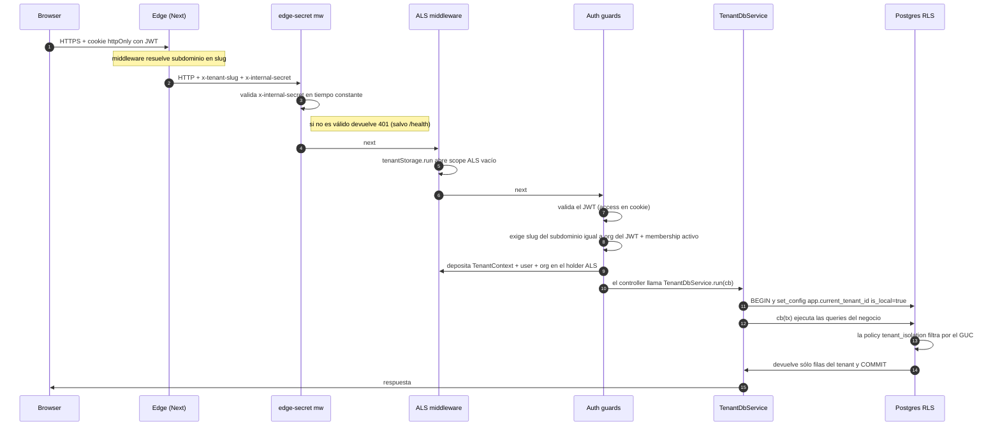

# Multi-tenancy: modelo POOL + RLS

Nutreitor corre en modelo **POOL**: un solo cluster Postgres con todas las
organizaciones, aislado por **Row Level Security (RLS)** de Postgres — no por el
código de la app. El schema lleva `tenant_id` + `region` en toda tabla de negocio
desde el commit cero, así promover un tenant a **SILO** (DB/instancia propia) es
mover filas y apuntar su conexión, sin tocar lógica de negocio. Este documento
describe cómo se aísla cada request y por qué.

> La clasificación de tablas tenant-scoped vs global está en
> [`data-model.md`](./data-model.md); el mapa de componentes, en
> [`overview.md`](./overview.md).

## Principio: el `tenant_id` nunca viene del request

Sale del **contexto de auth** (claims del JWT) cruzado con el **subdominio**. El
cliente no puede elegir su tenant: lo deriva el servidor y lo hace cumplir la DB.

## Roles de Postgres (defensa en profundidad)

Ningún rol es superusuario ni tiene `BYPASSRLS`, ni siquiera el owner: la base se
arma igual que en RDS, en desarrollo y en CI (ADR
[0048](../decisions/0048-plano-de-control-sin-superusuario.md)).

| Rol | Uso | RLS |
|---|---|---|
| `nutreitor_owner` | migraciones, seed y tests (nunca la API) | policy explícita `owner_all` en cada tabla: ve todo |
| `nutreitor_control` | plano de control de la API: alta, consola, login, invitaciones, sesiones | policy `control_plane` **sólo** en las tablas de plataforma; ningún dato clínico |
| `nutreitor_app` | runtime de la API (toda query tenant-scoped) | **sujeto** a RLS (`tenant_isolation`) |
| `nutreitor_worker`, `nutreitor_agents` | worker y servicio de agentes | **sujetos** a RLS, con GRANTs acotados |

La API **jamás** usa el owner. En código, la separación es física: dos servicios
distintos, `TenantDbService` (rol app) y `AdminDbService` (rol control). El tipo de lo
que inyectás dice de qué lado del borde estás.

Sobre cada tabla tenant-scoped:

- `ENABLE ROW LEVEL SECURITY` + `FORCE ROW LEVEL SECURITY` → RLS aplica incluso al
  owner de la tabla (ni el owner lee cross-tenant si por error usa esa conexión).
- Policy `tenant_isolation` con `USING` (lecturas) + `WITH CHECK` (escrituras):

```sql
USING      (tenant_id = NULLIF(current_setting('app.current_tenant_id', true), '')::uuid)
WITH CHECK (tenant_id = NULLIF(current_setting('app.current_tenant_id', true), '')::uuid)
```

### Fail-closed

`current_setting('app.current_tenant_id', true)` devuelve `NULL` si el GUC nunca se
definió. El `NULLIF(..., '')` cubre además el caso de **pooling**: una conexión que
ya sirvió un `SET LOCAL` vuelve al pool con el GUC en string vacío (`''`), no `NULL`
— sin `NULLIF`, `''::uuid` lanzaría error en cada query sin tenant. En ambos casos
el resultado es `NULL` → la comparación da `NULL` → **se deniega todo**. Sin
contexto de tenant, no se ve ni se escribe nada.

`WITH CHECK` impide además **plantar** una fila en otro tenant: aunque la app fuerce
un `tenant_id` ajeno en un INSERT/UPDATE, la policy lo rechaza.

## Anatomía de un request tenant-scoped

El orden de los chequeos es deliberado: resolver tenant del borde → abrir scope →
validar JWT → verificar `slug == org` + membership → setear RLS → ejecutar.



### Por qué AsyncLocalStorage y no request-scoped DI

El scope `REQUEST` de Nest re-instancia todo el subárbol de providers que lo
consume en cada request, y es viral. `AsyncLocalStorage` (`tenant-context.store.ts`)
da el mismo aislamiento por request manteniendo los providers como **singletons** →
mejor throughput, sobre todo bajo Fargate. El `TenantContextMiddleware` abre un
holder mutable vacío para todo request; el guard lo completa al autenticar; las
rutas públicas simplemente nunca lo completan.

### Por qué transacción + `SET LOCAL`

`withTenant()` (`packages/db/src/tenant/with-tenant.ts`) corre todo dentro de una
transacción y setea el GUC con `set_config(name, value, is_local=true)` (equivale a
`SET LOCAL`):

- Es **transaction-scoped**: el valor vive sólo hasta COMMIT/ROLLBACK; la conexión
  vuelve al pool sin contexto residual → no hay fuga de tenant entre requests.
- Compatible con **pgBouncer en transaction-pooling** (clave para escalar en
  Fargate). Un `SET` de sesión no lo sería.
- Se pasa el `tenantId` como **parámetro** (`$1`), no por interpolación de string.

## Lectura pública sin sesión: `runAs`

Las páginas públicas (vidriera de profesionales, landing del tenant) no tienen JWT,
pero **no** salen del perímetro de RLS. `TenantResolverService` resuelve la org por
slug con el owner (lookup pre-auth, el slug del hostname no es de confianza) y luego
`TenantDbService.runAs(tenantId, cb)` corre la query bajo RLS con ese tenant
explícito. Misma arquitectura de aislamiento que `run()` (pool app + `SET LOCAL` +
RLS): **no hay ruta de negocio exenta de RLS**.

## Borde edge ↔ API

El `x-tenant-slug` que llega a la API viaja en un header que sólo el edge debería
poder setear. Capas, de la primaria a la de respaldo:

1. **Lógica**: `JwtAuthGuard` exige `slug(subdominio) == org(JWT)` + membership, así
   spoofear `x-tenant-slug` no escala privilegios (un token de un tenant no sirve en
   el subdominio de otro).
2. **Secreto compartido**: `edge-secret.middleware` exige `x-internal-secret`
   (`EDGE_SHARED_SECRET`, comparado en tiempo constante) en todo request salvo
   `/health`. Si la API quedara expuesta, los requests directos se caen.
3. **Red (prod, documentado, no implementado)**: API en subnet privada, alcanzable
   sólo vía el edge/ALB. Es el borde primario; el secreto es la segunda capa.
   Upgrade futuro: HMAC+TTL del contexto firmado / mTLS.

## `region` y promoción a SILO

`region` es un **enum** (`us-east-1`, `eu-central-1`, `sa-east-1`) — no text libre —
**denormalizado** en cada tabla de negocio: la región viaja con el dato, así el
routing/placement no requiere join y la fila se autodescribe. Se hereda de la
organización al crear y se trata como **inmutable** salvo un job de migración
explícito (cambiar de región ES mover datos).

Promover un tenant de POOL a SILO (DB/instancia propia, p. ej. por residencia de
datos regional o por volumen): se mueven sus filas a la nueva DB y se apunta su
conexión; la lógica de negocio no cambia porque cada fila ya lleva `tenant_id` +
`region` y el aislamiento ya está expresado en RLS.

## Garantías verificadas por tests

El test de aislamiento (`docker compose exec api pnpm --filter @nutreitor/api test`)
levanta un Postgres real con 2 tenants y verifica: cada tenant ve sólo lo suyo,
forzar el id de un paciente ajeno no devuelve nada, insertar con `tenant_id` ajeno
es rechazado por `WITH CHECK`, y que **sin contexto no se ve nada** (fail-closed).
En CI corre contra un Postgres service container (no se mockea la DB).

Además, `rls-catalog.e2e.spec.ts` recorre el **catálogo de Postgres** en vez de una
lista de tablas: toda tabla sobre la que el rol app tiene privilegios tiene que tener
RLS habilitado y **forzado**, una policy atada a `app.current_tenant_id` en `USING` y
`WITH CHECK`, devolver 0 filas sin contexto y ninguna fila de otro tenant con
contexto. Una tabla nueva que se olvide de RLS rompe el CI sin que nadie tenga que
sumarla al test. Las únicas excepciones son las tablas globales declaradas en el test
con su justificación (hoy sólo `users`, ver ADR 0003).

Encima de RLS, los `*-authz.e2e.spec.ts` cubren el scoping **de servicio**
(profesional → sólo pacientes asignados, acceso por id que no cruce de paciente,
reserva pública acotada a la org del slug), que RLS no puede ver porque es una regla
dentro del mismo tenant.
