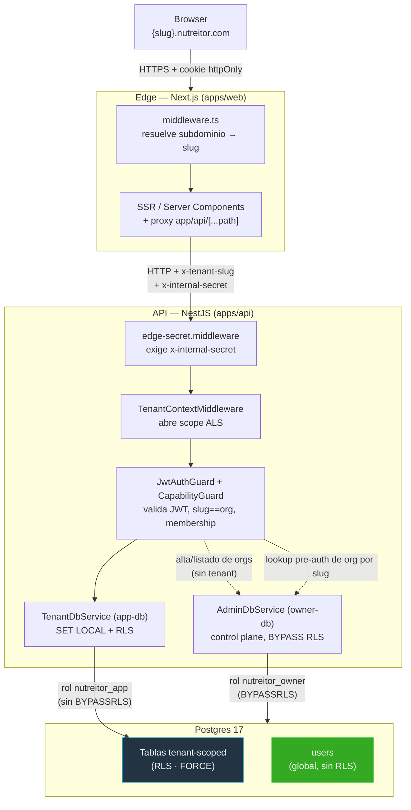

# Arquitectura — visión general

Nutreitor es una plataforma multi-tenant white-label de captación y seguimiento de
pacientes para nutrición: un mismo deploy sirve a múltiples organizaciones
(nutricionistas, gimnasios, clínicas) con aislamiento de datos fuerte. Este
documento da el mapa de componentes y los **límites de aislamiento** del sistema.
El detalle del aislamiento por tenant está en
[`multi-tenancy.md`](./multi-tenancy.md); el esquema, en
[`data-model.md`](./data-model.md).

## Monorepo

pnpm workspaces + Turborepo, TypeScript end-to-end (ESM), Node ≥ 22.

```
apps/
  api/   NestJS 11 — backend
    core/      tenant (ALS) · auth (passport-jwt, guards, capabilities) ·
               database (RLS app-db / owner admin-db) · security (edge secret) ·
               crypto · mail · config
    modules/   organizations · members · invitations · patients · portal ·
               professionals · public · scheduling (placeholder)
    agents/    slot vacío (servicio Python a futuro)
  web/   Next.js 15 (App Router) + Tailwind — frontend + edge
    app/page.tsx          landing de producto (host raíz)
    middleware.ts         resuelve subdominio → /s/[slug] + x-tenant-slug
    app/api/[...path]      proxy server-side a la API (cookies first-party)
    app/s/[slug]/          workspace del tenant: login · admin · pro · app (portal)
packages/
  db/      schema Drizzle + migraciones SQL (RLS), runner, seed, with-tenant
  shared/  tipos/DTOs compartidos (TenantContext, auth, schemas Zod)
  config/  tsconfig/eslint/env compartidos
```

## Componentes y borde de red

El principio rector es **defensa en profundidad**: el `tenant_id` nunca viaja en el
request del cliente, sale del contexto de auth; y el plano de datos tenant está
detrás de RLS, alcanzable sólo por el rol de runtime sin privilegios.



**Límites de aislamiento marcados arriba:**

- **Borde de red (edge → API)**: en prod la API vive en subnet privada, alcanzable
  sólo vía el edge/ALB. El `x-internal-secret` (`EDGE_SHARED_SECRET`) es la segunda
  capa: la API rechaza todo request sin él, salvo `/health`.
- **Borde de tenant (RLS)**: el runtime usa el rol `nutreitor_app` (sin `BYPASSRLS`).
  Toda lectura/escritura de tablas de negocio pasa por `TenantDbService`, que setea
  `app.current_tenant_id` por transacción y deja que la policy RLS filtre.
- **Borde de control plane**: el alta/listado de organizaciones (operación de
  plataforma, sin tenant) usa `AdminDbService` con el rol `nutreitor_owner`
  (bypassa RLS) — explícitamente fuera del perímetro de tenant. Hoy **sin authz de
  PLATFORM-ADMIN** (deuda consciente, no desplegar así).
- **`users` es global**: única tabla fuera de RLS (sólo credencial + nombre, sin
  PHI). El acceso queda gateado por `memberships`, que sí está bajo RLS.

## Despliegue

- **Dev**: `docker compose up` levanta `db` (Postgres 17) + `api` + `web` con
  hot-reload. La API migra al arrancar (conveniencia de dev).
- **Prod (objetivo)**: Fargate; API en subnet privada detrás del edge/ALB;
  migraciones como job separado; secrets desde AWS Secrets Manager / SSM. Ver las
  "Notas para producción" del [README](../../README.md).

## Fuera de alcance (con el lugar reservado)

- **Agentes (CHEF/NUTRI/PSICO)**: `apps/api/src/agents/` es un slot vacío. Vivirán
  en un servicio Python que consume el mismo Postgres bajo las mismas RLS policies.
- **Agendamiento**: módulo placeholder; antes de implementar se decide Cal.com
  self-hosted vs motor propio. Invariante fijado: UTC en storage, conversión en
  presentación, DST por país.
