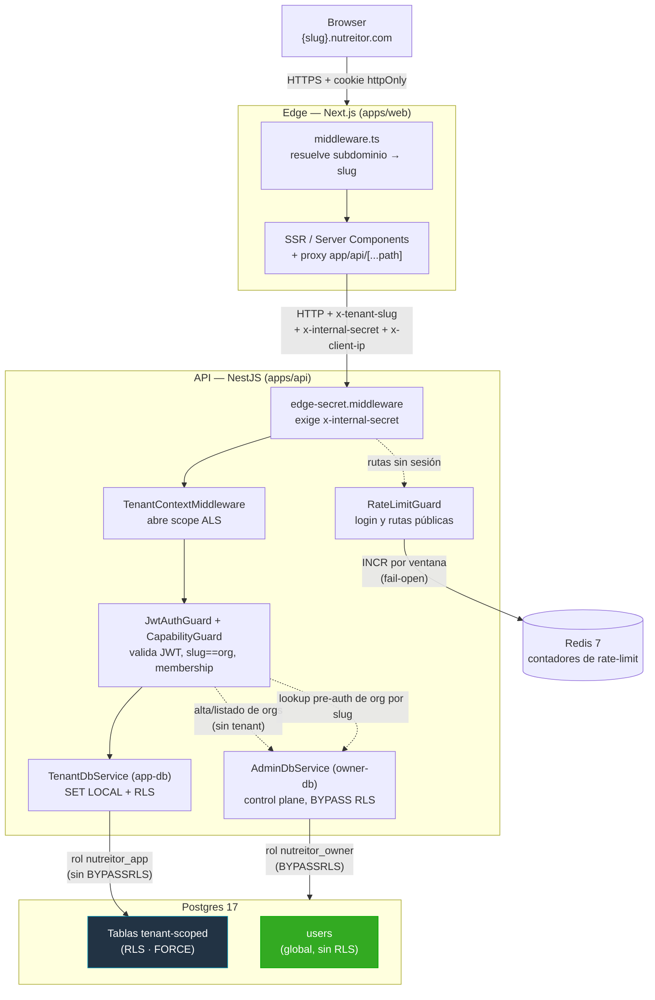

# Arquitectura — visión general

Nutreitor es una plataforma multi-tenant white-label de captación y seguimiento de
pacientes para nutrición: un mismo deploy sirve a múltiples organizaciones
(nutricionistas, gimnasios, clínicas) con aislamiento de datos fuerte. Este
documento da el mapa de componentes y los **límites de aislamiento** del sistema.
El detalle del aislamiento por tenant está en
[`multi-tenancy.md`](./multi-tenancy.md); el esquema, en
[`data-model.md`](./data-model.md).

## Monorepo

pnpm workspaces + Turborepo, TypeScript end-to-end (ESM), Node ≥ 22.

```
apps/
  api/   NestJS 11 — backend
    core/      tenant (ALS) · auth (passport-jwt, guards, capabilities) ·
               database (RLS app-db / owner admin-db) · security (edge secret) ·
               crypto · mail · config
    modules/   organizations · members · invitations · patients · portal ·
               professionals · public · scheduling · foods · agents ·
               onboarding (alta autoservicio + consola de plataforma) ·
               contact (solicitudes desde la vidriera)
    agents/    slot vacío (servicio Python a futuro)
  site/  Astro 5 estático — landing de producto (nutreitor.com), S3 + CloudFront (ADR 0028)
  web/   Next.js 15 (App Router) + Tailwind — frontend + edge
    app/page.tsx          raíz: en dev redirige a la landing (apps/site); en prod no se alcanza
    app/registro/         alta autoservicio de organizaciones (host raíz)
    app/plataforma/       consola de plataforma, sesión propia (host raíz)
    middleware.ts         resuelve subdominio → /s/[slug] + x-tenant-slug
    app/api/[...path]      proxy server-side a la API (cookies first-party)
    app/s/[slug]/          workspace del tenant: login · admin · pro · app (portal)
packages/
  db/      schema Drizzle + migraciones SQL (RLS), runner, seed, with-tenant
  shared/  tipos/DTOs compartidos (TenantContext, auth, schemas Zod)
  config/  tsconfig/eslint/env compartidos
```

## Componentes y borde de red

El principio rector es **defensa en profundidad**: el `tenant_id` nunca viaja en el
request del cliente, sale del contexto de auth; y el plano de datos tenant está
detrás de RLS, alcanzable sólo por el rol de runtime sin privilegios.



**Límites de aislamiento marcados arriba:**

- **Borde (CloudFront)**: todo entra por CloudFront. `nutreitor.com` sirve la landing
  estática (`apps/site`) desde S3, y `/registro`, `/plataforma` y `/api` van al ALB de
  la web. Los subdominios de cada organización pasan por una segunda distribución, sin
  caché, al mismo ALB. El ALB sólo acepta tráfico de CloudFront. Ver
  [ADR 0028](../decisions/0028-landing-separada-astro-s3-cloudfront.md) y
  [ADR 0047](../decisions/0047-infraestructura-como-codigo-terraform.md).
- **Borde de red (edge → API)**: en prod la API vive en subnet privada, alcanzable
  sólo vía el edge/ALB. El `x-internal-secret` (`EDGE_SHARED_SECRET`) es la segunda
  capa: la API rechaza todo request sin él, salvo `/health`.
- **Borde de tenant (RLS)**: el runtime usa el rol `nutreitor_app` (sin `BYPASSRLS`).
  Toda lectura/escritura de tablas de negocio pasa por `TenantDbService`, que setea
  `app.current_tenant_id` por transacción y deja que la policy RLS filtre.
- **Borde de control plane**: el alta de organizaciones y la consola de plataforma
  (operaciones sin tenant) usan `AdminDbService` con el rol `nutreitor_owner`
  (bypassa RLS) — explícitamente fuera del perímetro de tenant. El alta autoservicio
  (`/signup`) es pública y rate-limitada; la consola (`/platform/*` y el viejo
  `/admin/organizations`) exige la **sesión de plataforma**: cookie host-only del
  dominio raíz, JWT con `aud` propio y `users.is_platform_admin` re-chequeado en cada
  request. Lee sólo metadatos de orgs, admins y matrículas, nunca datos de pacientes.
  Ver [ADR 0025](../decisions/0025-alta-de-organizaciones-y-consola-de-plataforma.md)
  y [`flows/onboarding.md`](../flows/onboarding.md).
- **Rate-limiting (sin sesión)**: login, invitaciones y la reserva pública cuentan
  hits por IP (y por email en el login) en Redis; 429 al pasarse. Si Redis no
  responde, deja pasar. La IP real la resuelve el edge desde `X-Forwarded-For`. Ver
  [ADR 0017](../decisions/0017-rate-limiting-redis.md).
- **PWA del portal**: el edge sirve, por tenant, el manifest, los íconos y un
  service worker que **no cachea datos** (sólo avisa "sin conexión"). Ver
  [ADR 0021](../decisions/0021-pwa-white-label-sin-cache.md).
- **`users` es global**: única tabla fuera de RLS (sólo credencial + nombre, sin
  PHI). El acceso queda gateado por `memberships`, que sí está bajo RLS.

## Despliegue

- **Dev**: `docker compose up` levanta `db` (Postgres 17) + `redis` + `api` + `web`
  (+ `agents` + `worker`) con hot-reload. La API migra al arrancar (conveniencia de dev).
- **Prod**: Terraform en [`infra/terraform/`](../../infra/terraform/README.md),
  explicado en [`infraestructura-aws.md`](infraestructura-aws.md)
  (ADR [0047](../decisions/0047-infraestructura-como-codigo-terraform.md)), con una
  cuenta AWS por entorno. App y datos en **sa-east-1**; Bedrock, sólo desde agents, en
  us-east-1 (ADR [0046](../decisions/0046-region-de-produccion.md)).
  - **Red**: VPC en 2 AZ con subnets públicas (ALB y NAT), privadas (tareas) y de
    datos (RDS y Redis, sin internet).
  - **ECS Fargate**:
    - web detrás del ALB;
    - api y agents internos por Service Connect;
    - worker sin puertos;
    - la migración como tarea one-off, que además fija las contraseñas de los roles.
  - **Datos**: RDS Postgres 17 (Multi-AZ en prod) con TLS verificado, y ElastiCache
    Redis 7 con TLS.
  - **Secretos**: en Secrets Manager, escritos con argumentos write-only (no quedan
    en el state).
  - **Email**: por Amazon SES.

## Evolución a servicios

La API es un **modular monolith** a propósito: la arquitectura objetivo es orientada
a servicios, alcanzada **incrementalmente** (extraer un bounded context cuando hay un
disparador real), no de un big-bang. Los módulos, los DTOs de `shared`, el
`tenant_id`/`region` por tabla y el servicio de agentes (ya extraído) son las costuras
para esa extracción. Reglas, disparadores y orden en el ADR
[`../decisions/0012-modular-monolith-evolucion-a-servicios.md`](../decisions/0012-modular-monolith-evolucion-a-servicios.md).

## Fuera del monolito

- **Agentes (CHEF/NUTRI/PSICO)**: servicio Python aparte (`apps/agents`) que consume
  el mismo Postgres bajo las mismas RLS policies, con un rol propio
  (`nutreitor_agents`). La API es su gateway (`modules/agents`): firma un contexto de
  tenant HMAC + TTL y aplica el consentimiento y el tope de costo antes de egresar.
  Ver [`../flows/agents.md`](../flows/agents.md) y los ADR 0013–0016.
- **Worker de notificaciones**: proceso Node aparte (`apps/worker`) con BullMQ sobre
  Redis. Rol propio `nutreitor_worker` sin BYPASSRLS: recorre los consultorios con
  `withTenant`; la lista de ids sale de una función SECURITY DEFINER. Ver
  [`../flows/notifications.md`](../flows/notifications.md) y el ADR 0023.
- **Agendamiento**: motor propio dentro de la API (`modules/scheduling`), no Cal.com.
  Ver [`../flows/scheduling.md`](../flows/scheduling.md) y el ADR 0011.
