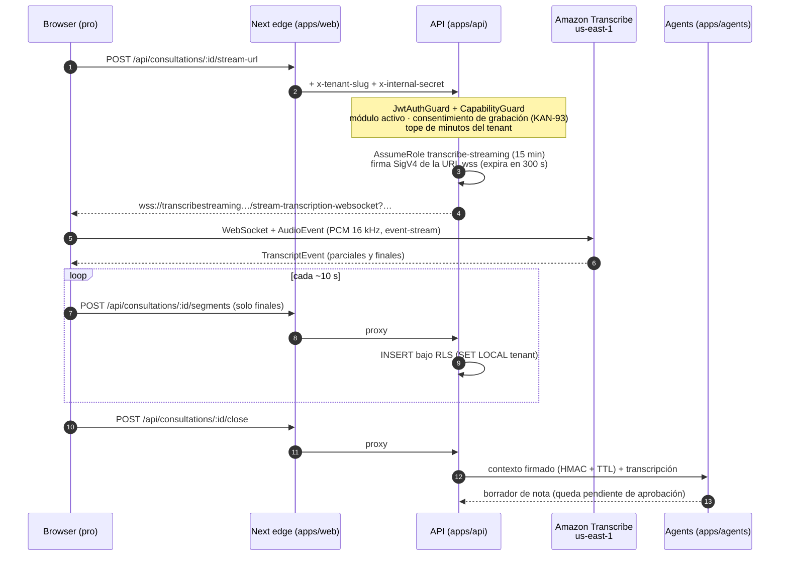

# 0050 — Nota de consulta asistida: transcripción en streaming con Amazon Transcribe

- **Estado**: aceptada, salvo el proveedor de speech-to-text: Transcribe o
  Speechmatics se decide con la prueba de concepto (ver *Comparación de
  proveedores*). La implementación va en KAN-95 y KAN-96.
- **Fecha**: 2026-11-19
- **Épica**: KAN-91 · Relacionados: [ADR 0014](0014-inferencia-bedrock-y-controles-de-costo.md),
  [ADR 0048](0048-region-us-east-1.md), [ADR 0006](0006-borde-edge-api-defensa-en-profundidad.md),
  [ADR 0042](0042-registro-de-lecturas-de-datos-de-salud.md)

## Contexto

La épica KAN-91 suma una nota de consulta asistida. La consulta se transcribe, el
servicio de agentes arma un borrador de nota nutricional estructurada y el
profesional la revisa y la aprueba. Nada entra en la ficha sin esa aprobación.

El servicio de agentes ([ADR 0013](0013-agentes-servicio-ia.md)) solo procesa texto.
Para llegar a la nota faltan cuatro cosas: pasar el audio a texto, capturarlo en el
navegador, decidir cuándo se transcribe y definir cuánto tiempo se guarda cada cosa.
Todo involucra datos de salud, así que cada decisión también es una decisión de
cumplimiento.

Dos restricciones del entorno:

- **Transcribe Medical y AWS HealthScribe solo funcionan en inglés.** Para español
  queda Transcribe estándar (`es-US`). No existe `es-AR`.
- **El proxy de Next (`app/api/[...path]`) no maneja WebSockets.** Cualquier
  streaming tiene que resolver el borde sin romper el
  [ADR 0006](0006-borde-edge-api-defensa-en-profundidad.md).

## Decisión

### 1. Speech-to-text: Amazon Transcribe estándar en `es-US`

- **Vocabulario personalizado** con términos de antropometría, suplementación y
  fármacos frecuentes (pliegues, ISAK, Kerr, somatotipo, creatina, levotiroxina…).
  Arranca con uno global y se suman vocabularios por organización con las plantillas
  de KAN-99.
- Corre en `us-east-1`, como el resto ([ADR 0048](0048-region-us-east-1.md)), dentro
  de la misma cuenta y cubierto por el BAA de AWS (Transcribe es HIPAA-eligible). No
  suma proveedores ni contratos.
- **Opt-out de uso de contenido**: los servicios de IA de AWS pueden usar el contenido
  para mejorar el servicio salvo que la cuenta se excluya. Se aplica una *AI services
  opt-out policy* de AWS Organizations antes de mandar audio real.

### 2. Streaming durante la consulta, directo del navegador a Transcribe

El navegador abre un WebSocket **directo contra Transcribe** con una URL prefirmada
que emite la API. El audio no pasa por nuestros servidores y no se guarda en ningún
lado.

Por qué así:

- **El borde no cambia.** La API sigue alcanzable solo por el proxy de Next con el
  secreto interno. No hay un WebSocket propio que exponer por CloudFront y el ALB.
- **La firma fija los parámetros.** Idioma, formato, vocabulario y modo de hablantes
  van en la URL firmada; el cliente no puede cambiarlos sin invalidarla.
- **La credencial es mínima.** La API asume un rol dedicado cuya única acción es
  `transcribe:StartStreamTranscriptionWebSocket` y firma con esa sesión de 15
  minutos. La URL lleva el token de esa sesión, nunca el del rol de la tarea de ECS.
- **Los controles van antes de firmar**, como los de costo del
  [ADR 0014](0014-inferencia-bedrock-y-controles-de-costo.md): sin consentimiento,
  sin módulo activo o con el tope de minutos agotado, no se emite URL y no sale audio.

La transcripción la manda el navegador del profesional. Tiene la misma confianza que
una nota tipeada a mano: es el profesional quien la carga y quien la aprueba. Se
registra en el audit quién inició cada sesión.

**Cortes de conexión:** el navegador guarda en memoria los últimos segundos de audio.
Si el WebSocket se cae, pide una URL nueva, reconecta y reenvía ese tramo. Lo ya
confirmado está guardado en la API, así que un corte no pierde la consulta. Una sesión
de Transcribe dura como máximo 4 horas, muy por encima de una consulta.

La CSP de `apps/web` suma
`connect-src wss://transcribestreaming.us-east-1.amazonaws.com:8443`.

### 3. Captura de audio

| Caso | Captura | Separación de hablantes |
|---|---|---|
| **Presencial** | Micrófono del profesional (`getUserMedia`) | Diarización de Transcribe (`show-speaker-label`) |
| **Online** | Micrófono y audio de la pestaña de la videollamada (`getDisplayMedia` con audio) | Un canal por hablante (`enable-channel-identification`): canal 0 el profesional, canal 1 el paciente |
| **Archivo grabado** | Subida de un audio grabado en otro lado | Diarización, en lote |

- El audio se procesa con un `AudioWorklet` y se convierte a PCM de 16 bit y 16 kHz,
  mono en presencial y estéreo en online.
- **La captura de pestaña solo funciona en Chrome y Edge de escritorio.** En Safari y
  Firefox no hay audio de pestaña: la interfaz ofrece solo micrófono y avisa que la
  separación de hablantes va a ser peor.
- Nutreitor no tiene videollamada propia y esta decisión no la suma. Se captura la de
  Meet, Zoom o la que use el profesional.
- **Archivo grabado:** es el único caso donde el audio toca disco. Va con una URL
  prefirmada de `PUT` a un bucket propio cifrado con KMS. El worker lanza un job en
  lote de Transcribe y borra el objeto al terminar. Una regla de ciclo de vida lo borra
  igual a las 24 horas si algo falla.

### 4. Retención

| Dato | Dónde | Cuánto |
|---|---|---|
| Audio en streaming | No se guarda | — |
| Audio subido como archivo | S3 cifrado con KMS | Hasta terminar el job; 24 h como máximo por ciclo de vida |
| Transcripción | Postgres, tabla del tenant bajo RLS | **30 días** desde el cierre; después la borra un scan del worker |
| Borrador de la IA | Postgres, bajo RLS | Lo mismo que la transcripción |
| Nota aprobada | Ficha del paciente | Lo mismo que el resto de la historia clínica |

La transcripción y el borrador se guardan 30 días. Sirven para auditar qué propuso la
IA frente a lo que aprobó el profesional y para armar el set de evaluación de KAN-49.
Cada lectura de la transcripción queda en el registro de lecturas
([ADR 0042](0042-registro-de-lecturas-de-datos-de-salud.md)). El plazo es configurable
por entorno y lo tiene que validar la revisión legal (KAN-6). Para el set de
evaluación solo se usan casos con consentimiento explícito, nunca el universo de
transcripciones.

### 5. Región y transferencia internacional

No cambia nada respecto del [ADR 0048](0048-region-us-east-1.md): Transcribe corre en
`us-east-1`, igual que los datos y Bedrock. El audio suma una categoría nueva de dato
(la voz del paciente y del profesional) a la transferencia internacional que ya hay
que documentar ante la AAIP. El consentimiento de grabación (KAN-93) tiene que
nombrarla.

## Validación

Prueba de concepto en [`tools/poc-transcribe/`](../../tools/poc-transcribe/README.md).
Usa una consulta sintética con vocabulario deportivo y recorre el mismo camino que la
decisión: URL `wss` prefirmada, frames de event-stream a ritmo real, diarización y
canales, con y sin vocabulario. Mide WER aproximado, recall del vocabulario técnico y
el retraso de los resultados finales.

- **Hecho:** guion y audio sintético; codificación de frames verificada contra el
  decodificador de botocore; firma de la URL.
- **Pendiente:** correrla contra AWS (las credenciales locales estaban vencidas) y
  repetirla con grabaciones reales de voces rioplatenses. Las voces de macOS son de
  México y de España.
- **A verificar en esa corrida:** que el streaming en `es-US` acepte a la vez
  diarización y vocabulario personalizado. Si no lo acepta, en presencial se prioriza
  el vocabulario y la separación de hablantes queda para el borrador de la nota.

**Cuándo revisar esta decisión:** si con grabaciones reales y vocabulario el recall de
términos técnicos queda por debajo del 90 %, o si los profesionales tienen que
corregir más de lo que ahorran. La alternativa a probar es Whisper propio (ver
abajo).

## Comparación de proveedores: Transcribe o Speechmatics

Agregado el 2026-11-21, a partir de una propuesta del equipo: Speechmatics tiene un
programa para startups con hasta US$ 50.000 en créditos de uso. Antes estaba
descartado junto con las demás APIs externas (ver *Alternativas*); se reabre porque
cambia el costo y porque Transcribe no tiene `es-AR`, que es el riesgo principal.

La arquitectura no cambia: la API emite una credencial de vida corta y el navegador
manda el audio directo al proveedor. Con Speechmatics es una **clave temporal** de
tiempo real, que la API pide con la clave de la cuenta.

| | Amazon Transcribe | Speechmatics |
|---|---|---|
| Español | `es-US`, sin `es-AR` | `es`, un solo modelo para todos los acentos |
| Audio en tiempo real | No se guarda | No se graba ni se guarda: se procesa en memoria |
| Uso para entrenar | Opt-out con una política de AWS Organizations | Opt-in: hay que **activarlo** en el portal. Si se activa, Speechmatics pasa a tratar los datos personales como **responsable independiente**. Queda desactivado |
| Contrato | Dentro de la cuenta de AWS y su BAA | Proveedor nuevo: un subencargado más y una transferencia internacional más. Dice cumplir HIPAA, ISO 27001 y SOC 2; **el BAA y el acuerdo de tratamiento de datos hay que pedirlos** |
| Región | `us-east-1` | Nube de EE. UU. o de la UE |
| Parámetros | Fijados por la firma de la URL | Los manda el cliente en el primer mensaje. El navegador podría cambiar idioma o vocabulario: no es un problema de acceso a datos, pero sí de costo y calidad |
| Precio en tiempo real | ~US$ 1,44 por hora (US$ 0,024/min, a confirmar) | ~US$ 0,40–0,80 por hora según el plan (a confirmar), o con créditos |

**Cómo se decide:** se corre el mismo guion con los dos ([`tools/poc-transcribe/`](../../tools/poc-transcribe/README.md)):
primero con voces sintéticas y después con una grabación real rioplatense.
Speechmatics se elige si el **recall del vocabulario técnico** es claramente mejor
(5 puntos o más) con un retraso parecido, y si firma el acuerdo de tratamiento de
datos. Si quedan parejos, gana Transcribe, porque no suma proveedor.

**Programa para startups:** pide estar en producción o cerca (1–2 meses), haber
levantado menos de US$ 10 millones y que la voz sea central al producto. En
Nutreitor la voz es una función, no el producto: puede pesar en contra. Postularse
no compromete nada; los créditos son de uso, no dinero, y la aprobación no está
garantizada.

Google Speech-to-Text también tiene `es-AR`. Queda como tercer candidato si ninguno
de los dos alcanza el criterio de revisión de abajo.

## Consecuencias

- **A favor:** sin proveedor nuevo, el audio queda dentro de AWS y no se persiste en
  streaming. El borde de red y el modelo de confianza del ADR 0006 no cambian. El
  profesional ve el texto mientras habla y la nota está lista al cerrar.
- **En contra:**
  - Más trabajo en el cliente: `AudioWorklet`, codificación de event-stream,
    reconexión y mezcla de canales.
  - La transcripción depende de que la pestaña quede abierta durante la consulta.
  - La captura online solo funciona en Chromium de escritorio.
  - La calidad con el acento rioplatense no está probada. Es el riesgo principal.
- **Costo:** precio de lista de Transcribe en streaming, unos US$ 0,024 por minuto (a
  confirmar). Una consulta de 45 minutos sale alrededor de US$ 1, más la inferencia
  de la nota. Por eso el tope de minutos por tenant va junto con el de tokens.
- **Infraestructura (KAN-95):** rol IAM dedicado y política de opt-out; bucket S3 con
  ciclo de vida para los archivos; permiso de `sts:AssumeRole` para la tarea de la
  API; tablas nuevas tenant-scoped con RLS para sesiones, segmentos y borradores.
  Cuando existan, se actualizan `data-model.md`, `overview.md` y el flujo en
  `docs/flows/`.

## Alternativas descartadas

- **Whisper propio en ECS** (faster-whisper): suele andar mejor con acentos, pero el
  streaming real necesita GPU, con costo fijo y operación. Queda como plan B si
  Transcribe no alcanza la calidad.
- **API externa de speech-to-text** (Deepgram, OpenAI y similares): buena calidad en
  español, pero el audio con datos de salud sale de AWS y suma un subencargado y otra
  transferencia. Speechmatics se reabrió como candidato el 2026-11-21 (ver
  *Comparación de proveedores*).
- **Transcribir en lote al cerrar la consulta:** más simple y robusto, pero el
  profesional no ve nada hasta el final y el audio completo tiene que guardarse,
  aunque sea un rato. Se usa solo para archivos subidos.
- **Proxy WebSocket propio** (navegador → API → Transcribe): deja la transcripción del
  lado del servidor, pero obliga a exponer WebSockets por CloudFront y el ALB, fuera
  del proxy de Next y del secreto interno. Además mantiene conexiones largas en las
  tareas de ECS.
- **Credenciales temporales en el navegador** (Cognito Identity o STS): permiten usar
  el SDK oficial de AWS en el cliente, pero esas credenciales sirven para abrir
  cualquier sesión, con cualquier parámetro, mientras no expiren. La URL prefirmada
  sirve para una sola conexión con parámetros fijos.
