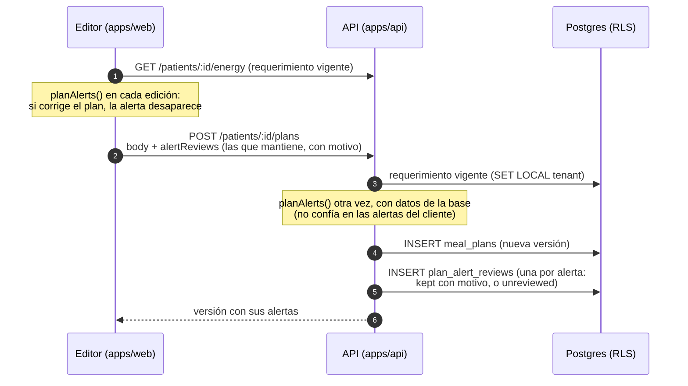

# 0051 — Alertas clínico-nutricionales del plan: motor determinístico y foto al guardar

- **Estado**: aceptada. Implementadas las secciones A (alergias e intolerancias, KAN-105) y C (energía y macros).
- **Fecha**: 2026-11-20
- **Épica**: KAN-91 · Tickets: KAN-97 (motor), KAN-98 (catálogo) · Relacionados:
  [ADR 0032](0032-requerimiento-energetico-periodizado.md), [ADR 0014](0014-inferencia-bedrock-y-controles-de-costo.md)

## Contexto

KAN-97 pide revisar el plan contra la ficha mientras el profesional lo arma, avisar con
la fuente visible y **registrar la decisión** del profesional sobre cada aviso. Las
alertas no bloquean: informan. El catálogo de reglas, con umbrales y fuentes, lo valida
la nutricionista en [`docs/validation/alertas.md`](../validation/alertas.md). Por ahora
solo la sección C (energía y macros) tiene los datos que necesita.

Había que decidir tres cosas:

1. **Quién decide si salta una alerta.**
2. **Cuándo y cómo se registra la decisión del profesional.** Las alertas cambian con
   cada edición del plan.
3. **Qué puede hacer el profesional con una alerta.**

## Decisión

### 1. Reglas determinísticas en `packages/shared`, sin LLM

`planAlerts(body, { subject, energy })` es una función pura. Revisa el **plan
prescripto** contra el requerimiento vigente (ADR 0032) y la masa libre de grasa. Los
umbrales viven en `PLAN_ALERT_THRESHOLDS`. La misma función corre en el editor (para
mostrar) y en la API (para registrar): no hay dos implementaciones que puedan divergir.

- Los días con algún alimento sin kcal **no se evalúan**: el total sería parcial y
  daría falsos avisos de energía baja. Se listan aparte.
- Lo que falta (peso, masa libre de grasa, requerimiento) se informa, no se supone.
- El LLM no decide nada. A futuro, como mucho, redacta la explicación.

### 2. Foto al guardar cada versión del plan

- La API **recalcula** las alertas: el cliente solo manda qué decidió. Las decisiones
  sobre alertas que ya no existen se ignoran.
- Cada fila queda atada a la versión del plan y al requerimiento usado
  (`energy_requirement_id`). Es la foto de qué avisos tenía el plan cuando se entregó.
- La tabla `plan_alert_reviews` es append-only (sólo `SELECT` + `INSERT`), con RLS.
- Aplicar una plantilla a un grupo (KAN-33) usa el mismo guardado: sus alertas
  quedan registradas como "sin revisar".
- Las alertas nunca llegan al portal del deportista.

### 3. "Mantengo el plan así", con motivo

Si el profesional no corrige el plan, puede marcar la alerta como mantenida. En las
**importantes el motivo es obligatorio**: lo exigen la interfaz, la API (400) y un
`CHECK` en la base. En las informativas es opcional. Las que no toca quedan como
**sin revisar**. Nada impide guardar.

## Consecuencias

- **A favor:** auditable y reproducible (misma función, mismos datos, mismo resultado).
  La foto por versión permite responder qué sabía el profesional cuando entregó el plan,
  algo que también sirve para la consulta regulatoria (KAN-101). El editor da feedback
  inmediato sin pedirle nada a la API.
- **En contra:** una tabla más y una consulta extra al guardar y al listar versiones.
  Si cambian los umbrales, las fotos viejas conservan el texto y el valor de su momento
  (es lo buscado). El plan se evalúa contra el **último** requerimiento; si el
  profesional lo cambia después, las versiones ya guardadas no se recalculan.
- **Sección A** (KAN-105, ADR 0052): usa las casillas de la ficha y los alérgenos
  copiados a cada item. Una alerta por regla y por día, que agrupa los alimentos (la
  clave de `plan_alert_reviews` es versión + regla + día). No depende de las kcal: se
  evalúa aunque el día tenga alimentos sin macros. Los items sin datos de alérgenos
  (texto libre o vinculados antes) se cuentan y se avisan; no se suponen limpios.
- **Pendiente:** secciones B y D del catálogo, que necesitan datos estructurados
  (medicación por principio activo, suplementos de KAN-59) y su validación.

## Alternativas descartadas

- **Registrar cada decisión al instante:** como las alertas cambian con cada edición,
  quedan muchos registros de alertas que después desaparecen, y no queda claro cuál
  era el estado al entregar el plan.
- **Solo mostrar, sin registrar:** lo más simple, pero no cumple el criterio de
  aceptación de KAN-97 y no deja rastro para auditoría.
- **Aceptar o descartar** (dos botones): "aceptar" una alerta que sigue en el plan es
  ambiguo; si el profesional está de acuerdo, corrige el plan y la alerta desaparece.
  Lo único que hace falta registrar es la decisión de mantenerlo.
- **Que decida un LLM:** no es reproducible ni auditable, y acerca el producto a un
  dispositivo médico sin necesidad.
