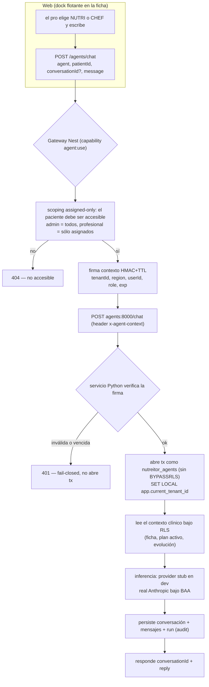

# Flujo: agentes de IA (NUTRI / CHEF)

Asistentes que ayudan al **profesional** sobre un paciente. Viven en un **servicio
Python separado** (`apps/agents`) — la decisión de sacarlos del monolito y su
contrato están en el ADR
[`../decisions/0013-agentes-servicio-ia.md`](../decisions/0013-agentes-servicio-ia.md)
(seam de servicios: [`0012`](../decisions/0012-modular-monolith-evolucion-a-servicios.md)).
El front nunca habla directo con el servicio: pasa por el **gateway** Nest, que
valida sesión + acceso al paciente y reenvía con un **contexto de tenant firmado**.

Hoy hay dos agentes:

- **NUTRI** — asiste sobre la **evolución** del paciente e ideas de **ajuste del plan**.
- **CHEF** — traduce el **plan activo** a **recetas** concretas, respetando
  preferencias, restricciones y **alergias**.

Ambos producen un **borrador** que el profesional revisa: nunca se aplica solo.

Modelo (`agent_conversations`, `agent_messages`, `agent_runs`) y los GRANT del rol
`nutreitor_agents` en
[`../architecture/data-model.md`](../architecture/data-model.md).

## De punta a punta

- **Defensa en profundidad**: el gateway ya chequea el acceso al paciente *antes* de
  salir del proceso; el servicio igual opera bajo **RLS** con un rol propio
  (equivalente a `nutreitor_app`, sin BYPASSRLS), así un bug del gateway no alcanza
  para cruzar tenants. Sin contexto firmado válido y vigente **no hay tenant** y el
  servicio no abre nada.
- **Hilo**: cada `(agente, paciente)` mantiene su conversación; el front reusa el
  `conversationId` para continuar. En el dock, NUTRI y CHEF tienen hilos separados.

## Contexto clínico por agente

El servicio carga sólo lo que cada agente necesita (todo bajo RLS, vía el rol
`nutreitor_agents` que tiene `SELECT` acotado):

- **NUTRI**: nombre/objetivo del paciente, plan activo (título + versión), y las
  últimas mediciones (peso/fecha).
- **CHEF**: además del paciente y el plan, **lee el cuerpo del plan** (`body` jsonb,
  layouts `day`/`week`) para derivar las **comidas**, más `dietary_preferences` y
  `allergies` para respetarlas en las recetas.

## Provider de inferencia

Detrás de `INFERENCE_PROVIDER` (`inference.py`):

- **`stub`** (default): respuesta determinística para dev/tests, **sin API key ni PHI
  a la nube**. Ejercita todo el pipeline (firma, RLS, contexto, historial,
  persistencia, audit, tope) y **estima tokens** (~4 chars/token) para que el tope sea
  probable end-to-end.
- **`bedrock`**: Claude vía **AWS Bedrock** (Converse API), con **prompt caching** del
  bloque estable (system + contexto del paciente), system prompt **por agente** y
  tokens reales en el audit. El PHI no sale de la cuenta AWS — ver
  [ADR 0014](../decisions/0014-inferencia-bedrock-y-controles-de-costo.md).

El provider real queda **detrás del flag** hasta cerrar el lado legal (BAA de AWS +
**consentimiento** del paciente; en AR aplica la **Ley 25.326**, no HIPAA, y hay
**transferencia internacional** porque Bedrock/Claude vive en US).

## Tope de costo / abuso (por tenant)

El **gateway** corta *antes* de egresar: si el tenant superó el **rate por minuto**
(`AGENTS_RATELIMIT_PER_MIN`) o el **tope mensual de tokens**
(`AGENTS_MONTHLY_TOKEN_CAP`, 0 = sin límite), responde **429** y no sale nada. El uso
se deriva del audit `agent_runs` (input+output tokens) leído bajo RLS.

## Autorización y UI

- Capacidad **`agent:use`** (admin + profesional; el paciente no la tiene).
- UI: **dock flotante** ("✨ Asistentes") siempre visible en la ficha del paciente,
  con tabs **NUTRI / CHEF**. Cada respuesta se marca como **borrador · revisá vos**.

## Pendiente

**Activar** el provider `bedrock` (gate legal: BAA AWS + consentimiento), pool de
conexiones en el servicio Python + CI del toolchain, override de tope **por tenant**
(hoy global por env), y **PSICO** (detección de crisis + escalamiento humano +
consentimiento, con guardrails más duros).
