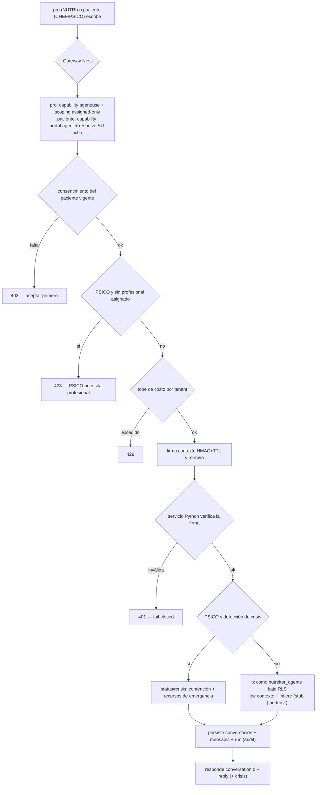

# Flujo: agentes de IA (NUTRI / CHEF / PSICO)

Asistentes que viven en un **servicio Python separado** (`apps/agents`) — la decisión
de sacarlos del monolito y su contrato están en el ADR
[`../decisions/0013-agentes-servicio-ia.md`](../decisions/0013-agentes-servicio-ia.md)
(seam de servicios: [`0012`](../decisions/0012-modular-monolith-evolucion-a-servicios.md)).
El front nunca habla directo con el servicio: pasa por el **gateway** Nest, que valida
sesión + acceso y reenvía con un **contexto de tenant firmado**.

Hay **dos caras** (ver ADR [`0015`](../decisions/0015-agentes-del-paciente-psico-supervisado.md)):

**Lado profesional** (`agent:use`, `POST /agents/chat`):
- **NUTRI** — asiste sobre la **evolución** del paciente e ideas de **ajuste del plan**.
  Su output es un **borrador** que el profesional revisa; nunca se aplica solo.

**Lado paciente** (`portal:agent`, `POST /portal/agents/chat`, sobre la PROPIA ficha):
- **CHEF** — traduce el **plan activo** a **recetas**, respetando preferencias,
  restricciones y **alergias**.
- **PSICO** — acompañamiento emocional. **Supervisado**: requiere profesional asignado,
  las charlas le quedan visibles, y tiene **guardrail de crisis**.

Ambos lados requieren **consentimiento** del paciente (ver más abajo).

> **Complemento instalable**: los agentes son un módulo **apagado por default**. La org
> debe **instalarlo** (admin → Configuración → Complementos: plan + términos) para que
> cualquiera de estos endpoints funcione. El `ModuleGuard` corta con **403** si el
> módulo `agents` no está activo — además de la capability del rol. Ver
> [ADR 0016](../decisions/0016-modulos-instalables-por-organizacion.md).

Modelo (`agent_conversations`, `agent_messages`, `agent_runs`, `agent_consents`) y los
GRANT del rol `nutreitor_agents` en
[`../architecture/data-model.md`](../architecture/data-model.md).

## De punta a punta

- **Defensa en profundidad**: el gateway chequea acceso/consentimiento/tope *antes* de
  salir del proceso; el servicio igual opera bajo **RLS** con un rol propio (sin
  BYPASSRLS). Sin contexto firmado válido **no hay tenant** y no abre nada.
- **Hilo**: cada conversación se continúa con su `conversationId`. El paciente nunca
  manda un `patientId`: el gateway resuelve "mi ficha" por la sesión.

## Contexto clínico por agente

El servicio carga sólo lo que cada agente necesita (todo bajo RLS, vía el rol
`nutreitor_agents` que tiene `SELECT` acotado):

- **NUTRI**: nombre/objetivo del paciente, plan activo (título + versión), y las
  últimas mediciones (peso/fecha).
- **CHEF**: además del paciente y el plan, **lee el cuerpo del plan** (`body` jsonb,
  layouts `day`/`week`) para derivar las **comidas**, más `dietary_preferences` y
  `allergies` para respetarlas en las recetas.
- **PSICO**: contexto **MÍNIMO** (sólo nombre + objetivo general). NO recibe plan,
  alergias, métricas ni motivo crudo (minimización de datos; "a ratificar" en ADR 0015).

Cada agente declara una **allow-list** de campos (`_AGENT_CONTEXT_FIELDS` en el
servicio): no se le inyecta el contexto crudo completo, sólo lo que su función necesita.

## Consentimiento, crisis y supervisión (lado paciente)

- **Consentimiento** (opt-in): antes del primer uso, el paciente acepta un
  consentimiento informado (no es terapia / no es emergencia / su profesional puede
  ver las charlas). Se registra en `agent_consents` (versión + fecha). El gateway lo
  exige (`GET/POST /portal/agents/consent`).
- **Crisis (PSICO) — doble capa**: una heurística normalizada (sin acentos/variantes)
  evalúa el **input del paciente** *antes* de inferir y también el **output del modelo**
  *antes* de devolverlo. En crisis no se sigue la charla: **contención + recursos de
  emergencia** (AR: 135 / 0800-345-1435 / 911 / SAME 107) y el run queda
  `status = 'crisis'`. El corte heurístico va primero; queda un gancho para sumar un
  clasificador del modelo con Bedrock activo.
- **Supervisión**: el profesional asignado ve las charlas del paciente
  (`GET /agents/conversations`), con las de crisis **marcadas**. La notificación activa
  (email/push) queda pendiente; hoy se asienta y se hace visible en la ficha.

## Provider de inferencia

Detrás de `INFERENCE_PROVIDER` (`inference.py`):

- **`stub`** (default): respuesta determinística para dev/tests, **sin API key ni PHI
  a la nube**. Ejercita todo el pipeline (firma, RLS, contexto, historial,
  persistencia, audit, tope) y **estima tokens** (~4 chars/token) para que el tope sea
  probable end-to-end.
- **`bedrock`**: Claude vía **AWS Bedrock** (Converse API), con **prompt caching** del
  bloque estable (system + contexto del paciente), system prompt **por agente** y
  tokens reales en el audit. El PHI no sale de la cuenta AWS — ver
  [ADR 0014](../decisions/0014-inferencia-bedrock-y-controles-de-costo.md).

El provider real queda **detrás del flag** hasta cerrar el lado legal (BAA de AWS +
**consentimiento** del paciente; en AR aplica la **Ley 25.326**, no HIPAA, y hay
**transferencia internacional** porque Bedrock/Claude vive en US).

## Tope de costo / abuso (por tenant)

El **gateway** corta *antes* de egresar: si el tenant superó el **rate por minuto**
(`AGENTS_RATELIMIT_PER_MIN`) o el **tope mensual de tokens**
(`AGENTS_MONTHLY_TOKEN_CAP`, 0 = sin límite), responde **429** y no sale nada. El uso
se deriva del audit `agent_runs` (input+output tokens) leído bajo RLS.

## Autorización y UI

- **Módulo `agents` instalado** (entitlement por org, ADR 0016) — condición previa a
  todo lo de abajo; sin él, 403 en el back y los docks no aparecen en la UI.
- **`agent:use`** (admin + profesional) → NUTRI + supervisión de charlas del paciente.
- **`portal:agent`** (paciente) → CHEF + PSICO sobre la propia ficha.
- UI profesional: **dock flotante** ("✨ Asistentes") en la ficha con **NUTRI**
  (borrador · revisá vos) + sección **"Charlas con asistentes"** (supervisión, con flag
  de crisis). UI paciente: dock en el portal con **CHEF / PSICO**, pantalla de
  consentimiento previa, y la respuesta de crisis resaltada con recursos.

## Pendiente

**Activar** el provider `bedrock` (gate legal: BAA AWS + consentimiento), pool de
conexiones en el servicio Python + CI del toolchain, override de tope **por tenant**
(hoy global por env), **notificación activa** de crisis al profesional (necesita
worker), y recursos de emergencia **configurables por región** (hoy AR hardcodeado).
