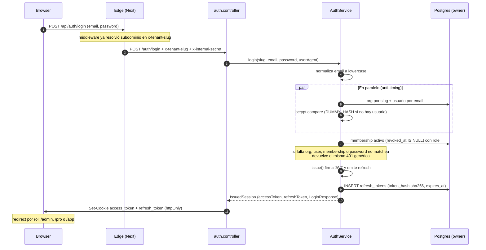
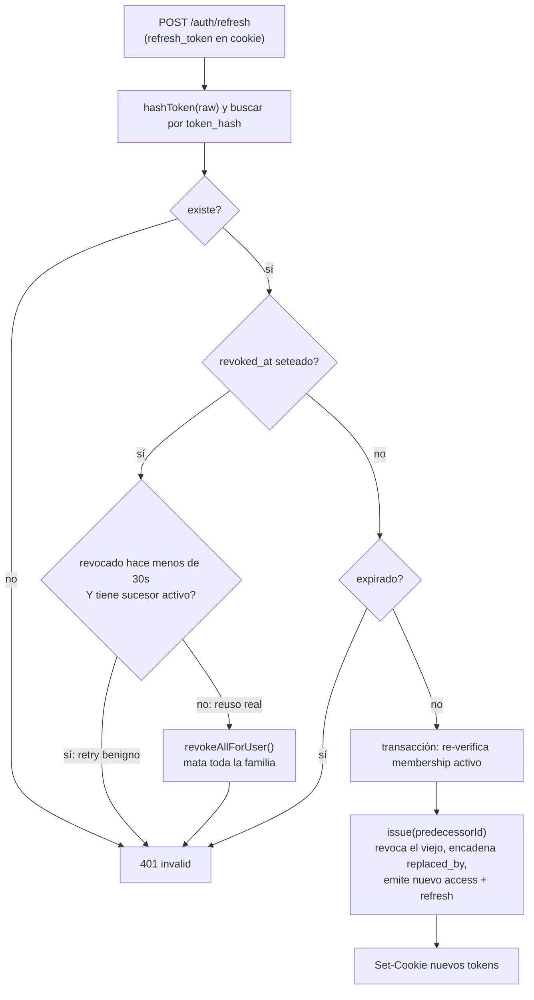
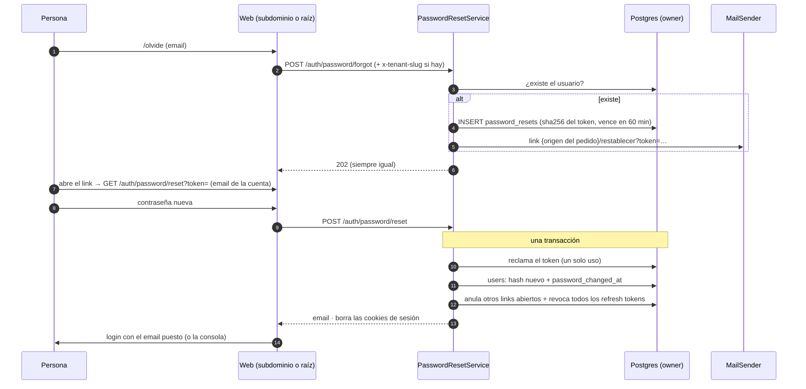

# Flujo: autenticación

Auth self-hosted (NestJS + Passport, datos en nuestro Postgres). Identidad
**global** (`users`) + pertenencia por organización (`memberships`). Es
**subdomain-first**: el tenant se resuelve del subdominio ANTES del login, y la
sesión nunca confía en un `tenant_id` del request. Access token JWT corto en cookie
httpOnly; refresh opaco rotado con detección de reuso.

Componentes y bordes en [`../architecture/overview.md`](../architecture/overview.md);
mecánica de RLS en [`../architecture/multi-tenancy.md`](../architecture/multi-tenancy.md).

## Login

`POST /auth/login` — `apps/api/src/core/auth/auth.controller.ts` →
`AuthService.login()`. El slug llega en `x-tenant-slug` (lo inyecta el middleware de
Next desde el subdominio). El lookup pre-auth de org/usuario usa la conexión
**owner** (`AdminDbService`, bypassa RLS): todavía no hay contexto de tenant.

Antes de tocar la base, `@RateLimit` corta con **429** + `Retry-After` a partir de
20 intentos por minuto desde una IP o 10 cada 15 minutos contra un mismo email del
tenant (cuentan éxitos y fallos). Contadores en Redis, fail-open; ver
[ADR 0017](../decisions/0017-rate-limiting-redis.md).

**Anti-timing (anti-enumeración)**: el membership y el `bcrypt.compare` corren
**siempre**, aun si el usuario no existe (se usa `NIL_UUID` y un `DUMMY_HASH`
precomputado). Todos los caminos de falla devuelven un único error genérico
`Credenciales inválidas`. Cubierto por `apps/api/test/auth-timing.spec.ts`.

**Claims del JWT** (`AccessPayload`): `{ sub: userId, org: orgId, role }`. El access
TTL por defecto es `900s`. Cookies: `httpOnly`, `SameSite=Lax`, `Secure` según
`COOKIE_SECURE` (off en dev), `path=/`, sin `domain` explícito (first-party al
subdominio).

## Resolución de tenant en el borde

- **Middleware de Next** (`apps/web/src/middleware.ts`): extrae `slug` del hostname
  `{slug}.ROOT_DOMAIN`, inyecta el header `x-tenant-slug`, y para rutas protegidas
  (`/admin`, `/pro`, `/app`) redirige a `/login` si no hay cookie `access_token`.
- **Proxy** (`apps/web/src/app/api/[...path]/route.ts`): reenvía a la API agregando
  `x-internal-secret` + `x-tenant-slug` + `cookie` + `user-agent`, y propaga los
  `Set-Cookie` de vuelta al browser (cookies first-party).

El slug **nunca** sale del path o de params; siempre del hostname, validado luego
contra los claims del JWT.

## Validación por request: `JwtAuthGuard`

`apps/api/src/core/auth/guards/jwt-auth.guard.ts`. Orden de chequeos:

1. Passport-JWT valida firma + expiración del `access_token` (extraído de la cookie).
2. Exige `x-tenant-slug`; resuelve la org por slug y exige `org.id == payload.org`
   (un token de un tenant no sirve en el subdominio de otro).
3. Re-verifica el `membership` (pudo revocarse después de emitir el token) y que el
   `role` no haya cambiado.
4. Deposita `TenantContext` + `user` + `org` en el holder de AsyncLocalStorage.

`RolesGuard` (`@Roles(...)`) y `CapabilityGuard` (`@RequireCapability(...)`) corren
después, sobre ese contexto ya poblado.

## Rotación de refresh con detección de reuso

`POST /auth/refresh`. El refresh es un token opaco de 256 bits (hex), guardado sólo
como `sha256` en `refresh_tokens`. Cada uso **rota**: revoca el actual y emite un
sucesor, encadenado por `replaced_by`. Esto permite distinguir un retry benigno
(respuesta perdida) de un robo real.

La revocación del predecesor es un **UPDATE condicional** (`WHERE id = predecessor
AND revoked_at IS NULL`): si dos refresh concurrentes corren, sólo uno gana; el otro
ve 0 filas y falla. El re-chequeo del membership dentro de la transacción cierra el
TOCTOU (si se revocó entre el check y el commit, aborta).

**Logout** (`POST /auth/logout`): hashea el refresh y lo marca `revoked_at = now()`
(idempotente), y limpia las cookies.

## Ruteo por rol y re-validación

`roleHome`: `admin → /admin`, `professional → /pro`, `patient → /app`, salvo la
admin de una org individual, que entra a `/pro` (`workspaceHome`, ADR 0026). Las
páginas `/pro` aceptan a quien atiende (`actsAsProfessional`); la admin de un equipo
también puede abrir `/pro/profile` y `/pro/agenda`. Post-login el
cliente navega ahí; las páginas re-validan contra `GET /auth/me` en el servidor
(defensa en servidor, no sólo middleware). `/auth/me` devuelve `user`, `org`, `role`
y `capabilities` (derivadas del rol).

## Estado de la org

Después de validar credenciales (login), al rotar el refresh y en cada request
(`JwtAuthGuard`), `assertOrgUsable` corta con **403** si la org está `rejected` o
`suspended` (con el motivo para mostrar). Una org `pending_review` entra normalmente.
Ver [`onboarding.md`](./onboarding.md).

## Recuperar la contraseña

[ADR 0029](../decisions/0029-recuperar-la-contrasena.md). "¿Olvidaste tu contraseña?" en el
login de cada org (`/olvide`, `/restablecer` en el subdominio) y en la consola (las mismas
rutas en el dominio raíz).

- Rate-limit: pedido 10/h por IP y 3/h por email; preview 30/min y confirmación 10/min por IP.
- La sesión de consola emitida antes de `password_changed_at` deja de valer.

## Sesión de plataforma (consola)

Es otra sesión, no un rol de tenant: cookie `platform_token` host-only del dominio
raíz, JWT con `aud: nutreitor-platform`, 2 h sin refresh, y `PlatformGuard`
re-chequea `users.is_platform_admin` en cada request. Un token de tenant no sirve en
la consola ni al revés. Detalle en [`onboarding.md`](./onboarding.md).

## Reemplazable por un IdP

Para mover a Cognito/Auth0/OIDC se cambia el verificador del token (la estrategia
JWT); el contrato (guards, roles, ALS, RLS) no se toca. Ver el ADR
[`../decisions/0003-auth-self-hosted-identidad-global.md`](../decisions/0003-auth-self-hosted-identidad-global.md).

## Pantallas de acceso (KAN-77)

Login, recuperar y elegir contraseña, aceptar invitación y alta usan `AuthShell`
(tema Estadio, ADR 0037) con el nombre, el escudo y los colores del club del
subdominio.

- **401:** "El email o la contraseña no coinciden" (no dice cuál de los dos falla).
- **429:** el proxy reenvía `Retry-After` y el login muestra la cuenta regresiva
  ("Probá de nuevo en 4:32"); el botón queda deshabilitado hasta entonces, con un
  link para restablecer la contraseña.
- **Link vencido o usado** (recuperar, invitación, alta): pantalla propia con la
  salida ("Pedir un link nuevo", "Volver al registro").
