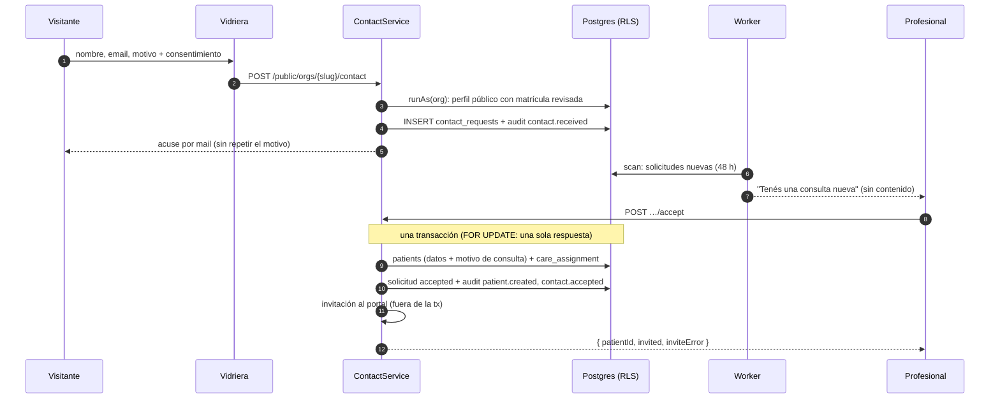

# Flujo: solicitud de contacto desde la vidriera

Un visitante sin cuenta le escribe a un profesional o al consultorio desde la
vidriera. La solicitud la ve **solo su destinatario**, que la acepta (se crea la
ficha y se invita al portal) o la rechaza. Decisión en
[ADR 0027](../decisions/0027-solicitud-de-contacto-desde-la-vidriera.md).

Código: `apps/api/src/modules/contact/`, `apps/web/src/components/public/public-contact.tsx`,
`apps/web/src/components/contact/`, worker `scans/contact-requests.ts`.

## Endpoints

| Acción | Método y path | Quién |
|---|---|---|
| Enviar consulta | `POST /public/orgs/{slug}/contact` | público (5 cada 10 min por IP, 3/h por email) |
| Bandeja | `GET /contact-requests?status=new\|accepted\|declined` | `contact:respond` |
| Contador | `GET /contact-requests/count` | `contact:respond` |
| Aceptar | `POST /contact-requests/{id}/accept` `{assignToMembershipId?, invite}` | `contact:respond` |
| Rechazar | `POST /contact-requests/{id}/decline` `{note?}` | `contact:respond` |
| Derivar | `POST /contact-requests/{id}/forward` `{membershipId}` | `patient:assign` (admin) |

## Quién ve qué

| Dirigida a | La ve | No la ve |
|---|---|---|
| Un profesional (`membership_id`) | ese profesional (o la admin, si el perfil es suyo) | la admin, otros profesionales |
| El consultorio (`membership_id` null) | las admins (asignan o derivan) | los profesionales |

Quien no la ve recibe 404. Derivar pasa una consulta del consultorio a un
profesional y la saca de la bandeja de las admins.

## De la vidriera a la ficha

- Asignación al aceptar: a quien acepta. En una consulta al consultorio, la admin de
  un equipo elige el profesional (sin elegir → 400); en una org individual queda para
  la admin.
- Si la invitación falla (el email ya es miembro, etc.), la ficha queda creada y se
  informa el motivo. Se puede reintentar desde la ficha.
- Rechazar guarda la nota **interna** y le manda al visitante un mail genérico.
- Una solicitud respondida no se puede volver a responder (409).

## Reglas

- La ruta pública nunca vincula a una ficha existente: cada aceptación crea una ficha
  nueva (igual que la reserva pública).
- Honeypot `website`: si llega con contenido, la respuesta es OK y no se guarda nada.
- Sin DELETE por GRANT; retención pendiente (Fase 3).
