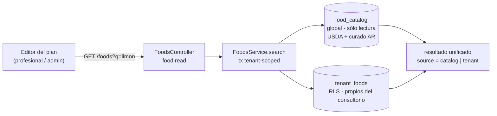
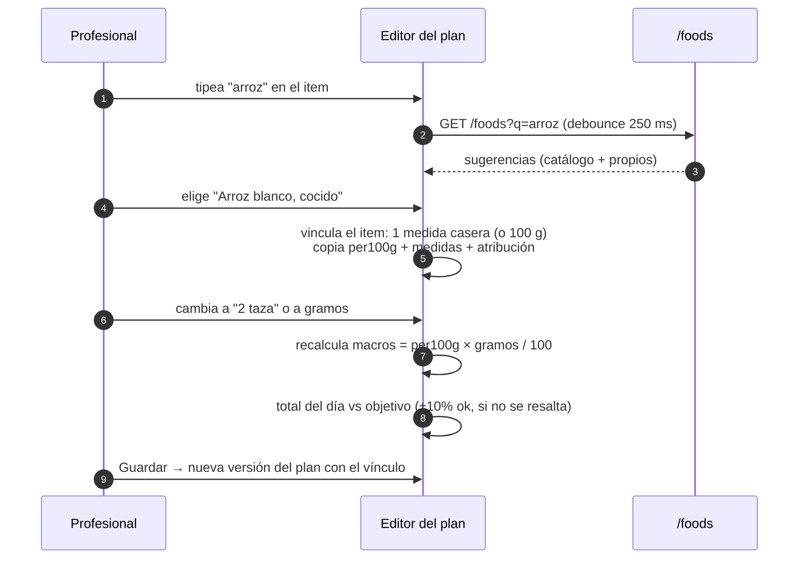

# Flujo: base de alimentos

La base de alimentos alimenta el cálculo nutricional del plan (Fase 4 del roadmap).
Decisión de fuente y alcance en el [ADR 0018](../decisions/0018-base-de-alimentos.md);
tablas en [`../architecture/data-model.md`](../architecture/data-model.md).

## Dos capas, una búsqueda

- **Catálogo global** (`food_catalog`): referencia por 100 g, sin tenant ni PHI. El rol
  app sólo puede leerlo; se carga por migración generada (ver el ADR, "Cómo se carga y
  se actualiza"). Cada fila declara su fuente (`attribution: "USDA FoodData Central"`).
- **Alimentos propios** (`tenant_foods`): preparaciones o productos que el catálogo no
  tiene. Se leen en la misma transacción tenant-scoped, así que RLS garantiza que un
  alimento propio de otro consultorio **nunca** aparece.

## Búsqueda

`GET /foods?q=&limit=` (`food:read`; `q` de 2 a 60 caracteres, `limit` hasta 50).

- Sin acentos ni mayúsculas: "limon" encuentra "Limón (jugo)" (`unaccent` sobre un
  índice `pg_trgm`).
- Orden: primero lo que **empieza** con el término, después lo que lo **contiene**,
  después lo **parecido** (similitud de trigramas, tolera errores de tipeo como
  "almendas"). A igual puntaje, primero los alimentos propios del consultorio.
- Los comodines de `LIKE` (`%`, `_`) del término se toman literales.

Cada resultado trae los nutrientes por 100 g (kcal, proteínas, carbohidratos, grasas,
fibra, azúcares, grasas saturadas y sodio), las **medidas caseras** (`portions`) y los
micronutrientes disponibles en `extra`.

## Alimentos propios

| Acción | Endpoint | Capacidad |
|---|---|---|
| Leer uno | `GET /foods/{catalog\|tenant}/{id}` | `food:read` |
| Crear | `POST /foods` | `food:manage` |
| Editar | `PUT /foods/tenant/{id}` | `food:manage` |
| Archivar | `POST /foods/tenant/{id}/archive` | `food:manage` |

- Los valores son por 100 g y se validan: proteínas + carbohidratos + grasas no pueden
  superar 100 g.
- **No se borran, se archivan**: un plan viejo puede haber usado el alimento. Un
  archivado sale de la búsqueda pero sigue legible por id, y no se puede editar.
- El catálogo global no se edita por API: un id del catálogo no es un alimento propio
  (404).
- Alta, edición y archivado quedan en `audit_log` (`food.created`, `food.updated`,
  `food.archived`).

## En el editor del plan

- El campo sigue aceptando **texto libre**: un item sin vínculo se carga como antes
  (cantidad, unidad y macros a mano).
- Con vínculo, los macros del item se calculan solos (no se editan a mano) y se puede
  **desvincular** para volver a la carga manual.
- La vista del plan (también la del portal del paciente) muestra los gramos, el
  **total del día contra el objetivo** y cita la fuente ("Datos nutricionales: USDA
  FoodData Central") cuando algún item viene del catálogo.

## Capacidades

`food:read` y `food:manage`: admin y profesional. El paciente no accede a la base de
alimentos (ve su plan ya armado en el portal).
