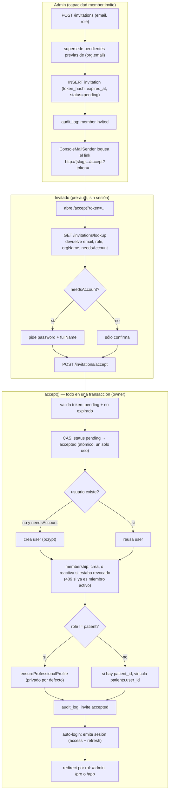

# Flujo: invitaciones

Las invitaciones suman miembros a una organización (admin, profesional o paciente)
sin que el invitado tenga cuenta previa. Son **stateful**: revocables, con
expiración, link único por mail (en dev el link se loguea en la consola de la API).
Autorización por **capacidad** (no por rol crudo). Toda acción queda en el
`audit_log` append-only.

Esquema en [`../architecture/data-model.md`](../architecture/data-model.md);
identidad y sesión en [`auth.md`](./auth.md).

## Endpoints

| Acción | Método y path | Capacidad | Auth |
|---|---|---|---|
| Crear | `POST /invitations` | `member:invite` | sí (admin) |
| Listar pendientes | `GET /invitations` | `member:read` | sí |
| Reenviar | `POST /invitations/{id}/resend` | `member:invite` | sí |
| Revocar | `POST /invitations/{id}/revoke` | `member:revoke` | sí |
| Lookup (preview) | `GET /invitations/lookup?token=…` | — | no (pre-auth) |
| Aceptar | `POST /invitations/accept` | — | no (pre-auth) |

Admin: `apps/api/src/modules/invitations/invitations.admin.controller.ts`. Público:
`invitations.public.controller.ts`. Lógica: `invitations.service.ts`.

Los dos endpoints públicos tienen rate-limit por IP (lookup 30/min, accept 10/min;
429 + `Retry-After`), ver [ADR 0017](../decisions/0017-rate-limiting-redis.md).

**Org en revisión** ([ADR 0025](../decisions/0025-alta-de-organizaciones-y-consola-de-plataforma.md)):
mientras la org está `pending_review` se puede invitar al equipo, pero invitar a un
**paciente** responde 403 ("Vas a poder invitar pacientes cuando aprobemos tu
organización").

**En lote** (KAN-43, [ADR 0043](../decisions/0043-import-de-deportistas-desde-csv.md)):
el import de deportistas crea las invitaciones de paciente vinculadas a cada ficha,
marcadas con `queued_at` y sin mandar nada. Las envía el worker de a poco
([`notifications.md`](notifications.md)): genera el token al enviar y cada
invitación sale una sola vez. Aceptarlas es el mismo flujo de siempre.

## Token y estados

- Token opaco de 256 bits; en DB sólo el `sha256` (`token_hash`). El raw viaja sólo
  en el link de aceptación.
- `expires_at` = `now() + INVITE_TTL_DAYS`.
- Lifecycle `invitation_status`: `pending → accepted | revoked | expired` (el
  `expired` se calcula al entregar).
- **Una sola pendiente por (org, email)**: índice único parcial
  `invitations_pending_unique … WHERE status = 'pending'`. Al crear, se hace
  supersede de las pendientes previas; un choque concurrente (`23505`) se mapea a
  `409 Conflict`.

## Crear → aceptar

Todo el `accept()` corre en una transacción con la conexión owner (es pre-auth,
plano de identidad). El **CAS** sobre `status` (`UPDATE … WHERE status='pending'`)
garantiza un único uso aunque dos requests lleguen juntos. El vínculo de paciente
sólo prende si la ficha existe en el tenant y aún no tiene `user_id`.

## Reenviar y revocar

- **Resend**: genera un token nuevo (invalida el link viejo), renueva `expires_at`,
  audita `invite.resent` y vuelve a loguear el link.
- **Revoke**: `UPDATE … status='revoked' WHERE status='pending'` (404 si no había
  pendiente), audita `invite.revoked`.

## Autorización por capacidad

`CapabilityGuard` + `@RequireCapability(...)` corren después de `JwtAuthGuard`, sobre
el rol del contexto. Mapeo (`packages/shared/src/auth/capabilities.ts`): sólo
`admin` tiene `member:invite`/`member:revoke`; `professional` tiene `member:read`
pero **no** puede invitar (403); `patient` no tiene ninguna de member. La UI oculta
las acciones que el rol no posee (vía `me.capabilities`).

## Auditoría

Acciones `member.invited`, `invite.accepted`, `invite.revoked`, `invite.resent` se
insertan en el `audit_log` **en la misma transacción** que la mutación (si rollback,
también la auditoría). La inmutabilidad la fuerza el GRANT: el rol de runtime tiene
sólo `INSERT`+`SELECT` sobre esa tabla.
