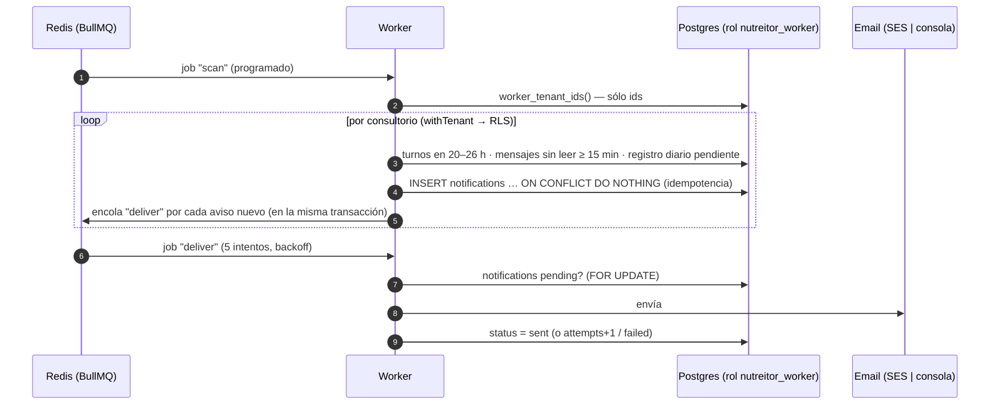

# Flujo: notificaciones (worker)

Avisos fuera de la sesión: recordatorio de turno, mensaje del chat sin leer y
recordatorio diario de registro. Los genera y manda `apps/worker` (BullMQ sobre
Redis). Decisión y trade-offs en el
[ADR 0023](../decisions/0023-worker-de-notificaciones.md).

## Avisos

- **Turno** (al paciente, ~24 h antes): fecha, hora y profesional, en la zona
  horaria de la disponibilidad del profesional. Llave: id del turno.
- **Mensaje sin leer** (conversaciones privadas, ADR 0024): si pasan 15 min sin
  leer, a los **participantes** de esa conversación (paciente ↔ su profesional;
  profesional ↔ admins). Una admin no recibe avisos del chat clínico de otros; sí de
  sus propios pacientes si es la asignada (org individual, ADR 0026). **No incluye
  el mensaje**. Llave: conversación + destinatario + hasta dónde había leído → un
  aviso por ráfaga.
- **Registro diario** (opt-in en el portal: interruptor + hora; toma la zona horaria
  del dispositivo): pasada esa hora local, si tiene plan activo y no marcó ninguna
  comida del día. Llave: paciente + fecha.

- **Consulta desde la vidriera** (al destinatario, ADR 0027): al profesional si es
  para él; a las admins si es para el consultorio. Sin el contenido. Llave: id de la
  solicitud + destinatario.

- **Reporte publicado** (al paciente): cuando su profesional publica el reporte del
  mes (últimas 48 h). Sólo el link, sin datos. Llave: id del reporte.

- **Invitación al portal del import** (KAN-43, ADR 0043): las invitaciones que deja
  el import en lote (`queued_at`). El worker las toma con `FOR UPDATE SKIP LOCKED`,
  genera el token (en la base sólo queda su hash), renueva el vencimiento desde el
  envío y encola el mail. Llave: id de la invitación.

- **Formulario pedido** (al deportista, ADR 0045): cuando su profesional le pide la
  anamnesis o la frecuencia de consumo (últimas 48 h, sigue `requested`). Sólo el link
  al formulario, sin el mensaje. Llave: id del pedido. Los pedidos que viajan en una
  invitación (`delivery = 'invitation'`, KAN-90) no se avisan por acá.
- **Invitación con la anamnesis** (KAN-90): si el paciente invitado tiene una anamnesis
  automática pedida, la invitación al portal en cola sale con otro texto ("Antes de tu
  primera consulta: completá tu ficha") y el link lleva al formulario después de crear
  la cuenta. Misma llave que la invitación.

## Preferencias

`GET/PUT /portal/me/notification-preferences` (`portal:read` / `portal:self_report`)
→ `notification_preferences` (opt-in, hora 0–23, zona horaria). Default: apagado.

## Operación

- Env: `DATABASE_WORKER_URL`, `REDIS_URL`, `WEB_URL_TEMPLATE`
  (`https://{slug}.nutreitor.com`), `MAIL_PROVIDER` (`console` | `ses`),
  `MAIL_FROM`, `AWS_REGION`, `SCAN_EVERY_MS`, `SEND_PER_SECOND` (tope de envíos por
  segundo, default 10: por debajo del límite de SES) e `INVITE_TTL_DAYS` (igual que
  la API).
- `notifications` queda como registro de lo enviado (sin contenido), legible por la
  app para una futura vista de avisos.
