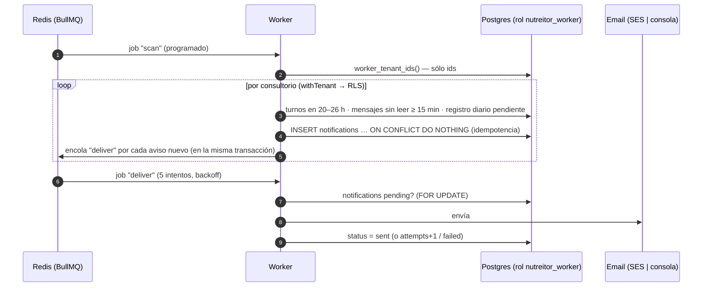

# Flujo: notificaciones (worker)

Avisos fuera de la sesión: recordatorio de turno, mensaje del chat sin leer y
recordatorio diario de registro. Los genera y manda `apps/worker` (BullMQ sobre
Redis). Decisión y trade-offs en el
[ADR 0023](../decisions/0023-worker-de-notificaciones.md).

## Avisos

- **Turno** (al paciente, ~24 h antes): fecha, hora y profesional, en la zona
  horaria de la disponibilidad del profesional. Llave: id del turno.
- **Mensaje sin leer** (chat, ADR 0022): si pasan 15 min sin leer, al destinatario
  (paciente → profesionales asignados; equipo → paciente). **No incluye el
  mensaje**. Llave: paciente + destinatario + hasta dónde había leído → un aviso
  por ráfaga.
- **Registro diario** (opt-in en el portal: interruptor + hora; toma la zona horaria
  del dispositivo): pasada esa hora local, si tiene plan activo y no marcó ninguna
  comida del día. Llave: paciente + fecha.

## Preferencias

`GET/PUT /portal/me/notification-preferences` (`portal:read` / `portal:self_report`)
→ `notification_preferences` (opt-in, hora 0–23, zona horaria). Default: apagado.

## Operación

- Env: `DATABASE_WORKER_URL`, `REDIS_URL`, `WEB_URL_TEMPLATE`
  (`https://{slug}.nutreitor.com`), `MAIL_PROVIDER` (`console` | `ses`),
  `MAIL_FROM`, `AWS_REGION`, `SCAN_EVERY_MS`.
- `notifications` queda como registro de lo enviado (sin contenido), legible por la
  app para una futura vista de avisos.
