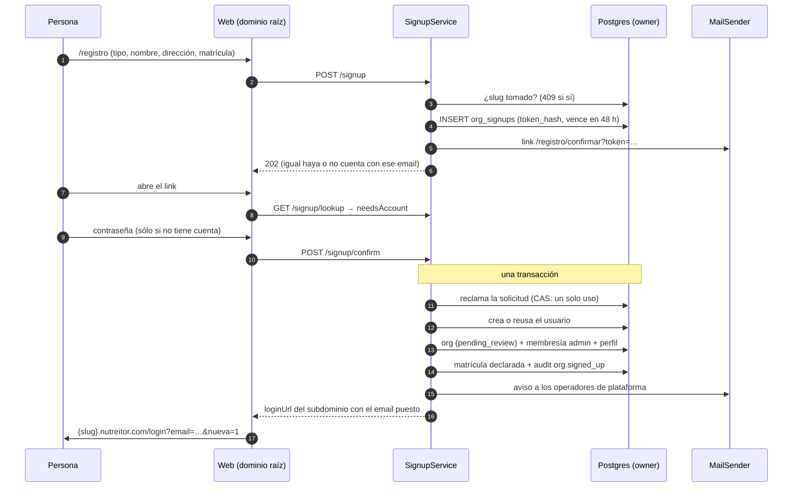
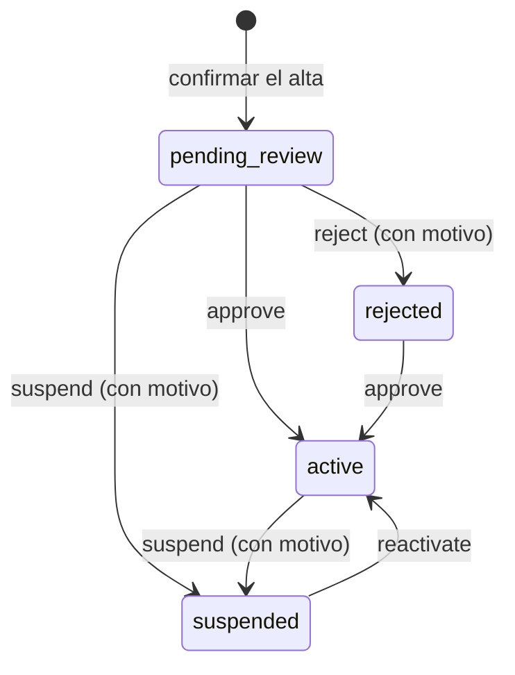
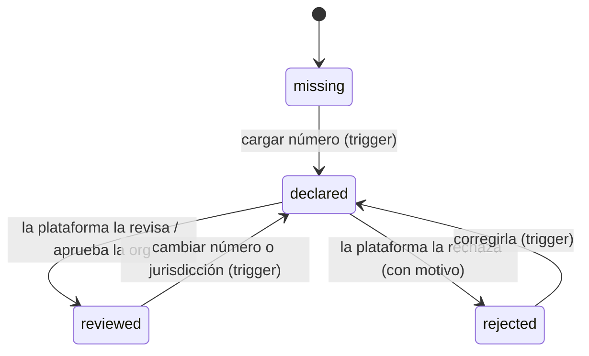

# Flujo: alta de organizaciones y consola de plataforma

Un consultorio (equipo) o un profesional independiente se registra solo en
`nutreitor.com/registro`. La org nace **en revisión** y la plataforma la aprueba
desde `nutreitor.com/plataforma`. Decisión y alternativas en
[ADR 0025](../decisions/0025-alta-de-organizaciones-y-consola-de-plataforma.md).

Código: `apps/api/src/modules/onboarding/` (API) y
`apps/web/src/components/onboarding/` + `app/registro`, `app/plataforma` (web).

## Endpoints

| Acción | Método y path | Auth | Rate-limit |
|---|---|---|---|
| ¿Dirección libre? | `GET /signup/slug?slug=` | — | 60/min por IP |
| Registrarse | `POST /signup` → 202 | — | 10/h por IP, 3/h por email |
| Preview del link | `GET /signup/lookup?token=` | — | 30/min por IP |
| Confirmar | `POST /signup/confirm` | — | 10/min por IP |
| Login de consola | `POST /platform/auth/login` | — | como el login |
| Sesión / salir | `GET /platform/auth/me`, `POST /platform/auth/logout` | consola | — |
| Orgs | `GET /platform/orgs?status=` | consola | — |
| Decidir sobre una org | `POST /platform/orgs/{id}/decision` | consola | — |
| Matrículas por revisar | `GET /platform/licenses` | consola | — |
| Decidir una matrícula | `POST /platform/licenses/{profileId}/decision` | consola | — |
| Primeros pasos | `GET /organizations/current/onboarding` | admin de la org | — |

## Registro → confirmación

Dos confirmaciones con el mismo slug: la segunda choca con el UNIQUE y recibe 409
("otra organización tomó esa dirección").

## Estados de la org

| Estado | Entrar al workspace | Vidriera, slots y reserva | Invitar pacientes |
|---|---|---|---|
| `pending_review` | sí | 404 | no (403 con mensaje) |
| `active` | sí | sí | sí |
| `rejected` / `suspended` | no (403 tras validar la contraseña) | 404 | — |

El corte vive en la API: `TenantResolverService.publicBySlug` (rutas públicas),
`assertOrgUsable` (login, refresh y `JwtAuthGuard`) e `InvitationsService.create`.
Las transiciones son CAS sobre el estado (dos operadores no se pisan; transición
inválida → 409). Cada decisión queda en el audit de la org (`org.approved`,
`org.rejected`, `org.suspended`, `org.reactivated`) y se avisa por mail a sus admins.

## Matrícula

- Sólo `reviewed` es pública: filtro en SQL del roster, del perfil y de la reserva.
  La vidriera muestra "Matrícula MN 1234 · Nacional".
- El rol app no tiene UPDATE sobre `license_status`: lo mueven el trigger
  `professional_profiles_license_reset` (al cambiar la matrícula) y la consola
  (conexión owner).

## Consola de plataforma

- Sesión propia: cookie `platform_token` host-only del dominio raíz, JWT con `aud`
  `nutreitor-platform`, 2 h sin refresh. `PlatformGuard` re-chequea
  `users.is_platform_admin` en cada request y rechaza si llega `x-tenant-slug`.
- Lee con la conexión owner, a propósito y con alcance mínimo: org, admins (nombre y
  email) y matrículas. Ningún dato de pacientes.
- La web proxya las decisiones por `app/api/platform/.../decision` para invalidar el
  ISR de la vidriera afectada (si no, una org recién aprobada seguiría en 404 hasta
  que venza el caché).

## Primeros pasos en el workspace

`GET /organizations/current/onboarding` arma la checklist con datos reales (nada se
tilda a mano): perfil con titular o bio, estado de la matrícula, branding,
horarios cargados y (en equipos) al menos otro miembro. La tarjeta del inicio de la
admin muestra además el aviso "Estamos revisando tu alta" y desaparece cuando la org
está activa y todo está hecho. La admin puede editar su perfil y su agenda
(`/pro/profile`, `/pro/agenda`), porque también puede atender.
