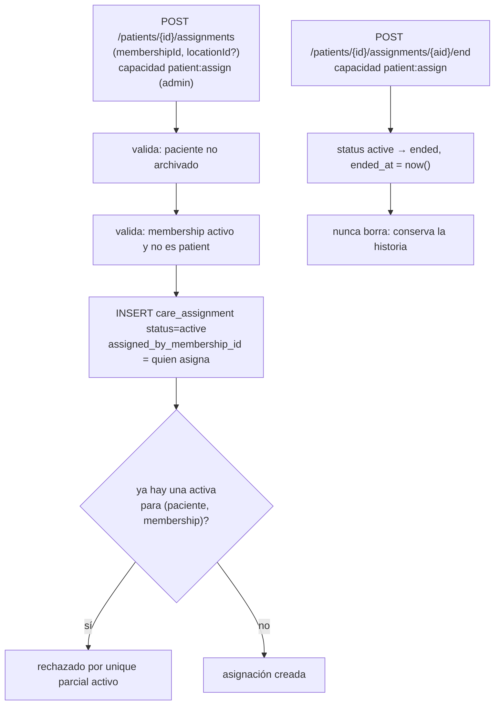
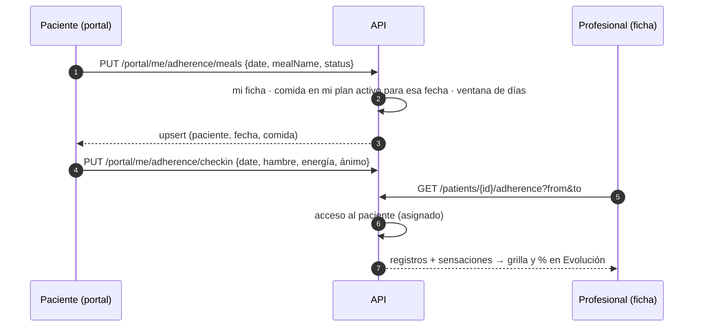

# Flujo: pacientes

El paciente es una **entidad clínica** del tenant, separada de la cuenta de acceso
(`users`): puede existir sin cuenta y vincularse a una después (portal). Sobre la
ficha se construyen asignaciones de cuidado (M:N versionada), notas (append-only),
métricas (serie temporal editable) y planes alimentarios (versionados). Todo
tenant-scoped por RLS y gateado por **capacidades** + alcance de acceso.

Esquema en [`../architecture/data-model.md`](../architecture/data-model.md).

## Alcance de acceso (quién ve a qué paciente)

`apps/api/src/modules/patients/patient-access.ts`:

- **admin**: ve todos los pacientes del tenant (RLS por `tenant_id`).
- **professional**: ve sólo pacientes con una `care_assignment` **activa** a su
  `membership` (si no, 404).
- **patient**: resuelve únicamente su propia ficha por `patients.user_id` (portal).

Esto es defensa por encima de RLS: RLS aísla por tenant; el alcance por profesional
acota dentro del tenant.

## Alta y ficha

`POST /patients` (`PatientsController.create` → `PatientsService.create`), capacidad
`patient:create` (admin). `tenant_id` y `region` salen del contexto (ALS), nunca del
request. Los campos clínicos (`reasonForConsult`, `medicalHistory`, `allergies`,
etc.) se aceptan sólo con `patient:read_clinical`. `assignToMembershipId` permite
crear-y-asignar en una sola transacción. Baja **lógica** vía `archived_at`
(`POST /patients/{id}/archive`, capacidad `patient:update`).

## Asignación de cuidado (M:N versionada)

`care_assignments` reemplazó a la vieja `patient_assignments` (ver el ADR
[`../decisions/0005-care-assignments-versionadas.md`](../decisions/0005-care-assignments-versionadas.md)).
Reasignar = cerrar la activa (`ended`) y abrir otra. El índice único parcial
`… WHERE status='active'` garantiza a lo sumo una activa por (paciente, profesional).

## Notas, métricas y planes

Las tres cuelgan del paciente y registran al autor por `membership`. Difieren en
mutabilidad — fijada a nivel de GRANT, no sólo por código:

| Recurso | Endpoints | Capacidad | Mutabilidad |
|---|---|---|---|
| **Notas** (`patient_notes`) | `GET`/`POST /patients/{id}/notes` | `patient:read` / `patient:add_note` | **Append-only** (sólo INSERT+SELECT). Corregir = nueva nota. |
| **Métricas** (`patient_metrics`) | `GET`/`POST` + `PATCH`/`DELETE /patients/{id}/metrics/{mid}` | `metric:read` / `metric:record` | **Editable/borrable** (data entry). Wide para chartables + `extra` JSONB ad-hoc. |
| **Planes** (`meal_plans`) | `GET`/`POST /patients/{id}/plans` + `/plans/archive` | `plan:read` / `plan:write` | **Versionado**: cada save hace supersede del activo y crea `version+1`. Sin DELETE. |

El save de plan calcula `version = max(version)+1`, marca `superseded` al activo e
inserta el nuevo `active`; el índice único parcial `… WHERE status='active'`
garantiza un único plan activo por paciente (un choque concurrente da `409`).

### Estructura del plan (multi-estilo)

El `body` del plan es un documento JSONB flexible por estilo de trabajo: layout
`day` (día-tipo) o `week` (lun-dom), con detalle opcional por item (cantidad,
unidad, alternativas/intercambios, macros) y `targets` del plan. El profesional
elige cuánto detalle carga. Bodies legacy (anteriores al `layout`) se normalizan a
`day` (`normalizeMealPlanBody`, shared) y se migraron en `0021`. Detalle del shape y
el racional en [`../architecture/data-model.md`](../architecture/data-model.md) y el
ADR [`../decisions/0009-estructura-plan-multiestilo.md`](../decisions/0009-estructura-plan-multiestilo.md).

## Visibilidad de la ficha clínica hacia el paciente

Por defecto el paciente **no** ve ningún campo clínico en su portal. La ficha lleva
`clinical_visibility` (jsonb, default `{}`); el profesional/admin habilita campo por
campo desde la ficha (`PATCH /patients/{id}/clinical-visibility`, capacidad
`patient:update_clinical_visibility`, scopeado assigned-only e **auditado**:
`patient.clinical_visibility_updated`). En la UI pro, el panel **"Visible para el
paciente"** (en la ficha, sólo si la sesión puede editar visibilidad) muestra un
**toggle por campo** con su estado actual y un conteo en vivo; cada cambio manda sólo
ese campo (merge JSONB). El stripping es **server-side** en
`getMe` (helper puro `applyClinicalVisibility`): un campo sale al portal sólo si su
flag es `true`; el front nunca decide. Las `patient_notes` quedan **siempre**
internas (no se comparten). Ver el ADR
[`../decisions/0008-visibilidad-campo-ficha-clinica.md`](../decisions/0008-visibilidad-campo-ficha-clinica.md).

## Portal del paciente

El paciente logueado **no** pasa `patientId`: se resuelve "mi ficha" por
`patients.user_id = session.user.id` (`PortalService.resolveMyPatient`). El unique
parcial `patients_tenant_user_unique` garantiza a lo sumo una ficha por (tenant,
user). Endpoints (`apps/api/src/modules/portal/`):

- `GET /portal/me` (capacidad `portal:read`): devuelve perfil + los campos clínicos
  **habilitados** (ver visibilidad arriba; default ninguno), nombres de profesionales
  activos, plan activo y serie de métricas. **No** ve las notas internas del
  profesional.
- `POST /portal/me/metrics` (capacidad `portal:self_report`): auto-reporte de una
  métrica sobre su propia ficha (queda marcada como originada por el paciente).
- `GET /portal/me/adherence?from&to` (`portal:read`) y `PUT /portal/me/adherence/meals`
  / `PUT /portal/me/adherence/checkin` (`portal:self_report`): registro de adherencia
  (ver abajo).

**Adherencia** (Fase 4.3). El paciente marca **cada comida del plan** del día
(cumplí / en parte / no, nota opcional) y una vez por día **cómo se sintió** (hambre,
energía, ánimo de 1 a 5 + nota). Reglas del servidor:

- Sólo sobre **su** ficha y sólo comidas que estén en **su plan activo para esa
  fecha** (si no, 400); se guarda la versión del plan vigente (`plan_id`).
- Ventana: **hoy y los últimos 3 días**, con un día de tolerancia a cada lado por la
  zona horaria del paciente (las fechas son locales del paciente).
- Una fila por (paciente, fecha, comida) y por (paciente, fecha): corregir es un
  **upsert**; no hay `DELETE`.

El profesional asignado la lee en `GET /patients/{id}/adherence?from&to`
(`metric:read`, máx. 62 días; profesional → sólo asignados) y la ve en la pestaña
**Evolución**: grilla comida × día de las últimas 2 semanas, el % de los últimos 7 y
14 días (sobre lo **registrado**: cumplí = 1, en parte = ½; sin registros no es 0 %)
y las notas del paciente.

**Plantillas de planes** (`/plan-templates`, `plan:read` / `plan:write`): desde el
editor, "Guardar como plantilla" guarda las comidas, el objetivo y las notas (sin
datos del paciente) a nivel consultorio; al crear o revisar un plan, "Empezar desde
una plantilla" las carga en el editor para ajustarlas. Las comparten todos los
profesionales del consultorio; se archivan, no se borran.

**Lista de compras** (`shoppingList` en shared, sin backend): una semana del plan
(día-tipo × 7; semanal, la suma de los días cargados), agrupada por grupo de
alimento. Los items vinculados suman gramos exactos; una **receta se expande en sus
ingredientes** (desglose copiado en el item); los de texto libre se listan aparte con
cuántas veces aparecen; las alternativas no se suman. La ven el paciente
(`/app/compras`, imprimible) y el profesional (botón en la pestaña Plan).

**En la UI del portal** (`/app`, pensado primero para el celular) lo primero es **lo
que le toca comer hoy**: las comidas del plan activo para la fecha (`mealsForDate`:
día-tipo → siempre las mismas; semanal → las del día de la semana), con un toque por
comida para la adherencia y "¿Cómo te sentiste?" (se puede completar el de ayer), después su
próximo turno, la evolución y sus datos de salud. El plan completo está en
`/app/plan`, listo para **imprimir o guardar como PDF** (al imprimir se oculta la
navegación). El paciente sólo ve un total de calorías/macros cuando **todos** los
items del día los tienen (`macroCoverage`), y nunca el desvío contra el objetivo:
eso es una herramienta del profesional, que ve el total como "parcial" si faltan
datos.
