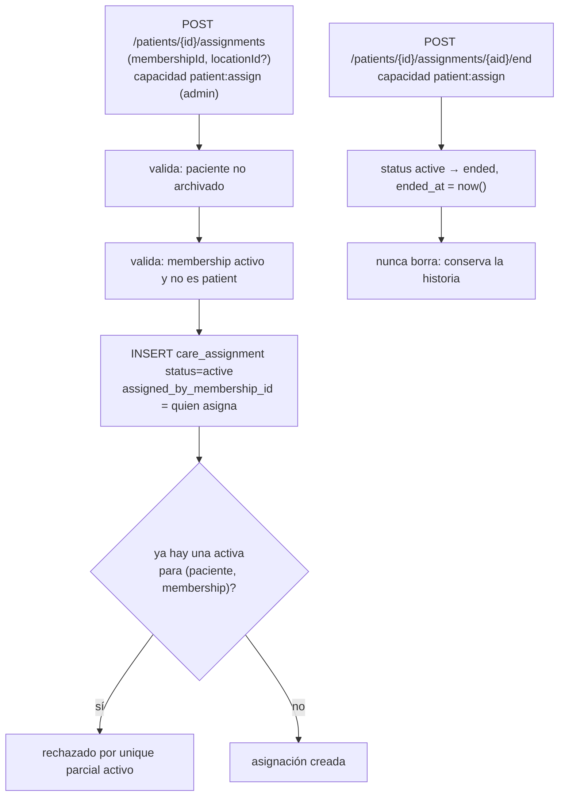

# Flujo: pacientes

El paciente es una **entidad clínica** del tenant, separada de la cuenta de acceso
(`users`): puede existir sin cuenta y vincularse a una después (portal). Sobre la
ficha se construyen asignaciones de cuidado (M:N versionada), notas (append-only),
métricas (serie temporal editable) y planes alimentarios (versionados). Todo
tenant-scoped por RLS y gateado por **capacidades** + alcance de acceso.

Esquema en [`../architecture/data-model.md`](../architecture/data-model.md).

## Alcance de acceso (quién ve a qué paciente)

`apps/api/src/modules/patients/patient-access.ts`:

- **admin**: ve todos los pacientes del tenant (RLS por `tenant_id`).
- **professional**: ve sólo pacientes con una `care_assignment` **activa** a su
  `membership` (si no, 404).
- **patient**: resuelve únicamente su propia ficha por `patients.user_id` (portal).

Esto es defensa por encima de RLS: RLS aísla por tenant; el alcance por profesional
acota dentro del tenant.

## Alta y ficha

`POST /patients` (`PatientsController.create` → `PatientsService.create`), capacidad
`patient:create` (admin). `tenant_id` y `region` salen del contexto (ALS), nunca del
request. Los campos clínicos (`reasonForConsult`, `medicalHistory`, `allergies`,
etc.) se aceptan sólo con `patient:read_clinical`. `assignToMembershipId` permite
crear-y-asignar en una sola transacción. Baja **lógica** vía `archived_at`
(`POST /patients/{id}/archive`, capacidad `patient:update`).

## Asignación de cuidado (M:N versionada)

`care_assignments` reemplazó a la vieja `patient_assignments` (ver el ADR
[`../decisions/0005-care-assignments-versionadas.md`](../decisions/0005-care-assignments-versionadas.md)).
Reasignar = cerrar la activa (`ended`) y abrir otra. El índice único parcial
`… WHERE status='active'` garantiza a lo sumo una activa por (paciente, profesional).

## Notas, métricas y planes

Las tres cuelgan del paciente y registran al autor por `membership`. Difieren en
mutabilidad — fijada a nivel de GRANT, no sólo por código:

| Recurso | Endpoints | Capacidad | Mutabilidad |
|---|---|---|---|
| **Notas** (`patient_notes`) | `GET`/`POST /patients/{id}/notes` | `patient:read` / `patient:add_note` | **Append-only** (sólo INSERT+SELECT). Corregir = nueva nota. |
| **Métricas** (`patient_metrics`) | `GET`/`POST` + `PATCH`/`DELETE /patients/{id}/metrics/{mid}` | `metric:read` / `metric:record` | **Editable/borrable** (data entry). Wide para chartables + `extra` JSONB ad-hoc. |
| **Planes** (`meal_plans`) | `GET`/`POST /patients/{id}/plans` + `/plans/archive` | `plan:read` / `plan:write` | **Versionado**: cada save hace supersede del activo y crea `version+1`. Sin DELETE. |

El save de plan calcula `version = max(version)+1`, marca `superseded` al activo e
inserta el nuevo `active`; el índice único parcial `… WHERE status='active'`
garantiza un único plan activo por paciente (un choque concurrente da `409`).

## Portal del paciente

El paciente logueado **no** pasa `patientId`: se resuelve "mi ficha" por
`patients.user_id = session.user.id` (`PortalService.resolveMyPatient`). El unique
parcial `patients_tenant_user_unique` garantiza a lo sumo una ficha por (tenant,
user). Endpoints (`apps/api/src/modules/portal/`):

- `GET /portal/me` (capacidad `portal:read`): devuelve perfil + sus datos clínicos,
  nombres de profesionales activos, plan activo y serie de métricas. **No** ve las
  notas internas del profesional.
- `POST /portal/me/metrics` (capacidad `portal:self_report`): auto-reporte de una
  métrica sobre su propia ficha (queda marcada como originada por el paciente).
