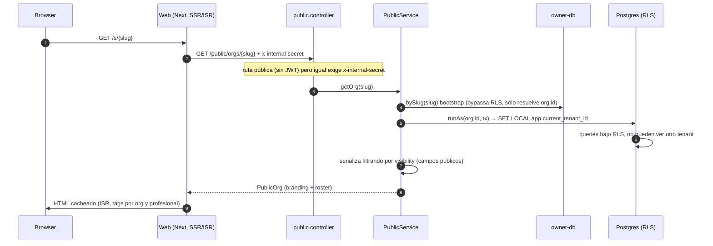
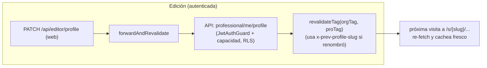

# Flujo: perfiles públicos (capa pública white-label)

Cada organización tiene una página pública (`{slug}.nutreitor.com`) con su branding
y un roster de profesionales. Cada profesional tiene un perfil con **visibilidad por
campo**: decide qué se muestra. La lectura pública no tiene sesión pero **no** sale
del perímetro de RLS, y las páginas se sirven con ISR + revalidación on-demand
cuando un perfil cambia.

Branding y bordes en [`../architecture/overview.md`](../architecture/overview.md);
RLS y `runAs` en [`../architecture/multi-tenancy.md`](../architecture/multi-tenancy.md).

## Lectura pública sin sesión, pero bajo RLS

Endpoints sin auth (`apps/api/src/modules/public/`):

- `GET /public/orgs/{slug}` → org + roster.
- `GET /public/orgs/{slug}/professionals/{profileSlug}` → detalle.

El bootstrap del slug usa la conexión **owner** (`TenantResolverService.bySlug` vía
`AdminDbService`) sólo para obtener `org.id` — el slug del hostname no es un tenant
de confianza. La lectura real va por `TenantDbService.runAs(org.id, …)`, misma
arquitectura de aislamiento que una request autenticada: **no hay ruta de negocio
exenta de RLS**. "Público" significa sin JWT, no sin `x-internal-secret`.

**Sólo orgs aprobadas y matrículas revisadas** ([ADR 0025](../decisions/0025-alta-de-organizaciones-y-consola-de-plataforma.md)):
las rutas públicas resuelven la org con `TenantResolverService.publicBySlug`, que
devuelve `null` (→ 404) si la org no está `active`. Y un perfil sólo entra al roster,
a su página y a la reserva pública si `license_status = 'reviewed'` (filtro en SQL).
La matrícula revisada se muestra siempre ("Matrícula MN 1234 · Nacional"), sin toggle
de visibilidad: es la señal de confianza de la vidriera. Ver
[`onboarding.md`](./onboarding.md).

**Contacto**: además de reservar turno, la vidriera tiene el formulario "Escribile una
consulta" (`#consultar`), en el perfil de cada profesional y para el consultorio en la
página de la org. Ver [`contact.md`](./contact.md). En el modo de perfil único (un solo
profesional listado), la página de la org también muestra la reserva y la consulta.

## Visibilidad por campo

`professional_profiles.visibility` es un `Record<field, boolean>` (default `{}` =
todo privado). Campos marcables: `headline`, `bio`, `photoUrl`, `credentials`,
`specialties`, `services`. El **serializer de la API** (`public-serializer.ts`)
filtra antes de responder: un campo cuyo `visibility[field] !== true` sale como
`null`/`[]`. El stripping pasa en la API, nunca se confía en el front.

Reglas del roster:

- Una entrada aparece sólo si `is_publicly_listed = true`, la matrícula está
  `reviewed` **y** tiene contenido público mínimo (headline o bio, visible y no vacío) — evita tarjetas vacías.
- Orden: `display_order ASC, full_name ASC`.
- Acceso directo por URL a un perfil sin contenido público → 404.

## Edición y curaduría (dos roles distintos)

| Quién | Endpoint | Capacidad | Qué edita |
|---|---|---|---|
| **Profesional** (propio) | `PATCH /professional/me/profile` | `professional:update_own_profile` | contenido + `visibility` por campo, y su `profile_slug` (único por org) |
| **Admin** (curaduría) | `GET /members/roster`, `PATCH /members/{id}/roster` | `org:update_public_profile` | `is_publicly_listed`, `display_order`, `specialty` |

El perfil se auto-provisiona (`ensureProfessionalProfile`, privado por defecto) al
aceptar la invitación de un profesional o al primer edit. `profile_slug` es
kebab-case, único por org (índice `professional_profiles_org_slug_unique` +
chequeo en `assertSlugAvailable`).

## ISR y revalidación on-demand

Las páginas públicas (`apps/web/src/app/s/[slug]/page.tsx` y
`[professionalSlug]/page.tsx`) usan ISR: `export const revalidate = 3600` como red
de seguridad, y `fetch` con `cache: "force-cache"` + **tags** para invalidación
inmediata. Tags: `orgTag(slug) = "org:{slug}"` y `proTag(slug, proSlug) =
"pro:{slug}:{proSlug}"`.

Las rutas `apps/web/src/app/api/editor/*` (profile, public-profile, roster) reenvían
a la API con cookie + `x-internal-secret`, y al éxito llaman `revalidateTag(...)`
para invalidar el ISR al instante (`editor-proxy.ts`). Un cambio de roster invalida
`orgTag`; un cambio de perfil invalida `orgTag` + `proTag` (y el slug viejo si hubo
rename).
