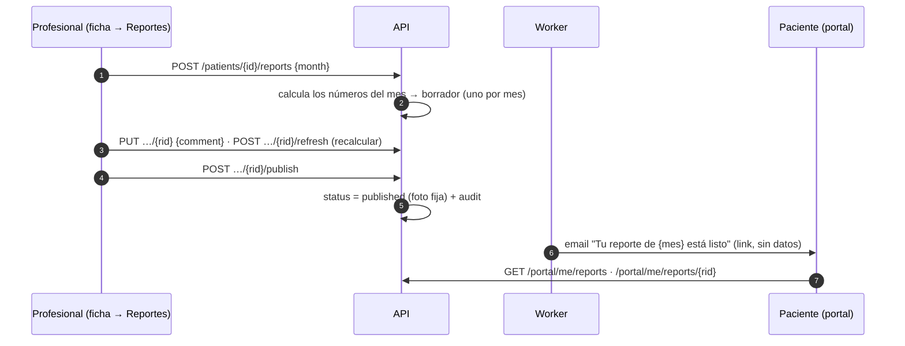

# Flujo: reporte mensual del paciente

Resumen del mes que arma la plataforma y comenta el profesional (Fase 4.4). Con
Bedrock activo, NUTRI podrá redactar el borrador del comentario.

## Qué incluye (`data`, calculado desde las tablas de siempre)

- **Evolución**: peso, % grasa y cintura — primera y última medición del mes y
  diferencia.
- **Adherencia**: % sobre lo registrado (en parte = ½), días con registro y % por
  comida.
- **Cómo se sintió**: promedio de hambre, energía y ánimo (1–5).
- **Turnos**: realizados, cancelados (sólo el profesional) y reservados.
- **Plan**: el vigente a fin de mes y cuántos ajustes hubo.

## Reglas

- Uno por paciente y mes (`UNIQUE (patient_id, period)`); pedirlo otra vez devuelve
  el existente. No se arma un mes que no empezó.
- **Borrador**: se comenta y se puede **recalcular**. **Publicado**: foto fija — no se
  edita ni se recalcula (409); lo que leyó el paciente no cambia si después se
  corrige una medición.
- Acceso: el mismo que la ficha (admin + profesional asignado; `patient:read` para
  leer, `report:write` para armar/publicar). El paciente ve **sólo los publicados de
  su ficha** (`portal:read`).
- Auditoría: `report.created`, `report.published`.
