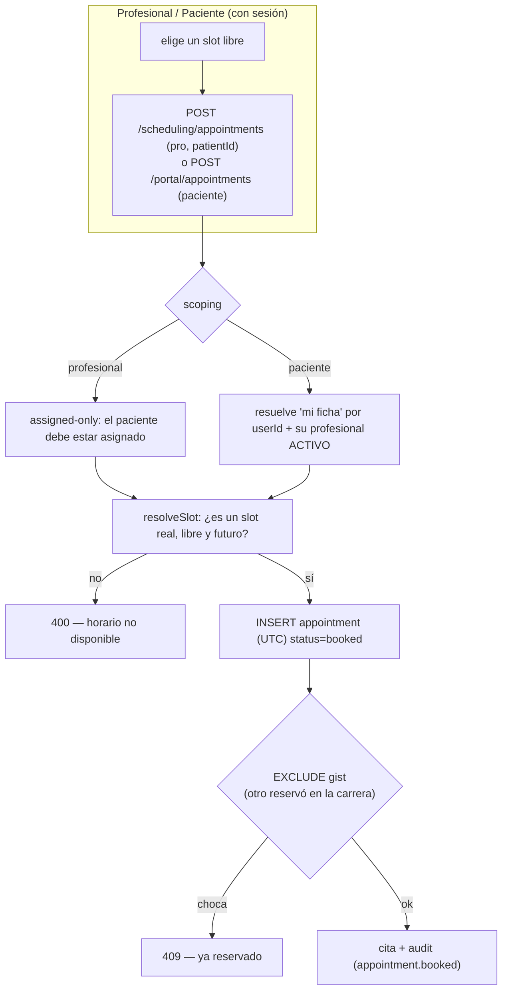
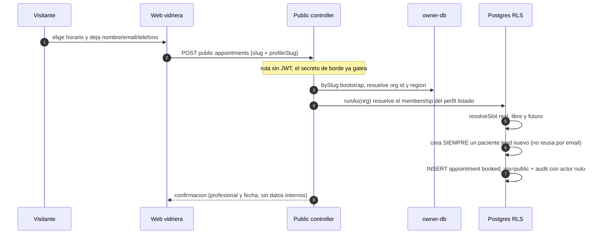

# Flujo: agendamiento

Motor de agendamiento **propio** (no Cal.com — ver el ADR
[`../decisions/0011-agendamiento-motor-propio.md`](../decisions/0011-agendamiento-motor-propio.md)).
El profesional define su disponibilidad semanal; de ahí se derivan los **slots
libres**; un paciente (interno) o un visitante (público) reserva. Tenant-scoped
bajo RLS; instantes en **UTC**, conversión en presentación, DST por país vía Luxon.

Modelo (`availability_rules`, `appointments`) en
[`../architecture/data-model.md`](../architecture/data-model.md).

## Disponibilidad y slots

El profesional carga ventanas semanales (`PUT /scheduling/availability`): un huso
IANA + N franjas `{weekday 1-7, start/end minute, slotMinutes}`. Se valida que el
huso sea IANA real (400 si no). La generación de slots (`slots.ts`, pura y
unit-tested) ancla cada slot a su **hora de pared** en el huso del profesional y lo
convierte a UTC; descarta los pasados, los ocupados y los **inexistentes por el gap
de spring-forward** (Luxon "forwardea" una hora inexistente, así que se compara el
wall-clock pedido y se descarta si no coincide). El cliente muestra los slots en el
huso del que mira.

El rango `from`/`to` lo manda el cliente (también en la ruta pública, sin sesión),
así que el cálculo se acota **siempre** a `[now, now + 180 días]`: sin tope, un
rango arbitrario (`1970→9999`) hace iterar a `generateSlots` millones de días y
bloquea el event loop. El mismo tope limita hasta cuándo se puede reservar. Una
fecha que no parsea es 400.

## Reserva interna (con sesión)

- **Scoping**: el profesional opera sobre su propia agenda y sólo pacientes que
  tiene **asignados**; el paciente reserva con su profesional con asignación activa.
  Si tiene varias asignaciones activas (M:N), se toma la **más antigua**, de forma
  determinística (slots y reserva siempre contra el mismo profesional).
- **Cancelar / reprogramar**: la cita se *cancela* (no se borra; sin `DELETE` a
  nivel GRANT). Reprogramar = cancela la actual y reserva la nueva **en una sola
  transacción** (`run()` es transaccional: si la nueva choca, se revierte la
  cancelación). Auditadas (`appointment.cancelled` / `appointment.rescheduled`).
- **Reprogramación del paciente** (portal, `POST portal/appointments/:id/reschedule`,
  capability `portal:book`): el paciente reprograma una cita **propia** a otro horario
  disponible **de su mismo profesional** (no elige profesional). El acceso se valida por
  la **rama paciente** (`requireAccessibleAppointment(..., "patient")` → 404 si la cita
  no es suya) y el nuevo slot se resuelve contra el `membershipId` **de la cita**.
  Profesional y paciente comparten el **núcleo** `rescheduleCore` (resolver slot +
  cancelar + insertar + audit); sólo cambia la validación de acceso y el `via` del audit
  (`metadata: { from, via }`). Mismos cortes: 404 (ajena), 400 (horario no disponible),
  409 (no `booked`, o carrera contra el `EXCLUDE`).

## Reserva pública (lead → cita)

Desde la vidriera (`{slug}.nutreitor.com/{profileSlug}`), sin login: cierra el
"captar". Mismo patrón que las lecturas públicas — la org se resuelve por slug
(owner, bootstrap) y todo se opera bajo **`runAs(org)`** (RLS scopea al tenant;
nunca hay contexto de sesión, así que tenant/region viajan explícitos).

**Por qué el lead se crea siempre nuevo**: una ruta sin sesión no debe poder atar
una cita a la ficha de un paciente existente con sólo conocer/adivinar el email
(sería un oracle de existencia + contaminación de su historia). El duplicado lo
reconcilia el profesional desde la gestión.

## Capacidades

`appointment:read` / `appointment:write` (admin + profesional), `portal:book`
(paciente). La reserva pública no requiere capacidad (no hay sesión).

## Fuera de alcance (deuda consciente)

Sync con Google/Outlook Calendar; **recordatorios** (necesitan cron/worker — sólo
hay confirmación al reservar); email real (reusa `ConsoleMailSender`, como
invitaciones); **rate-limiting** de los endpoints públicos (riesgo de spam /
denial-of-booking); dedupe de leads; reserva del admin en nombre de un profesional.
