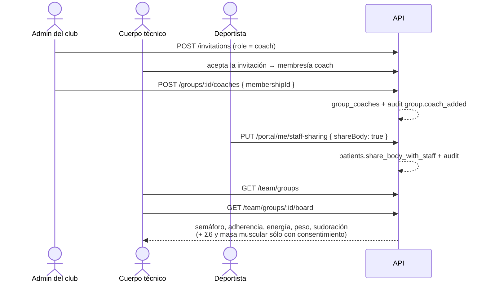

# Flujo: cuerpo técnico

El DT y el preparador físico siguen a sus planteles desde `/equipo`, sin ver la ficha
clínica ([ADR 0054](../decisions/0054-rol-cuerpo-tecnico.md), KAN-109).

## Quién ve qué

| Dato | Cuerpo técnico | Con consentimiento |
|---|---|---|
| Semáforo y motivos (sin la bandera de Σ6) | ✓ | ✓ (con la bandera) |
| Adherencia 7 días y tendencia | ✓ | ✓ |
| Último check-in: energía y ánimo | ✓ | ✓ |
| Peso y su variación | ✓ | ✓ |
| % de pérdida en la sudoración | ✓ | ✓ |
| Tiene plan (sí/no) y fecha del próximo turno | ✓ | ✓ |
| Σ6 y su variación, masa muscular | — | ✓ |
| Ficha, medicación, notas, plan, mensajes, informes | nunca | nunca |

## Reglas

- El coach sólo tiene `org:read` y `team:read`: cualquier otra ruta le responde 403.
- Un plantel que no le asignaron responde 404. Revocar su membresía corta el acceso en
  el acto, aunque la fila de `group_coaches` siga.
- No se lo puede asignar como profesional de un deportista.
- El consentimiento lo da el deportista en el portal (la tarjeta aparece sólo si alguno
  de sus planteles tiene cuerpo técnico) o lo registra quien lo atiende en la ficha
  (papel firmado). Vale el último cambio; todos quedan en la auditoría.
