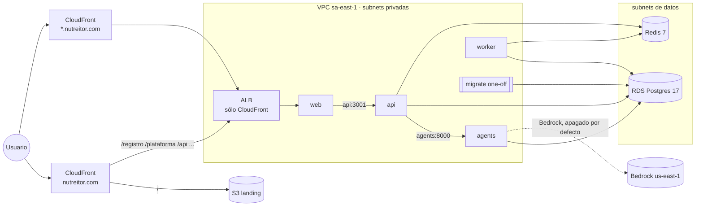

# Infraestructura (Terraform)

Topología de producción de Nutreitor en AWS. Las decisiones están en los ADR
[0046](../../docs/decisions/0046-region-de-produccion.md) (región) y
[0047](../../docs/decisions/0047-infraestructura-como-codigo-terraform.md) (IaC).

```
bootstrap/        bucket del state + rol de deploy por OIDC (una vez por cuenta)
modules/
  stack/          un entorno completo: KMS, security groups, secretos y los módulos de abajo
  network/        VPC en 2 AZ: subnets públicas, privadas y de datos; NAT; endpoint de S3
  data/           RDS Postgres 17 y ElastiCache Redis 7
  edge/           ACM, ALB, CloudFront (raíz y *.dominio), landing en S3, Route 53
  ecs/            cluster, ECR, logs, IAM y servicios (web, api, agents, worker) + migrate
envs/
  staging/        staging.nutreitor.com, chico (Spot, single-AZ)
  prod/           nutreitor.com, Multi-AZ y autoscaling
```



## Requisitos

- Terraform ≥ 1.11 (CI usa 1.14.9): los secretos usan recursos *ephemeral* y
  argumentos *write-only*, que no quedan en el state.
- Una cuenta AWS por entorno y credenciales de administrador para el bootstrap.
- El dominio `nutreitor.com` con su hosted zone en la cuenta de prod.

## Primer despliegue de un entorno

1. **Bootstrap de la cuenta** (crea `nutreitor-<env>-tfstate` y `nutreitor-<env>-deploy`):

   ```bash
   cd infra/terraform/bootstrap
   terraform init
   terraform apply -var env=staging -var account_id=<cuenta>
   ```

   El state del bootstrap queda local. Para moverlo al bucket que acaba de crear,
   agregá un bloque `backend "s3" {}` y corré
   `terraform init -migrate-state -backend-config=../envs/staging/backend.hcl`
   con `key = "nutreitor/bootstrap.tfstate"`.

2. **DNS de staging**: crear la hosted zone `staging.nutreitor.com` en la cuenta de
   staging y delegarla con un registro NS en la zona de prod.

3. **Imágenes**: crear primero sólo los repositorios de ECR y subir las imágenes
   (`api`, `web`, `worker`, `agents`) con el tag del commit; si no, los servicios no
   tienen qué arrancar:

   ```bash
   terraform apply -target=module.stack.module.ecs.aws_ecr_repository.this
   ```

4. **Apply del entorno**:

   ```bash
   cd infra/terraform/envs/staging
   cp terraform.tfvars.example terraform.tfvars   # cuenta, zona y tag
   terraform init -backend-config=backend.hcl
   terraform plan -out=staging.tfplan
   terraform apply staging.tfplan
   ```

5. **Migración** (también después de cada deploy con migraciones nuevas):

   ```bash
   aws ecs run-task --cluster nutreitor-staging --launch-type FARGATE \
     --task-definition nutreitor-staging-migrate \
     --network-configuration "awsvpcConfiguration={subnets=[...],securityGroups=[...]}"
   ```

   Las subnets y el security group salen de `terraform output stack`
   (`migrate_network`). La tarea migra con el rol owner y después fija la contraseña
   de `nutreitor_app`, `nutreitor_worker` y `nutreitor_agents` desde sus secretos.

6. **Landing**: `pnpm --filter @nutreitor/site build`, subir `apps/site/dist` al
   bucket (`site_bucket`) e invalidar la distribución (`site_distribution_id`).

## Operación

- **Deploy de una versión**: cambiar `image_tag` y hacer `apply`. ECS despliega con
  rollback automático si la versión nueva no queda sana.
- **Rotar las contraseñas de la base**: subir `credentials_version` y hacer `apply`;
  después correr la migración y redeployar los servicios
  (`aws ecs update-service --force-new-deployment`).
- **Rotar los secretos de la app** (JWT, edge, agents): subir `app_secrets_version`,
  hacer `apply` y redeployar. Rotar el JWT cierra todas las sesiones.
- **Activar Bedrock** (KAN-52, con el BAA y el consentimiento): `bedrock_enabled = true`
  y `bedrock_model_ids` con los modelos permitidos.
- **Activar SES** (KAN-17): `mail_provider = "ses"` y `ses_identity_arns`.

## Pendiente antes de prod

- **Verificar en staging que `nutreitor_owner` pueda leer el plano de control.** En
  RDS, el usuario maestro no es superusuario y las tablas tienen
  `FORCE ROW LEVEL SECURITY` (KAN-88, ADR 0047).
- Logs de acceso del ALB, flow logs, alarmas y WAF (KAN-18).
- Pipeline de deploy desde GitHub Actions (KAN-89).
